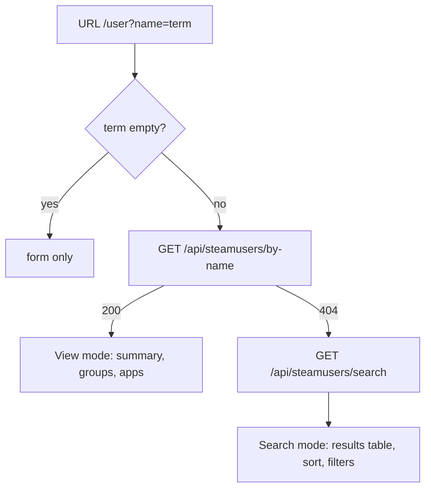

# Combined Users and Groups pages plan

## Original Prompt

Make a plan to combine the "Search" and "View" pages for Users and Groups. If the search term of the user matches exactly with a steam user ignoring case, the page should display the same as "View User" currently does. A link to the combined user page using the current url query settings should work the same way on the combined page as it currently does on the View User page. A search that does not match exactly should display the page as the current "Search User" page.  
The group page should should work the same way. If the search term of a group matches exactly, the page should appear like the current view group page. If the searched text is not an exact match the page should display like the "Search Groups" page. The Create a group section in View Group should be removed and replaced by a button in the top right of the combined page with "+ Create Group" as the text. When clicked, the Create Group button should display a themed dialog overlay with a text box to enter a new group name, a Create button, and a cancel button.
Ask questions for unresolved issues. When all questions are answered, write the plan to agents/plans.

## Goal

Merge the four front-end pages into two:

- **Users page** (`/user`) — combines "Search Users" (`/search`) and
  "View User" (`/user`) in one page.
- **Groups page** (`/group`) — combines "Search Groups" (`/search-groups`)
  and "View Group" (`/group`) in one page.

A term that matches a stored Steam user (or group) **exactly, ignoring
case**, renders the current View page content. Any other non-empty term
renders the current Search page results. Deep links keep working:
`/user?name=…&list=…&page=…&pageSize=…` behaves exactly as View User does
today when the name is an exact match.

The inline "Create a group" section on View Group is removed. In its place
a **+ Create Group** button sits in the top right of the combined Groups
page and opens a themed `<dialog>` overlay (name input, Create, Cancel).

Everything is front-end: `web/public/app.js`, `web/public/index.html`,
`web/public/styles.css`. No Go, SQL, or API changes — the existing
`by-name` endpoints already resolve exact matches case-insensitively
(`lower(name) = lower($1)` in `steam_users.sql:6` and `groups.sql:17`) and
return 404 when the term is not an exact match.



## Decisions

| Topic               | Decision                                                                                                                                                                       |
| ------------------- | ------------------------------------------------------------------------------------------------------------------------------------------------------------------------------ |
| Old routes          | `/search` and `/search-groups` are removed and **redirect** client-side to `/user` / `/group`, carrying the query string over.                                                 |
| Nav bar             | Four links become two: **Users** → `/user`, **Groups** → `/group`.                                                                                                             |
| Match detection     | Frontend only. Call `by-name`; on 200 show view mode, on 400-level miss (404) call `search` and show results. Only 404 triggers search — real errors surface as status errors. |
| Search-mode URL     | Stays `/user?name=…` / `/group?name=…`. Sort, filter, and page state remain in-memory only, like today's Search pages.                                                         |
| Create Group button | Visible whenever the combined Groups page shows (view or search mode). Never on the Users page.                                                                                |
| Dialog              | Native `<dialog>` + `showModal()`: themed via `::backdrop`, Escape and backdrop click cancel, Create navigates to the new group.                                               |
| After delete        | Stay on `/group?name=<deleted term>` in search mode (exact match now fails), showing remaining partial matches and "Deleted group …".                                          |
| Empty term          | Page shows just the form (and the Groups page's Create Group button), same as today.                                                                                           |
| Row links           | Search rows already link to `/user?name=` / `/group?name=` — those now land on the combined page in view mode. No change needed.                                               |

## Phase 1: routing and navigation ✅ complete

1. **`ROUTES`** (`app.js:13-23`): delete the `"/search"` and
   `"/search-groups"` entries.
2. **Redirect** in `renderRoute` (`app.js:4817`), before the
   `ROUTES.has(path)` check: map `/search → /user`, `/search-groups →
/group`, `history.replaceState` to the new path + `location.search`,
   then recurse (same pattern as the auth redirect at `app.js:4828-4833`).
   `/search?name=gab` therefore opens the combined page in search mode.
   _Implemented as a `LEGACY_ROUTE_REDIRECTS` map next to `ROUTES`._
3. **`ROUTE_TITLES`** (`app.js:25-35`): drop the removed keys; set
   `user: "Users"`, `group: "Groups"`.
4. **`pageLifecycles`** (`app.js:4794-4804`): remove `search` and
   `searchGroups` entries. Fold `leaveSearch` (`app.js:1647`) into
   `leaveUser` and `leaveSearchGroups` (`app.js:1899`) into `leaveGroup`
   so both controllers are aborted and tokens bumped when leaving.
   _The two old functions were deleted outright during Phase 1, so
   Phase 5 no longer needs to._
5. **Nav** (`index.html:13-23`): replace the four links with
   `Users → /user` and `Groups → /group`.

## Phase 2: combined Users page ✅ complete

_Deviations from the draft while implementing: the submit button text is
**"Search"** (the single form serves both modes); `setSearchBusy` now
disables `userInput`/`userSubmit` since the old search input/button are
gone; a `clearUserPage()` helper (view + search + both status lines) was
added; the moved search pagination keeps `aria-label="Search result
pages"` to distinguish it from the app-list pagination._

### HTML (`index.html`)

1. Delete the `#view-search` section (`index.html:290-400`) and **move its
   inner blocks** into `#view-user`'s card, **keeping every existing id**
   (`search-controls`, `search-status`, `search-toolbar`,
   `search-results-panel`, `search-results`, `search-pagination`) so the
   rendering pipeline (`renderSearchPipeline`, `buildSteamUserRows`, …) is
   untouched. The top-level `document.querySelector` references
   (`app.js:94-108`) still resolve because the nodes live in the document.
2. Drop `#search-form`, `#search-name`, `#search-button`: the page has one
   form. Keep `#user-form` / `#user-name` / `#user-submit`.
3. Header copy: eyebrow **Users**, `h1` **"Find and view a Steam user"**,
   lede covering both behaviors; change the form hint from "Exact name
   match, ignoring case. Use Search Users for partial searches." to
   something like "An exact name, ignoring case, opens that user. Anything
   else lists matching users."

### JS (`app.js`)

1. Replace `searchInput` uses inside `performSearch` (`app.js:1201`) with
   the combined input (`userInput`), and give `performSearch` an explicit
   `name` argument so callers pass the term. Delete the `searchForm`
   submit listener (`app.js:368-371`); `#user-form` submit (`app.js:424`)
   stays the only entry point (it already pushes
   `/user?name=…&list=owned&page=1&pageSize=…`).
2. **Mode switching in the load flow** — `loadUser` (`app.js:2657`):
    - On success (`applyUserResponse`): view mode; call
      `clearSearchResults()` so no search UI stays visible.
    - On `response.status === 404`: **search mode** — call
      `clearUserView()` (replacing `showUserNotFound()`, delete that
      function at `app.js:3480`) and then `void performSearch(name)` with
      the same term and current token discipline.
    - Errors other than 404 keep the current `setUserStatus(error)` path.
3. **Mutual exclusion**: any new navigation (`enterUser`,
   `pushUserURL` path) clears both regions first, so a stale search
   response never renders under a view and vice versa. Bump both
   `userToken` and `searchToken` in `enterUser`; `leaveUser` aborts both
   controllers.
4. Search-mode interactions (sort/direction/wishlist/page-size/reset —
   `app.js:373-395`) stay exactly as today; they re-render the in-memory
   `searchUsers` array and never touch the URL.
5. Result-row links to `/user?name=` (`buildSteamUserRows`,
   `app.js:1462`) need no change; clicking one navigates to the same route
   with an exact name, which now renders view mode.
6. Deep-link parity: `parseUserQuery` / `buildUserURL` / `syncUserURL`
   (`app.js:2558-2627`) are unchanged, so `?name=&list=&page=&pageSize=`
   links keep working, including the rewrite to stored casing after an
   exact match.

## Phase 3: combined Groups page ✅ complete

_Deviations from the draft while implementing: like Phase 2, the submit
button text became **"Search"**; the removal of the create-group feature
was carried through fully in this phase (HTML block **and** JS:
`createGroup()`, the `groupCreateForm` listener, the `groupCreate*` DOM
refs, the `groupCreateButton` line in `setGroupMutationBusy`, and the
`groupCreateStatus` resets in the submit handler/`enterGroup`) so nothing
references removed elements — Phase 4 re-adds all of it inside the
dialog; a `clearGroupPage()` helper mirrors `clearUserPage()`; the moved
pagination keeps `aria-label="Search result pages"`._

### HTML

1. Delete the `#view-search-groups` section (`index.html:402-506`) and
   move its blocks into `#view-group`'s card, keeping ids
   (`search-groups-controls`, `search-groups-status`,
   `search-groups-toolbar`, `search-groups-results-panel`,
   `search-groups-results`, `search-groups-pagination`).
2. Drop `#search-groups-form` / `-name` / `-button`; keep `#group-form`
   (`index.html:711-731`) as the single form, and update the header copy
   (eyebrow **Groups**, `h1` **"Find and view a group"**) and the
   "Use Search Groups for partial searches" hint like in Phase 2.
3. Remove the whole `#group-create-form` block (`index.html:733-765`) —
   replaced in Phase 4.

### JS

1. `performGroupSearch` (`app.js:1655`): take the term as an argument
   read from `groupInput`; delete the `searchGroupsForm` listener
   (`app.js:397-400`). `#group-form` submit (`app.js:472`) stays the only
   entry point.
2. `loadGroup` (`app.js:1974`): on 404 → `clearGroupView()` and search
   mode with the same term (delete `showGroupNotFound`, `app.js:2153`).
   On success → view mode with `clearGroupSearchResults()`.
3. `enterGroup` (`app.js:1907`): also bump `searchGroupsToken` /
   `searchGroupsController`; `leaveGroup` folds in `leaveSearchGroups`.
4. Group search result links to `/group?name=` (`buildGroupRows`,
   `app.js:1833`) already resolve to the combined page — no change.
5. Delete flow (`deleteGroup`, `app.js:2316-2346`): replace
   `history.pushState({}, "", "/search-groups")` + `renderRoute()` with:
   stay on the current `/group?name=…` URL, `clearGroupView()`, then run
   search mode for the same term and report
   `Deleted group "…".` via `setGroupSearchStatus`. (The exact match now
   404s, so search mode is where the user belongs.)

## Phase 4: Create Group dialog ✅ complete

_Deviations from the draft while implementing: the dialog's form omits
the placeholder `method="dialog-less"` from the sketch (plain form, the
submit listener calls `preventDefault()`); focus restoration lives in a
single `close` event handler instead of separate `cancel`/button/backdrop
paths, so Escape, Cancel, backdrop click, and successful create all
restore focus to `+ Create Group` uniformly; button placement is
`.card__header { position: relative }` + `.card__header-action` absolute
top-right, with a `@media (max-width: 30rem)` fallback that makes it
static/full flow; the button row reuses the existing `.group-actions`
style; dialog panel uses the same gradient/radius/shadow as `.card`._

1. **Button**: add `#create-group-button` ("+ Create Group",
   `class="button--secondary"`) inside `#view-group`'s
   `header.card__header`, floated to the right. Make `.card__header` a
   flex row (or `position: relative` + absolute pin) so the heading block
   stays on the left and the button hugs the top-right corner.
2. **Markup**: add a native dialog inside the group card:

    ```html
    <dialog id="create-group-dialog" aria-labelledby="create-group-title">
        <h2 id="create-group-title">Create a group</h2>
        <form id="group-create-form" method="dialog-less">
            <label for="group-create-name">Group name</label>
            <input id="group-create-name" maxlength="64" required … />
            <p id="group-create-status" class="status" role="status" …></p>
            <div>
                <button id="group-create-button" type="submit">Create</button>
                <button
                    id="group-create-cancel"
                    type="button"
                    class="button--secondary"
                >
                    Cancel
                </button>
            </div>
        </form>
    </dialog>
    ```

    Keep the existing ids (`group-create-form`, `group-create-name`,
    `group-create-button`, `group-create-status`) so `createGroup()`
    (`app.js:2212`) barely changes. `method` is omitted; the submit
    listener already calls `preventDefault()`.

3. **Behavior**:
    - Click on `#create-group-button` → reset input/status,
      `dialog.showModal()`, focus the input. Native `showModal()` gives
      the focus trap and Escape-to-close (`cancel` event) for free.
    - `cancel` event, Cancel button, and backdrop click → `close()` and
      return focus to `#create-group-button`. Backdrop click = `click` on
      the `<dialog>` whose `target` is the dialog itself.
    - Create success → `close()`, then `pushGroupURL(createdName)` exactly
      like the current inline form, so the page navigates to the new
      group's view. Errors render in `#group-create-status` inside the
      still-open dialog.
    - While `groupMutationBusy`, disable Create/Cancel and the
      `+ Create Group` button (extend `setGroupMutationBusy`,
      `app.js:2193`).
4. **CSS** (`styles.css`, new section at the end):
    - `dialog` styled like the card theme: `background:
var(--surface-raised)`, `border: 1px solid var(--border-strong)`,
      radius and padding matching `.card`, `color: var(--text)`, `box-shadow:
var(--shadow)`.
    - `dialog::backdrop { background: rgba(11, 15, 25, 0.72); }`.
    - Ensure `dialog[open] { display: grid; }` (the global
      `[hidden] { display: none !important }` at `styles.css:43` does not
      interfere because we never set `hidden` on the dialog).
    - Buttons reuse the existing `button` / `.button--secondary` styles.

## Phase 5: cleanup ✅ complete

_Result of the sweep while implementing: `searchForm`/`searchGroupsForm`
listeners, the old DOM refs, and `showUserNotFound` had already been
removed in Phases 2–4 (and `leaveSearch`/`leaveSearchGroups` in Phase 1);
this phase removed the dead `showGroupNotFound` function and the stale
`.group-create` CSS selector (the dialog form reuses `class="lookup"`).
The `"/search"` / `"/search-groups"` literals now exist only in
`LEGACY_ROUTE_REDIRECTS` — the two `deleteGroup`/nav sites were replaced
in Phases 1/3. Docs check: `README.md` and `docs/` contain no page map;
the two `cmd/test/README.md` mentions describe still-accurate behavior
(the combined Users page resolves case-insensitive lookups like the old
View User did). Verification: a full sweep found no unreferenced
functions, unused consts, dangling `querySelector` ids, duplicate ids, or
unbalanced tags/braces, and `go test ./...` passes. Automated checks
can't exercise routes/DOM without a browser (no JS harness in the repo);
the manual checklist below still stands as the acceptance test._

## Verification (manual — the repo has no JS test harness)

1. `go test ./...` still passes (no backend touched).
2. **Users**:
    - `/user` with no query shows only the form.
    - `/user?name=gaben` (exact, any casing) → View User layout today:
      summary badge, groups panel, Owned/Wishlist tabs, app pagination.
      URL rewrites to stored casing.
    - `/user?name=gaben&list=wishlist&page=2&pageSize=50` deep link
      restores exactly that view.
    - `/user?name=gab` (partial) → Search Users table with sort/direction/
      wishlist filter/rows-per-page/reset behaving as today.
    - Clicking a result row opens the combined page in view mode.
    - Typing a new term in the box + submit re-evaluates the mode.
    - Navigating away mid-flight cancels both in-flight requests (no
      stale renders).
3. **Groups**: same matrix for `/group?name=…`, plus the group search
   table renders member chips that link to groups/users correctly.
4. **Redirects**: `/search?name=gab` → `/user?name=gab` (search mode);
   `/search-groups` → `/group` (empty form).
5. **Dialog**: button visible in both modes of the Groups page, absent on
   Users. Opens with focus in the input; Escape, backdrop click, and
   Cancel all close and restore focus. Empty-name create shows the
   inline error in the dialog. Successful create closes and lands on the
   new group's view.
6. **Delete**: deleting a group stays on `/group?name=<term>` in search
   mode with "Deleted group …" and no stale summary/members panels.

## File summary

| File                    | Changes                                                                                                             |
| ----------------------- | ------------------------------------------------------------------------------------------------------------------- |
| `web/public/index.html` | Nav (2 links); move search blocks into combined sections; delete old sections/forms; dialog markup + button.        |
| `web/public/app.js`     | Routes/redirects/titles/lifecycles; combined enter/load/search flows; dialog logic; delete flow; dead-code removal. |
| `web/public/styles.css` | Card-header button placement; themed `dialog` + `::backdrop`.                                                       |
| Go / SQL / API          | No changes.                                                                                                         |
