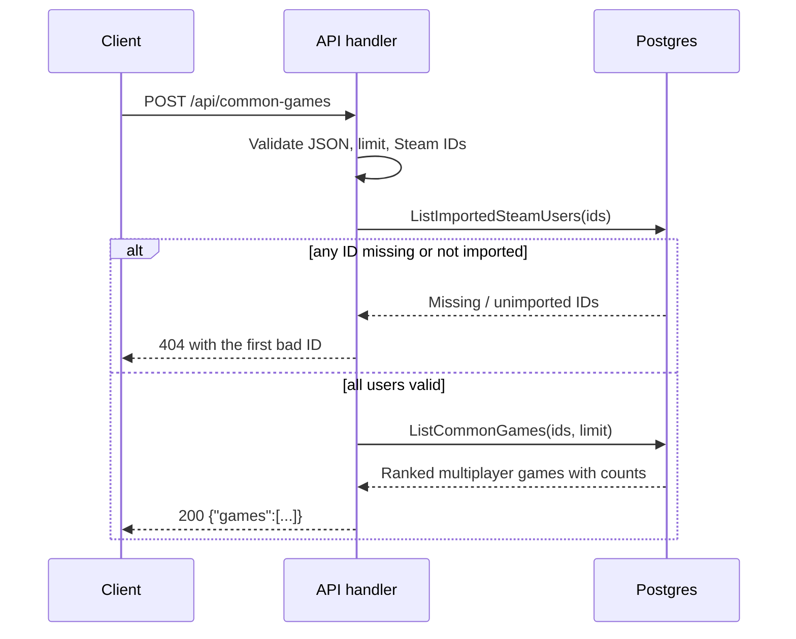

# Common multiplayer games endpoint plan

## Goal

Add an endpoint that accepts a list of Steam IDs and returns the games those
users have in common from Steam's **Multi-player** category (category ID `1`).
A game counts when at least one requested user owns it or has it on their
wishlist. The response reports how many users own the game and how many have it
wishlisted.

Only released games are returned. A game is excluded when Steam marks it as
coming soon, when its parsed release date is in the future, or when no release
date can be established.

The endpoint only reads imported data from Postgres. It does not call Steam or
start import jobs.



## Resolved decisions

| Topic                 | Decision                                                                                                                              |
| --------------------- | ------------------------------------------------------------------------------------------------------------------------------------- |
| Endpoint              | `POST /api/common-games` with a JSON body.                                                                                            |
| Multiplayer category  | Only Steam category ID `1` (`Multi-player`).                                                                                          |
| Ranking               | Distinct common users DESC, owned count DESC, wishlist count DESC, parsed release date DESC, app ID ASC.                              |
| Owned vs wishlist     | Owned always outranks wishlist when total common users are equal. Release date only breaks a tie when total, owned, and wishlist are all equal. |
| Unknown users         | Reject the whole request with `404` if any ID is missing or has no succeeded import job.                                               |
| Release date          | Add `apps.release_date_parsed DATE`, populated by the importer.                                                                        |
| Release eligibility   | Exclude games with `release_coming_soon = TRUE`, a parsed release date after today, or no parsed release date.                        |
| Limit                 | Default `10`; accept `1`–`100`; reject other values with `400`.                                                                       |
| Input IDs             | Deduplicate, require at least one, reject more than `25` unique IDs.                                                                  |
| Response              | `appId`, `name`, `headerImage`, `releaseDate`, `ownedCount`, `wishlistCount`, `totalCommonUsers`.                                     |
| Own/wishlist overlap  | A user who owns and wishlists the same game is counted once in `totalCommonUsers`, but once in each of the two individual counts.     |
| Data freshness        | Use whatever is currently stored. No Steam lookup, import trigger, or freshness check.                                                |

## API contract

### Request

```http
POST /api/common-games
Content-Type: application/json
```

```json
{
  "steamIds": [
    "76561198000000001",
    "76561198000000002"
  ],
  "limit": 10
}
```

- `steamIds` is required. Each value must be a positive base-10 SteamID64
  string.
- Duplicate IDs are removed before validation and querying.
- `limit` is optional. Omitted or `null` means `10`.
- The request body is capped with `http.MaxBytesReader` (4 KiB is enough for 25
  IDs plus the limit).

### Response

```json
{
  "games": [
    {
      "appId": 730,
      "name": "Counter-Strike 2",
      "headerImage": "https://cdn.akamai.steamstatic.com/steam/apps/730/header.jpg",
      "releaseDate": "21 Nov, 2024",
      "ownedCount": 2,
      "wishlistCount": 1,
      "totalCommonUsers": 2
    }
  ]
}
```

- `games` is always a JSON array, including when there are no matches.
- `name` and `headerImage` are nullable. `releaseDate` is present for every
  returned game because games without a confirmed released date are excluded.
- `totalCommonUsers` is the number of **distinct** requested users who own or
  wishlist the game.
- The response does not echo the request IDs or limit.

### Validation and status codes

| Condition                                                        | Status |
| ---------------------------------------------------------------- | -----: |
| Success                                                          |  `200` |
| Invalid JSON, empty `steamIds`, invalid ID, or more than 25 IDs   |  `400` |
| `limit` present but not an integer from 1 to 100                 |  `400` |
| Any ID is not in `steam_users`                                  |  `404` |
| Any ID has no `succeeded` import job                            |  `404` |
| Database error                                                   |  `500` |

The `404` message names the first invalid ID in request order, for example
`steam user 76561198000000001 not found` or
`steam user 76561198000000001 has no completed import`.

A user whose only succeeded import returned zero games is still valid and
simply contributes no matches. A user with only queued, running, or failed
imports is rejected.

## Ranking rules

### Eligibility filter

Before ranking, exclude every game that:

- has `apps.release_coming_soon = TRUE`, or
- has `apps.release_date_parsed IS NULL`, or
- has `apps.release_date_parsed > CURRENT_DATE`.

A game without a confirmed released date is excluded rather than sorted last,
because the endpoint must not return unreleased games. This also means a
coming-soon game with high ownership and wishlist counts never appears.

### Order

Included games are ordered by:

1. `totalCommonUsers DESC`
2. `ownedCount DESC`
3. `wishlistCount DESC`
4. `release_date_parsed DESC`
5. `steam_appid ASC`

How this satisfies the requirements:

- "Total" means `totalCommonUsers`, the distinct count of users who own or
  wishlist the game. It is not `ownedCount + wishlistCount`, so a user who
  both owns and wishlists a game is counted once.
- Games every requested user owns or wishlists have the largest possible
  `totalCommonUsers`, so they appear first.
- When there are fewer than `limit` such games, games with the next-highest
  number of common users fill the remaining slots automatically.
- When two games have the same total, the game with more owners always ranks
  higher. Release date does not override this, even if the less-owned game is
  newer.
- When total and owned count are equal, the game with more wishlist users ranks
  higher. Release date does not override this either.
- Release date is only considered when total, owned count, and wishlist count
  are all equal. The newer parsed release date wins.
- The app ID tie-breaker makes the response deterministic when every ranking
  field is equal.

### Example ranking set

Assume three users, `Alice`, `Bob`, and `Carol`, and a request made on
`2026-11-15`. Every game below is in category `1`.

| Rank | Game | Owned by              | Wishlisted by          | Owned | Wishlist | Total | Release    | Why it ranks here                                                   |
| ---: | ---- | --------------------- | ---------------------- | ----: | -------: | ----: | ---------- | ------------------------------------------------------------------- |
|    1 | A    | Alice, Bob, Carol     | —                      |     3 |        0 |     3 | 2005-01-01 | Highest owned count at the highest total.                           |
|    2 | D    | Alice, Bob            | Alice, Carol           |     2 |        2 |     3 | 2018-01-01 | Same total as A, fewer owners. More wishlisted than B, so above B.  |
|    3 | B    | Alice, Bob            | Carol                  |     2 |        1 |     3 | 2025-01-01 | Total, owned, and wishlist match E and C; newest release date wins. |
|    4 | E    | Alice, Bob            | Carol                  |     2 |        1 |     3 | 2024-01-01 | Same three counts as B and C; newer than C.                         |
|    5 | C    | Alice, Bob            | Carol                  |     2 |        1 |     3 | 2020-01-01 | Same three counts as B and E; oldest of the three.                  |
|    6 | G    | Alice                 | Bob, Carol             |     1 |        2 |     3 | 2024-01-01 | Same total, but fewer owners than B/E/C. Wishlist does not overturn owned. |
|    7 | F    | Alice, Bob            | —                      |     2 |        0 |     2 | 2024-01-01 | Lower total, so below every total-3 game even though two users own it. |

Resulting order: **A, D, B, E, C, G, F**.

Excluded before ranking:

| Game | Owned | Wishlist | Total | Exclusion reason                                      |
| ---- | ----: | -------: | ----: | ----------------------------------------------------- |
| H    |     3 |        0 |     3 | `release_coming_soon = TRUE`.                         |
| I    |     3 |        0 |     3 | Parsed release date `2027-01-01` is still in the future. |
| J    |     3 |        0 |     3 | No parsed release date, so release cannot be confirmed. |

This set confirms the ordering precedence:

- A beats D because it has three owners, even though D is newer.
- D beats B because D has more wishlist users at the same total and owned
  count, even though B is newer.
- B beats E and C only because of release date, since total, owned, and
  wishlist are identical.
- B/E/C beat G because they have more owners, even though G has more wishlist
  users.
- F is last because its total is lower, regardless of its owned count or date.

## Phase 1: release date parsing and schema

### Schema

Add a nullable parsed date to `apps` in
`internal/database/migrations/00001_initial_schema.sql`, immediately after
`release_date`:

```sql
release_date VARCHAR(255),
release_date_parsed DATE,
release_coming_soon BOOLEAN,
```

Follow the repository convention of editing the initial migration and
resetting local databases. Existing rows will have `NULL` parsed dates until
the app is imported again, and the new eligibility filter excludes them until
then.

If this database ever needs to be preserved instead of reset, use a separate
goose migration that adds the column and backfill it by re-importing app
details. A SQL-only backfill is not reliable because Steam's date text is
free-form.

### Parser

Add `internal/importer/release_date.go` with a pure helper:

```go
func parseReleaseDate(date string, comingSoon bool) sql.NullTime
```

Behavior:

- Trim whitespace, collapse repeated spaces, and remove commas so
  `21 Nov, 2024` becomes `21 Nov 2024`.
- Return an invalid `sql.NullTime` when `comingSoon` is true or the value is
  empty / `coming soon` / `to be announced` / `TBA`.
- Parse these normalized layouts:
  - `2 Jan 2006`
  - `2 January 2006`
  - `Jan 2 2006`
  - `January 2 2006`
  - `Jan 2006` (first day of the month)
  - `2006` (January 1)
  - `Q1 2006` through `Q4 2006` (first day of the quarter)
- Return the parsed date in UTC as `sql.NullTime{Time: ..., Valid: true}`.
- Return an invalid value when no layout matches.

The parser is used for both release eligibility and ordering. The raw
`release_date` string is still stored and returned to clients.

### Importer

In `appParams` in `internal/importer/importer.go`, set:

```go
ReleaseDateParsed: parseReleaseDate(data.ReleaseDate.Date, data.ReleaseDate.ComingSoon),
```

Update `CreateApp`, `UpdateApp`, and `UpsertApp` in
`internal/database/queries/apps.sql` to include `release_date_parsed`, then run
`sqlc generate`. This adds `ReleaseDateParsed sql.NullTime` to `dbgen.App` and
the generated app parameter structs.

Existing `AppDetail` data already contains `release_date.date` and
`release_date.coming_soon`, so no Steam client change is needed.

## Phase 2: queries

### Validate requested users

Add to `internal/database/queries/steam_users.sql`:

```sql
-- name: ListImportedSteamUsers :many
SELECT
    su.steam_id,
    su.name,
    EXISTS (
        SELECT 1
        FROM import_jobs ij
        WHERE ij.steam_id = su.steam_id
          AND ij.status = 'succeeded'
    ) AS has_succeeded_import
FROM steam_users su
WHERE su.steam_id = ANY(@steam_ids::bigint[])
ORDER BY su.steam_id;
```

The handler builds a set from the result, then walks the deduplicated request
IDs in order:

- Missing from the result → `404` "not found".
- Present with `has_succeeded_import = false` → `404` "no completed import".

### Common games

Add `internal/database/queries/common_games.sql`:

```sql
-- name: ListCommonGames :many
WITH active_owned AS (
    SELECT DISTINCT sua.steam_id, aa.app_id
    FROM steam_user_apps sua
    JOIN app_alias aa ON aa.alias_id = sua.app_id
    WHERE sua.steam_id = ANY(@steam_ids::bigint[])
      AND sua.removed = FALSE
),
active_wishlist AS (
    SELECT DISTINCT suw.steam_id, aa.app_id
    FROM steam_user_wishlist suw
    JOIN app_alias aa ON aa.alias_id = suw.app_id
    WHERE suw.steam_id = ANY(@steam_ids::bigint[])
      AND suw.removed = FALSE
),
per_user AS (
    SELECT
        steam_id,
        app_id,
        BOOL_OR(owned) AS owned,
        BOOL_OR(wishlisted) AS wishlisted
    FROM (
        SELECT steam_id, app_id, TRUE AS owned, FALSE AS wishlisted
        FROM active_owned
        UNION ALL
        SELECT steam_id, app_id, FALSE AS owned, TRUE AS wishlisted
        FROM active_wishlist
    ) lists
    GROUP BY steam_id, app_id
)
SELECT
    a.steam_appid,
    a.name,
    a.header_image,
    a.release_date,
    a.release_date_parsed,
    COUNT(*) FILTER (WHERE pu.owned)::bigint AS owned_count,
    COUNT(*) FILTER (WHERE pu.wishlisted)::bigint AS wishlist_count,
    COUNT(*)::bigint AS total_common_users
FROM per_user pu
JOIN apps a ON a.steam_appid = pu.app_id
WHERE EXISTS (
    SELECT 1
    FROM app_categories ac
    WHERE ac.app_id = a.steam_appid
      AND ac.category_id = 1
)
  AND a.release_coming_soon IS NOT TRUE
  AND a.release_date_parsed IS NOT NULL
  AND a.release_date_parsed <= CURRENT_DATE
GROUP BY
    a.steam_appid,
    a.name,
    a.header_image,
    a.release_date,
    a.release_date_parsed
ORDER BY
    total_common_users DESC,
    owned_count DESC,
    wishlist_count DESC,
    a.release_date_parsed DESC,
    a.steam_appid ASC
LIMIT @limit;
```

Query notes:

- `app_alias` resolves every owned/wishlisted ID to the canonical
  `apps.steam_appid`, matching the existing list queries.
- `DISTINCT` removes duplicate aliases for one user and one app.
- `removed = FALSE` excludes removed library and wishlist rows.
- `per_user` collapses the owned and wishlist lists to one row per
  `(user, app)`, so a user who owns and wishlists the same game is counted once
  in `total_common_users` while still contributing to both individual counts.
- The `EXISTS` clause enforces category ID `1` without duplicating rows.
- The release eligibility clauses exclude coming-soon games, future-dated
  games, and games without a parsed release date.
- The `ORDER BY` implements the full precedence: total, owned, wishlist,
  release date, then app ID.
- The query returns only apps that at least one requested user owns or
  wishlists, and the `LIMIT` produces fewer than `limit` rows when there are
  not enough matches.
- `sqlc` will generate a `[]int64` parameter and wrap it with `pq.Array`, as it
  already does for `MarkSteamUserAppsRemoved`.

No new index is needed for the expected request sizes: the existing
`(steam_id, app_id)` primary keys filter the selected users, and
`app_categories (app_id, category_id)` is its primary key.

## Phase 3: handler, views, and route

### Handler

Add `GetCommonGames` to `internal/api/handler.go`.

Request and response types:

```go
type commonGamesRequest struct {
    SteamIDs []string `json:"steamIds"`
    Limit    *int     `json:"limit"`
}

type commonGamesResponse struct {
    Games []commonGameView `json:"games"`
}
```

Handler flow:

1. Cap the body with `http.MaxBytesReader` and decode JSON.
2. Resolve the limit:
   - `nil` → `defaultCommonGamesLimit = 10`
   - `< 1` or `> 100` → `400`
3. Trim each Steam ID and reject blanks.
4. Parse each ID with `strconv.ParseInt(..., 10, 64)` and require `> 0`.
   Invalid values → `400`.
5. Deduplicate while preserving request order.
6. Reject an empty result or more than `maxCommonGameUsers = 25` unique IDs
   with `400`.
7. Call `ListImportedSteamUsers` and validate every ID as described above.
8. Call `ListCommonGames` with the ID slice and limit.
9. Build a non-nil `Games` slice and return `200`.

Use the existing `internalError` helper for database failures so logs stay
consistent.

### View

Add to `internal/api/views.go`:

```go
type commonGameView struct {
    AppID            int32   `json:"appId"`
    Name             *string `json:"name"`
    HeaderImage      *string `json:"headerImage"`
    ReleaseDate      *string `json:"releaseDate"`
    OwnedCount       int64   `json:"ownedCount"`
    WishlistCount    int64   `json:"wishlistCount"`
    TotalCommonUsers int64   `json:"totalCommonUsers"`
}
```

`newCommonGameView` maps the generated row and converts `sql.NullString` fields
to pointers, following `newAppSummaryView`.

### Route

Register the route in `internal/httpserver/app.go`:

```go
dynamicMux.HandleFunc("POST /api/common-games", apiHandler.GetCommonGames)
```

The SPA catch-all already returns JSON `404` for unknown `/api` paths, and the
method-specific pattern makes `GET /api/common-games` return `405`.

## Phase 4: tests

### Handler tests

Add `internal/api/handler_common_games_test.go` with DB-backed tests. Extend
`newHandlerEnv` to register `POST /api/common-games`, and add helpers to seed
apps with release dates and category `1`.

Cover:

- **Happy path:** two users, shared owned and wishlisted games, correct counts
  and response fields.
- **Category filter:** category `1` included; category `2` and uncategorized
  apps excluded.
- **Ranking:** a three-user dataset that exercises total DESC, then owned
  count DESC, then wishlist count DESC, then newer parsed date DESC, then app
  ID ASC. Include a case where a newer game loses to an older game with more
  owners, and a case where a newer game loses to an older game with the same
  owners but more wishlist users.
- **Release eligibility:** coming-soon, future-dated, and unparsed-date games
  are excluded even when their counts would otherwise rank them first.
- **Partial commonality:** when fewer than `limit` games are common to every
  user, lower-commonality games fill the rest.
- **Overlap:** one user owns and wishlists the same game; `ownedCount`,
  `wishlistCount`, and `totalCommonUsers` each count it correctly.
- **Alias dedupe:** multiple aliases for one app do not inflate counts.
- **Removed rows:** removed owned and wishlist rows are ignored.
- **Limit:** default `10`; explicit limit returns that many; `0`, `101`,
  fractional, and non-numeric values return `400`.
- **Input validation:** missing/empty `steamIds`, blank ID, non-numeric ID,
  non-positive ID, and more than 25 unique IDs return `400`.
- **Deduplication:** repeated input IDs do not change counts or ranking.
- **Unknown user:** one unknown ID returns `404` and names it.
- **No completed import:** a user with only queued/running/failed jobs returns
  `404`.
- **Empty library:** a user with a succeeded zero-game import is valid.
- **No matches:** returns `200` with `games: []`, not `null`.
- **Nullable fields:** missing name and header image serialize as `null`.
  `releaseDate` is present because games without a confirmed release date are
  excluded.

### Parser tests

Add `internal/importer/release_date_test.go` with table-driven cases for every
supported layout, year-only, quarter, coming soon, TBA, empty, and garbage
input.

### Importer tests

Update the fake app details to include `release_date`, and assert that
`apps.release_date_parsed` is populated. Add one case for a coming-soon app so
the parsed date stays `NULL`.

Existing `CreateApp`/`UpsertApp` call sites compile unchanged because the new
parameter is nullable, but any exact parameter assertions must include it.

### Manual verification

```sh
docker compose up -d
go run ./cmd/server
```

```sh
curl -sS -X POST http://localhost:3030/api/common-games \
  -H 'Content-Type: application/json' \
  -d '{
    "steamIds": [
      "76561198000000001",
      "76561198000000002"
    ],
    "limit": 10
  }'
```

With the test seed, category and release-date data must be added first, for
example:

```sql
INSERT INTO categories (id, description, created_at, updated_at)
VALUES (1, 'Multi-player', now(), now())
ON CONFLICT (id) DO NOTHING;

INSERT INTO app_categories (app_id, category_id, created_at, updated_at)
SELECT steam_appid, 1, now(), now()
FROM apps
WHERE steam_appid IN (730, 570, 440, 292030, 1091500)
ON CONFLICT DO NOTHING;

UPDATE apps SET release_date_parsed = DATE '2012-08-21' WHERE steam_appid = 730;
UPDATE apps SET release_date_parsed = DATE '2013-07-09' WHERE steam_appid = 570;
```

Then verify:

- Counts match `steam_user_apps` and `steam_user_wishlist` after alias and
  `removed` handling.
- Only category `1` games appear.
- Coming-soon, future-dated, and unparsed-date games are absent.
- Changing `limit` changes the number of returned rows without changing order.
- An unknown ID returns `404`.

## Files touched

| File                                                     | Change                                                                                  |
| -------------------------------------------------------- | --------------------------------------------------------------------------------------- |
| `internal/database/migrations/00001_initial_schema.sql`  | Add `apps.release_date_parsed`.                                                         |
| `internal/database/queries/apps.sql`                     | Include `release_date_parsed` in app inserts and updates.                               |
| `internal/database/queries/steam_users.sql`              | Add `ListImportedSteamUsers`.                                                           |
| `internal/database/queries/common_games.sql`             | New `ListCommonGames` query.                                                            |
| `internal/database/dbgen/*`                              | Regenerated by `sqlc generate`.                                                         |
| `internal/importer/release_date.go`                      | New Steam release-date parser.                                                          |
| `internal/importer/importer.go`                          | Populate `release_date_parsed` in `appParams`.                                          |
| `internal/importer/release_date_test.go`                 | Parser tests.                                                                           |
| `internal/importer/importer_test.go`                     | Assert parsed release dates and coming-soon behavior.                                   |
| `internal/api/handler.go`                                | Add `GetCommonGames`, request constants, and validation.                                |
| `internal/api/views.go`                                  | Add `commonGameView` and mapper.                                                        |
| `internal/api/handler_common_games_test.go`              | Endpoint tests.                                                                         |
| `internal/api/handler_test.go`                           | Register the route in `newHandlerEnv` if the shared helper is used.                     |
| `internal/httpserver/app.go`                             | Register `POST /api/common-games`.                                                      |
| `cmd/test/seed.sql`                                      | Optional: seed categories and parsed release dates for manual verification.              |

## Notes and risks

- Category membership comes from imported app details. An app whose details
  were stored before its categories were imported is excluded until it is
  imported again.
- `release_date_parsed` is `NULL` for rows that have not been re-imported after
  the schema change. Those rows are excluded until the app is imported again.
- Steam release dates are free-form. The parser covers the common formats and
  falls back to `NULL` rather than guessing. Games with an unparsed date are
  excluded because the endpoint cannot confirm they have been released.
- A game is also excluded when `release_coming_soon = TRUE` or when its parsed
  release date is after `CURRENT_DATE`. This check happens at query time, so a
  game becomes eligible automatically on its release date without re-importing.
- The 25-user cap and 100-row limit keep the aggregate query bounded without a
  new index.
- A user with a succeeded but empty import is valid and contributes no games.
  This differs from an unimported user, who is rejected with `404`.

## Out of scope

- Calling Steam or refreshing stale data during the request.
- Importing games that are not already stored.
- A front-end page or UI for common games.
- Matching users by vanity name; the endpoint accepts SteamID64 values only.
- Additional Steam categories such as Co-op, PvP, or Online Co-op.
- User-provided category filters, sort directions, or pagination.
- Exposing which specific users own or wishlist each game.
- Weighted scoring where owned matches can outrank a higher common-user total.
- Backfilling `release_date_parsed` for existing rows without re-importing.
