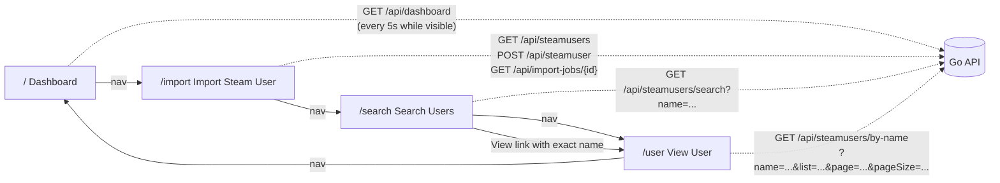

# Frontend navigation, dashboard, user search, and user view plan

## Goal

Turn the current single-purpose lookup page into a small single-page application
with four routes:

| Route     | Page               | Purpose                                                                   |
| --------- | ------------------ | ------------------------------------------------------------------------- |
| `/`       | Dashboard          | Total Steam users, total imported apps, running jobs, queued jobs.        |
| `/import` | Import Steam User  | The existing lookup / create-user / poll-import flow.                     |
| `/search` | Search Users       | Partial-name search with sorting, filtering, and links to View User.      |
| `/user`   | View User          | Exact-name lookup with paginated owned and wishlisted app lists.          |

The previous **Review User** page is renamed **Search Users**. Its inline detail
panel is replaced by a link to the new **View User** page. Search Users keeps
partial, case-insensitive matching and its client-side sort/filter controls.
View User uses an exact, case-insensitive name match and shows paginated app
results.

A top navigation menu links all four pages. The dashboard is the main entry
point and refreshes itself while it is visible. The import page keeps the
current behaviour. Search Users and View User are read-only.

No JavaScript framework, bundler, or external assets are introduced. The SPA
is plain HTML, CSS and JavaScript served from `web/public`.



## Decisions

| Topic                    | Decision                                                                                                                                 |
| ------------------------ | ---------------------------------------------------------------------------------------------------------------------------------------- |
| Routing                  | SPA with real paths: `/`, `/import`, `/search`, `/user`. The server serves `index.html` for unknown non-API paths.                      |
| Top navigation           | Dashboard, Import Steam User, Search Users, and View User. View User opens with an empty lookup form when no name is supplied.           |
| Active job metric        | Show running and queued jobs as two separate dashboard values.                                                                           |
| Apps metric              | Count every row in `apps`.                                                                                                               |
| Search Users matching    | Partial, case-insensitive match on `steam_users.name`; multiple results allowed.                                                         |
| Search Users result      | Summary rows only, with a link to View User. No inline app detail on Search Users.                                                       |
| Search Users sort/filter | Name, last updated, owned-app count, wishlist count; filter by wishlist privacy, latest import status, and active job.                   |
| View User matching       | Exact, case-insensitive match on `steam_users.name`. Multiple case variants resolve to the newest `updated_at` user.                     |
| View User input          | Steam name only. Steam ID lookup is out of scope.                                                                                        |
| View User layout         | Owned and Wishlist tabs, each with independent pagination.                                                                               |
| App pagination           | Server-side `LIMIT`/`OFFSET` with user-selectable page size: 25, 50, or 100; default 25.                                                 |
| App list controls        | Pagination only. Apps are ordered by name ascending, then app ID for stable pages.                                                       |
| View User URL state      | `/user?name=<exact name>&list=<owned/wishlist>&page=<n>&pageSize=<25/50/100>`; tab, page, and page size survive refresh and history navigation. |
| Dashboard refresh        | Every 5 seconds while the dashboard is active and the document is visible; refresh immediately on route entry and on tab visibility.    |
| Backend support          | Add read-only stats, search, and exact-name paginated view queries/endpoints.                                                            |
| Steam ID JSON            | Serialize Steam IDs as decimal strings in every API response to avoid JavaScript precision loss.                                         |
| Delete / re-import       | Out of scope for this change.                                                                                                            |

## API changes

### Steam IDs as strings

Steam IDs are `BIGINT` values such as `76561198000000001`, which exceed
JavaScript's `Number.MAX_SAFE_INTEGER` (`9007199254740991`). The current API
embeds `dbgen.SteamUser` and `importJobView`, both of which marshal `steam_id`
as a JSON number. That can round the ID before the browser ever sees it.

Introduce explicit API view types instead of returning generated database
models directly:

```go
type steamUserView struct {
    SteamID         string    `json:"steamId"`
    Name            string    `json:"name"`
    WishlistPrivate bool      `json:"wishlistPrivate"`
    CreatedAt       time.Time `json:"createdAt"`
    UpdatedAt       time.Time `json:"updatedAt"`
}

type appSummaryView struct {
    AppID       int32   `json:"appId"`
    Name        *string `json:"name"`
    HeaderImage *string `json:"headerImage"`
}

type steamUserSummaryView struct {
    SteamID              string     `json:"steamId"`
    Name                 string     `json:"name"`
    WishlistPrivate      bool       `json:"wishlistPrivate"`
    OwnedAppCount        int64      `json:"ownedAppCount"`
    WishlistAppCount     int64      `json:"wishlistAppCount"`
    LatestImportStatus   *string    `json:"latestImportStatus"`
    LatestImportFinished *time.Time `json:"latestImportFinishedAt"`
    HasActiveJob         bool       `json:"hasActiveJob"`
    UpdatedAt            time.Time  `json:"updatedAt"`
}
```

`importJobView.SteamID` changes from `int64` to `string` with the tag
`json:"steamId"`. All new and existing endpoints return these camelCase views.

This is a deliberate breaking change to the small internal API. Update the
frontend and handler tests in the same change. Database models stay unchanged;
only the API boundary does the conversion.

### `GET /api/dashboard`

Returns the four dashboard metrics in one query/statement:

```json
{
  "totalSteamUsers": 12,
  "totalApps": 342,
  "importJobs": {
    "running": 2,
    "queued": 1
  }
}
```

### `GET /api/steamusers/search?name=<partial name>`

- `name` is trimmed, required, and matches any substring of the stored name
  case-insensitively.
- An empty or whitespace-only `name` returns `400 {"error":"name is required"}`.
- No matches return `200` with an empty `steamUsers` array, not `404`.
- Results are returned in name order. The client applies sort and filter.

```json
{
  "steamUsers": [
    {
      "steamId": "76561198000000001",
      "name": "gaben",
      "wishlistPrivate": false,
      "ownedAppCount": 42,
      "wishlistAppCount": 7,
      "latestImportStatus": "succeeded",
      "latestImportFinishedAt": "2026-01-01T00:00:00Z",
      "hasActiveJob": false,
      "updatedAt": "2026-01-01T00:00:00Z"
    }
  ]
}
```

`latestImportStatus` and `latestImportFinishedAt` are `null` when the user has
never had an import.

### `GET /api/steamusers/by-name`

This is the View User endpoint. It resolves one exact name and returns the user
summary plus one page of apps from the selected list.

Query parameters:

| Parameter  | Required | Values                          | Default |
| ---------- | -------- | ------------------------------- | ------- |
| `name`     | yes      | Exact Steam name, case-insensitive | —     |
| `list`     | no       | `owned` or `wishlist`           | `owned` |
| `page`     | no       | Integer >= 1                    | `1`     |
| `pageSize` | no       | `25`, `50`, or `100`            | `25`    |

Matching uses the existing `GetSteamUserByName` query, which is
case-insensitive and returns the newest matching row when multiple users differ
only by case. The response always includes both app counts, the latest import,
and the active-job flag. Only the selected list is paginated and returned.

```json
{
  "steamUser": {
    "steamId": "76561198000000001",
    "name": "gaben",
    "wishlistPrivate": false,
    "createdAt": "2026-01-01T00:00:00Z",
    "updatedAt": "2026-01-01T00:00:00Z"
  },
  "ownedAppCount": 42,
  "wishlistAppCount": 7,
  "latestImport": {
    "id": 17,
    "steamId": "76561198000000001",
    "status": "succeeded",
    "totalApps": 42,
    "processedApps": 42,
    "skippedApps": 0,
    "failedApps": 0,
    "wishlistTotalApps": 7,
    "wishlistProcessedApps": 7,
    "wishlistSkippedApps": 0,
    "wishlistFailedApps": 0,
    "error": null,
    "createdAt": "2026-01-01T00:00:00Z",
    "startedAt": "2026-01-01T00:00:01Z",
    "finishedAt": "2026-01-01T00:01:00Z"
  },
  "hasActiveJob": false,
  "list": "owned",
  "page": 1,
  "pageSize": 25,
  "total": 42,
  "totalPages": 2,
  "apps": [
    {
      "appId": 440,
      "name": "Team Fortress 2",
      "headerImage": "https://cdn.akamai.steamstatic.com/steam/apps/440/header.jpg"
    }
  ]
}
```

Pagination rules:

- `total` is the number of active apps in the selected list.
- `totalPages = 0` when `total` is 0; otherwise
  `totalPages = ceil(total / pageSize)`.
- `page` greater than `totalPages` is clamped to the last page and the response
  reports the effective page. When `total` is 0, the effective page is 1.
- Apps are ordered by `name NULLS LAST`, then `steam_appid`, so page boundaries
  are deterministic.
- Removed apps are excluded. Distinct canonical apps are counted once even when
  multiple alias IDs point at the same app.

Errors:

- Missing or blank `name`: `400 {"error":"name is required"}`.
- Invalid `list`: `400 {"error":"list must be owned or wishlist"}`.
- Non-integer or `< 1` `page`: `400 {"error":"page must be a positive number"}`.
- `pageSize` not in `25|50|100`: `400 {"error":"pageSize must be 25, 50, or 100"}`.
- No matching user: `404 {"error":"steam user not found"}`.
- `latestImport` is `null` when there has never been a job.
- `hasActiveJob` is true when a job with status `queued` or `running` exists.

The previously proposed `GET /api/steamusers/{steamId}` full-detail endpoint is
no longer needed: View User resolves by name and fetches one paginated list per
request. The existing empty `GetSteamUserById` stub can remain unused.

### Existing endpoints

`POST /api/steamuser` and `GET /api/steamusers?name=` keep their routes and
status codes, but their response bodies use `steamUserView` and the string
`steamId`. The import page is updated to read the new field.

The exact lookup used by the import page stays a single-user lookup. View User
does not reuse it directly because it also needs counts, latest import data,
and a page of apps.

### Route precedence

Register the new routes on the existing dynamic mux:

```go
dynamicMux.HandleFunc("GET /api/dashboard", apiHandler.GetDashboard)
dynamicMux.HandleFunc("POST /api/steamuser", apiHandler.InsertSteamUser)
dynamicMux.HandleFunc("GET /api/steamusers", apiHandler.GetSteamUserByName)
dynamicMux.HandleFunc("GET /api/steamusers/search", apiHandler.SearchSteamUsers)
dynamicMux.HandleFunc("GET /api/steamusers/by-name", apiHandler.GetSteamUserView)
dynamicMux.HandleFunc("GET /api/import-jobs/{id}", apiHandler.GetImportJob)
```

Go's `ServeMux` gives the literal `/api/steamusers/search` and
`/api/steamusers/by-name` patterns precedence over a future
`/api/steamusers/{id}` pattern, so neither literal is treated as an ID. The
exact `/api/steamusers` pattern remains the exact-name lookup used by the
import page.

## Phase 1: database queries

The project edits `00001_initial_schema.sql` directly rather than adding a new
migration. `internal/database/dbtest` starts every test from the edited schema.

### `internal/database/queries/dashboard.sql` (new)

One statement keeps the dashboard metrics consistent with each other:

```sql
-- name: GetDashboardStats :one
SELECT
    (SELECT COUNT(*) FROM steam_users) AS total_steam_users,
    (SELECT COUNT(*) FROM apps) AS total_apps,
    (SELECT COUNT(*) FROM import_jobs WHERE status = 'running') AS running_jobs,
    (SELECT COUNT(*) FROM import_jobs WHERE status = 'queued') AS queued_jobs;
```

Run `sqlc generate` to create `internal/database/dbgen/dashboard.sql.go`.

### `internal/database/queries/steam_users.sql`

Add a partial, case-insensitive search. Use `strpos` instead of `LIKE` so
characters such as `%` and `_` in the search box are matched literally:

```sql
-- name: SearchSteamUsers :many
SELECT
    su.steam_id,
    su.name,
    su.wishlist_private,
    su.created_at,
    su.updated_at,
    (
        SELECT COUNT(DISTINCT aa.app_id)
        FROM steam_user_apps sua
        JOIN app_alias aa ON aa.alias_id = sua.app_id
        WHERE sua.steam_id = su.steam_id
          AND sua.removed = FALSE
    ) AS owned_app_count,
    (
        SELECT COUNT(DISTINCT aa.app_id)
        FROM steam_user_wishlist suw
        JOIN app_alias aa ON aa.alias_id = suw.app_id
        WHERE suw.steam_id = su.steam_id
          AND suw.removed = FALSE
    ) AS wishlist_app_count,
    latest.status AS latest_import_status,
    latest.finished_at AS latest_import_finished_at,
    EXISTS (
        SELECT 1
        FROM import_jobs active
        WHERE active.steam_id = su.steam_id
          AND active.status IN ('queued', 'running')
    ) AS has_active_job
FROM steam_users su
LEFT JOIN import_jobs latest ON latest.id = (
    SELECT id
    FROM import_jobs
    WHERE steam_id = su.steam_id
    ORDER BY created_at DESC, id DESC
    LIMIT 1
)
WHERE strpos(lower(su.name), lower(sqlc.arg(name))) > 0
ORDER BY su.name, su.steam_id;
```

Notes:

- `COUNT(DISTINCT aa.app_id)` counts canonical apps even when multiple alias
  IDs point at the same app. This matches how the owned/wishlist list queries
  join through `app_alias`.
- Removed apps are excluded so the summary matches the View User lists.
- The left join gives the latest import regardless of status. Using a plain
  `LEFT JOIN import_jobs` (rather than `LEFT JOIN LATERAL`) lets sqlc infer
  that `latest_import_status` is nullable; a lateral join leaves it typed as a
  non-null `string`. The generated row uses `sql.NullString`/`sql.NullTime`
  for the nullable latest-import columns; the API layer converts those to
  pointers.
- The expected `steam_users` population is small. A substring search scans the
  table, which is acceptable; add `pg_trgm` only if this becomes a problem.

### `internal/database/queries/steam_user_apps.sql`

Add count and paginated list queries. The existing unpaginated
`ListActiveSteamUserApps` can remain for other callers; View User uses the
paginated variant.

```sql
-- name: CountActiveSteamUserApps :one
SELECT COUNT(DISTINCT aa.app_id)
FROM steam_user_apps sua
JOIN app_alias aa ON aa.alias_id = sua.app_id
WHERE sua.steam_id = $1
  AND sua.removed = FALSE;

-- name: ListActiveSteamUserAppsPage :many
SELECT DISTINCT a.*
FROM apps a
JOIN app_alias aa ON aa.app_id = a.steam_appid
JOIN steam_user_apps sua ON sua.app_id = aa.alias_id
WHERE sua.steam_id = @steam_id
  AND sua.removed = FALSE
ORDER BY a.name NULLS LAST, a.steam_appid
LIMIT @page_size OFFSET @row_offset;
```

### `internal/database/queries/steam_user_wishlist.sql`

Add the matching count and paginated list queries:

```sql
-- name: CountActiveSteamUserWishlist :one
SELECT COUNT(DISTINCT aa.app_id)
FROM steam_user_wishlist suw
JOIN app_alias aa ON aa.alias_id = suw.app_id
WHERE suw.steam_id = $1
  AND suw.removed = FALSE;

-- name: ListActiveSteamUserWishlistPage :many
SELECT DISTINCT a.*
FROM apps a
JOIN app_alias aa ON aa.app_id = a.steam_appid
JOIN steam_user_wishlist suw ON suw.app_id = aa.alias_id
WHERE suw.steam_id = @steam_id
  AND suw.removed = FALSE
ORDER BY a.name NULLS LAST, a.steam_appid
LIMIT @page_size OFFSET @row_offset;
```

### `internal/database/queries/import_jobs.sql`

Add a latest-job query. `GetActiveImportJobForUser` and
`GetLatestSucceededImportJobForUser` already exist, but View User needs the
latest job of any status:

```sql
-- name: GetLatestImportJobForUser :one
SELECT * FROM import_jobs
WHERE steam_id = $1
ORDER BY created_at DESC, id DESC
LIMIT 1;
```

### Indexes

Add indexes that support the new lookups. They are safe to add to
`00001_initial_schema.sql`; reset the local database or let tests build a fresh
schema.

```sql
-- Exact case-insensitive name lookup (import page and View User).
CREATE INDEX steam_users_name_lower ON steam_users (lower(name));

-- Latest-job lookup; the existing index is (steam_id, status).
CREATE INDEX import_jobs_steam_id_created_at
    ON import_jobs (steam_id, created_at DESC, id DESC);
```

The partial search still scans `steam_users` because it matches substrings.
The app page queries use the existing `(steam_id, app_id)` primary keys and
sort the joined result; add application-level pagination indexes only if
profiling shows a need.

## Phase 2: API handlers and views

### Views

Put the new view types and constructors in `internal/api/views.go` (or keep
them in `handler.go` if the file remains manageable). Include:

- `newSteamUserView(dbgen.SteamUser) steamUserView`
- `newImportJobView(dbgen.ImportJob) importJobView` (move/update the existing
  constructor)
- `newAppSummaryView(dbgen.App) appSummaryView`
- `newSteamUserSummaryView(...) steamUserSummaryView`
- Helpers for `sql.NullString`/`sql.NullTime` to pointers.

All constructors format Steam IDs with `strconv.FormatInt(id, 10)`.

### `GetDashboard`

```go
func (handler *Handler) GetDashboard(responseWriter http.ResponseWriter, request *http.Request)
```

Call `GetDashboardStats` and respond `200` with a `dashboardResponse`:

```go
type dashboardResponse struct {
    TotalSteamUsers int64 `json:"totalSteamUsers"`
    TotalApps       int64 `json:"totalApps"`
    ImportJobs      struct {
        Running int64 `json:"running"`
        Queued  int64 `json:"queued"`
    } `json:"importJobs"`
}
```

Use `handler.internalError` for database failures.

### `SearchSteamUsers`

```go
func (handler *Handler) SearchSteamUsers(responseWriter http.ResponseWriter, request *http.Request)
```

1. Read `name := strings.TrimSpace(request.URL.Query().Get("name"))`.
2. Return `400` if it is empty.
3. Call `SearchSteamUsers` and map each row to `steamUserSummaryView`.
4. Respond `200` with `{"steamUsers": [...]}`.

Do not sort or filter on the server. The result set is a partial-name match and
the Search Users page applies the recommended controls in the browser, so
changing a control does not require another request.

### `GetSteamUserView`

```go
func (handler *Handler) GetSteamUserView(responseWriter http.ResponseWriter, request *http.Request)
```

This implements `GET /api/steamusers/by-name`.

1. Read and trim `name`. Return `400` when empty.
2. Parse `list`; default to `owned`; accept only `owned` and `wishlist`.
3. Parse `page`; default to `1`; reject non-integers and values `< 1`.
4. Parse `pageSize`; default to `25`; accept only `25`, `50`, and `100`.
5. Call `GetSteamUserByName`; return `404` for `sql.ErrNoRows`.
6. Call `CountActiveSteamUserApps` and `CountActiveSteamUserWishlist`.
7. Compute `total` for the selected list and `totalPages`:
   - `totalPages = 0` when `total == 0`.
   - Otherwise `totalPages = (total + pageSize - 1) / pageSize`.
8. Clamp `page` to `[1, max(1, totalPages)]`.
9. Compute `offset = (page - 1) * pageSize`.
10. Call `ListActiveSteamUserAppsPage` or
    `ListActiveSteamUserWishlistPage` with the Steam ID, page size, and offset.
11. Call `GetLatestImportJobForUser`; treat `sql.ErrNoRows` as `nil`.
12. Call `GetActiveImportJobForUser`; treat `sql.ErrNoRows` as
    `hasActiveJob=false`.
13. Respond with the View User shape shown above.

Use the SQL counts rather than `len(apps)` for `ownedAppCount`,
`wishlistAppCount`, and `total`, because the page only contains one slice of
the list. `offset` is safe because the handler validated and clamped the
inputs before binding them.

Database failures use `handler.internalError`.

### Existing handlers

`InsertSteamUser` and `GetSteamUserByName` switch from returning
`dbgen.SteamUser` to `newSteamUserView`. `newImportJobView` now formats the
Steam ID as a string. Status codes, `Location`, and error messages are
unchanged.

## Phase 3: SPA shell and routing

### `web/public/index.html`

Replace the single card with a shared shell:

```html
<body>
    <header class="site-header">
        <a class="brand" href="/">Steam Decision Engine</a>
        <nav class="site-nav" aria-label="Main">
            <a href="/" data-route="/">Dashboard</a>
            <a href="/import" data-route="/import">Import Steam User</a>
            <a href="/search" data-route="/search">Search Users</a>
            <a href="/user" data-route="/user">View User</a>
        </nav>
    </header>

    <main class="page">
        <section id="view-dashboard" data-view="/" hidden>...</section>
        <section id="view-import" data-view="/import" hidden>
            <!-- existing lookup, result and job markup, unchanged IDs -->
        </section>
        <section id="view-search" data-view="/search" hidden>...</section>
        <section id="view-user" data-view="/user" hidden>...</section>
    </main>

    <script src="/app.js" defer></script>
</body>
```

Use absolute asset paths (`/styles.css`, `/app.js`) so nested routes load the
same files.

### Router behaviour in `app.js`

- Define `const routes = new Map([["/", "dashboard"], ["/import", "import"], ["/search", "search"], ["/user", "user"]])`.
- Normalize trailing slashes: `/search/` becomes `/search`; `/` stays `/`.
- On load and `popstate`, read `location.pathname`, look up the route, hide all
  `[data-view]` sections except the active one, and set `document.title`.
- Set `aria-current="page"` on the active nav link and remove it from others.
- Intercept clicks on `a[data-route]` for same-origin, unmodified left clicks:
  `preventDefault()` then `history.pushState({}, "", href)` and render.
- After rendering a route, move focus to that view's `h1` (with
  `tabindex="-1"`) so keyboard and screen-reader users are placed at the start
  of the new page.
- Unknown paths redirect to `/` with `history.replaceState`.
- Expose a small `onRouteChange(previous, next)` hook so each page can start
  and stop its own work:
  - Leaving `/`: stop dashboard refresh, abort the in-flight metrics request.
  - Leaving `/import`: abort an in-flight lookup; keep the last job/result in
    the DOM.
  - Leaving `/search`: abort an in-flight search; keep the last search and
    filters in the DOM.
  - Leaving `/user`: abort in-flight View User requests.
  - Entering `/`: fetch metrics immediately and start the refresh timer.
  - Entering `/import`: resume polling if the last job is still active.
  - Entering `/search`: do nothing automatically; keep the last search and
    filters in the DOM.
  - Entering `/user`: parse `name`, `list`, `page`, and `pageSize` from the
    query string. If `name` is present, load the user; otherwise show the empty
    lookup form.
- Keep one `AbortController` per view for lookups, searches, and metric
  requests. Route changes abort the controller for the view being left.

The server must return `index.html` for `/import`, `/search`, and `/user`; see
Phase 8.

## Phase 4: Dashboard

### Markup

```html
<header class="page-header">
    <p class="eyebrow">Dashboard</p>
    <h1>Imported Steam data at a glance</h1>
    <p class="lede">Counts come from the database and refresh while this page is open.</p>
</header>

<p id="dashboard-status" class="status" role="status" aria-live="polite"></p>

<div id="dashboard-metrics" class="metric-grid" aria-busy="true">
    <article class="metric">
        <p class="metric__label">Steam users</p>
        <p id="metric-users" class="metric__value">—</p>
    </article>
    <article class="metric">
        <p class="metric__label">Apps imported</p>
        <p id="metric-apps" class="metric__value">—</p>
    </article>
    <article class="metric">
        <p class="metric__label">Running import jobs</p>
        <p id="metric-running" class="metric__value">—</p>
    </article>
    <article class="metric">
        <p class="metric__label">Queued import jobs</p>
        <p id="metric-queued" class="metric__value">—</p>
    </article>
</div>

<p id="dashboard-updated" class="hint"></p>
```

### Behaviour

- `loadDashboard()` aborts any previous request, fetches `GET /api/dashboard`
  with `Accept: application/json`, and updates the four values.
- Format counts with `Intl.NumberFormat`; while loading, keep `—`.
- On success, clear the status and set `dashboard-updated` to
  `Updated at <local time>`.
- On a transient failure, keep the last values and show
  `Could not refresh the dashboard; retrying…` in an error state.
- Refresh loop: recursive `setTimeout` with a **5000 ms** delay, not
  `setInterval`, so slow requests do not overlap.
- Pause when `document.visibilityState === "hidden"` or the route is not `/`.
  On `visibilitychange` back to visible, refresh immediately and resume.
- On route entry, refresh immediately and start the loop.
- Set `aria-busy="false"` after the first response.

The dashboard has no charts, tables, or historical data.

## Phase 5: Import page

Move the current markup and behaviour under `/import` with only small changes:

- Heading becomes `Import Steam User`; keep the lookup form, status line,
  result panel, and job panel with their existing IDs.
- `showSteamUser` reads `steamUser.steamId` instead of `steamUser.steam_id`.
  It still renders the value as text, never as a JavaScript number.
- Keep the 2-second job polling, 5-minute timeout, abort-on-new-search, and
  error handling.
- Polling pauses when the route is not `/import` and resumes when the user
  returns if the last job is still `queued` or `running`. A terminal job does
  not resume.
- The form remains enabled while a job is polling, so another user can be
  imported.
- `normalizeName`, full-profile-prefix stripping, and `readError` stay as they
  are.

No change to `POST /api/steamuser` semantics or importer behaviour.

## Phase 6: Search Users page

### Markup

```html
<header class="page-header">
    <p class="eyebrow">Search Users</p>
    <h1>Find imported Steam users</h1>
    <p class="lede">Search by any part of a stored Steam name, then open a user to view their apps.</p>
</header>

<form id="search-form" class="lookup" novalidate>
    <label for="search-name">Steam name</label>
    <div class="lookup__row">
        <input id="search-name" name="name" type="text" autocomplete="off"
               spellcheck="false" placeholder="e.g. gaben" required />
        <button id="search-button" type="submit">Search</button>
    </div>
</form>

<section id="search-controls" class="controls" aria-label="Sort and filter results" hidden>
    <label>Sort by
        <select id="search-sort">
            <option value="name">Name</option>
            <option value="updated">Last updated</option>
            <option value="owned">Owned apps</option>
            <option value="wishlist">Wishlist apps</option>
        </select>
    </label>
    <label>Direction
        <select id="search-direction">
            <option value="asc">Ascending</option>
            <option value="desc">Descending</option>
        </select>
    </label>
    <label>Wishlist
        <select id="search-wishlist">
            <option value="all">Any</option>
            <option value="public">Public</option>
            <option value="private">Private</option>
        </select>
    </label>
    <button id="search-reset" type="button" class="button--secondary">Reset</button>
</section>

<p id="search-status" class="status" role="status" aria-live="polite"></p>
<p id="search-count" class="hint" hidden></p>

<ul id="search-results" class="result-list" hidden></ul>
```

There is no inline detail panel. The previous inline detail section and
detail-fetch logic are removed.

### Search

- Reuse the "Steam name" label style; this is a separate form with a separate
  token/controller from the import page.
- On submit, trim the name. Empty input shows a client-side message and sends
  no request.
- `GET /api/steamusers/search?name=<encodeURIComponent(name)>`; abort any
  previous search.
- Show `Searching…` while in flight.
- On success, store the `steamUsers` array, default the sort to `name`
  ascending, reset filters to `any`, render the controls, and apply the
  sort/filter pipeline.
- On `400`/`5xx`, show the API error or a generic message.
- No results: hide the controls/results and show `No users match "<name>".`
- Do not auto-search as the user types. A submit is required, which avoids
  request spam and keeps the behaviour simple.

### Summary rows

Each result is a `<li>` containing the user summary and a **View user** link:

```html
<a
    class="result__link"
    href="/user?name=<encodeURIComponent(steamUser.name)>"
    data-route="/user"
>View user</a>
```

Show:

- Steam name
- Steam ID as text
- Owned app count
- Wishlist app count
- Wishlist privacy (`Public` / `Private`)
- Status, derived from the latest import status:
  - `queued` → `Pending`
  - `running` → `Processing`
  - `succeeded` → `Available`
  - `failed` or missing/unknown → `Out-of-Date`

Use `data-status` attributes on badges for CSS colours. The link uses the exact
stored `steamUser.name`, not the raw search query, so the View User lookup gets
the canonical case. The link is a normal anchor with `data-route="/user"`; the
router intercepts it, pushes the URL, and renders `/user`.

### Sort

Provide the four recommended sorts with ascending/descending direction:

| Sort value | Field                    | Default direction |
| ---------- | ------------------------ | ----------------- |
| `name`     | `name`, case-insensitive | Ascending         |
| `updated`  | `updatedAt`              | Descending        |
| `owned`    | `ownedAppCount`          | Descending        |
| `wishlist` | `wishlistAppCount`       | Descending        |

The sort select and direction select are independent, but changing the sort
select resets the direction to that sort's default from the table above. The
user can then change the direction without it being reset. Initial load and the
`Reset` button use `name` ascending.

Sort ties break by case-insensitive name, then Steam ID string.

### Filters

Apply filters before sorting:

- Wishlist: `any` / `public` (`wishlistPrivate === false`) /
  `private` (`wishlistPrivate === true`).

Show `Showing X of Y users` when a filter hides at least one result. The
`Reset` button restores `name` ascending and all filters to `any`, then
re-renders.

Do not fetch again for sort/filter changes; all data needed is already in the
summary rows.

## Phase 7: View User page

### Markup

```html
<header class="page-header">
    <p class="eyebrow">View User</p>
    <h1>View a Steam user</h1>
    <p class="lede">Enter an exact Steam name to see their imported library.</p>
</header>

<form id="user-form" class="lookup" novalidate>
    <label for="user-name">Steam name</label>
    <div class="lookup__row">
        <input id="user-name" name="name" type="text" autocomplete="off"
               spellcheck="false" placeholder="e.g. gaben" required />
        <button id="user-submit" type="submit">View user</button>
    </div>
    <p class="hint">Exact name match, ignoring case. Use Search Users for partial searches.</p>
</form>

<p id="user-status" class="status" role="status" aria-live="polite"></p>

<section id="user-summary" class="panel" hidden aria-labelledby="user-summary-title">
    <!-- name, Steam ID, privacy, created/updated, counts, latest import -->
</section>

<section id="user-apps" class="panel" hidden aria-labelledby="user-apps-title">
    <div class="tabs" role="tablist" aria-label="App lists">
        <button id="tab-owned" class="tab" role="tab" aria-selected="true"
                aria-controls="user-app-panel">Owned (<span id="owned-tab-count">0</span>)</button>
        <button id="tab-wishlist" class="tab" role="tab" aria-selected="false"
                aria-controls="user-app-panel">Wishlist (<span id="wishlist-tab-count">0</span>)</button>
    </div>

    <div id="user-app-panel" role="tabpanel" tabindex="0" aria-labelledby="tab-owned">
        <div class="app-toolbar">
            <p id="user-list-count" class="hint"></p>
            <label>Rows per page
                <select id="user-page-size">
                    <option value="25">25</option>
                    <option value="50">50</option>
                    <option value="100">100</option>
                </select>
            </label>
        </div>

        <table id="user-app-table" class="app-table">
            <!-- App name, app ID, optional header image, Steam store link -->
        </table>

        <nav id="user-pagination" class="pagination" aria-label="App pages"></nav>
    </div>
</section>
```

### URL state

Use the URL as the source of truth for the View User lookup:

```text
/user?name=<exact name>&list=owned|wishlist&page=<n>&pageSize=25|50|100
```

- Defaults: `list=owned`, `page=1`, `pageSize=25`.
- The page parses and validates the query string on load and on `popstate`.
- Invalid or missing values fall back to defaults client-side; the API remains
  the final validator.
- Tab changes, page changes, and page-size changes update the URL with
  `history.pushState` so back/forward works.
- When the API canonicalizes the name (different case) or clamps `page`, use
  `history.replaceState` to sync the URL without adding a history entry.
- The form input is always filled from the `name` query parameter on entry to
  `/user`.

### Load flow

- On entering `/user`, parse the query string.
- If `name` is empty, show the empty form and no summary/apps.
- If `name` is present:
  1. Set the input value to `name`.
  2. Abort any previous request.
  3. Fetch
     `GET /api/steamusers/by-name?name=<encodeURIComponent(name)>&list=<list>&page=<page>&pageSize=<pageSize>`.
  4. Show a loading state in the status line and mark the summary/apps sections
     `aria-busy="true"`.
  5. On success, render the summary and the selected app page.
  6. On `404`, show `Steam user not found.` and a link to `/search`; keep the
     form usable.
  7. On `400`, show the API error.
  8. On other errors, show a generic message and keep the last view.
- On form submit, trim the name, require a non-empty value, reset `list=owned`,
  `page=1`, keep the current `pageSize`, push the new URL, and load.

### Summary

Show:

- Steam name
- Steam ID as text (never parse it as a JavaScript number)
- Wishlist privacy (`Public` / `Private`)
- Owned-app and wishlist-app counts
- The latest import's `error` when present
- Status, applying the same `Pending` / `Processing` / `Available` /
  `Out-of-Date` mapping as Search Users, shown next to the section heading
  where the old `Active import` badge was
- A notice when `wishlistPrivate` is true:
  `This user's wishlist is private; imported wishlist data may be incomplete.`

There are no import, edit, or delete buttons. The page is read-only.

### Tabs

- The Owned and Wishlist tabs show their counts in the tab labels.
- Each tab remembers its own current page in memory:
  `viewUserState.pages = { owned: 1, wishlist: 1 }`.
- The active tab's page is reflected in `?page=`. Switching tabs restores that
  tab's remembered page, updates `?list=` and `?page=`, and fetches the new
  list.
- On a fresh deep link, the active tab's page comes from `?page=` and the other
  tab starts at page 1.
- Changing `pageSize` applies to both tabs and resets both remembered pages to
  1.
- Use `role="tab"` / `role="tabpanel"` relationships, update the panel's
  `aria-labelledby` to the active tab, and keep keyboard support simple:
  buttons are focusable and activate on click/Enter/Space.

### Pagination

- Fetch only the selected page from the API; do not load all apps into the
  browser.
- Show `Page X of Y` and the total app count. `Y` is `totalPages`; for an empty
  list show `No owned apps` or `No wishlist apps`.
- Render Previous, Next, and numbered page buttons around the current page,
  with ellipses when there are many pages. Disable Previous on page 1 and Next
  on the last page.
- When `totalPages` is 0, hide the numbered controls and disable both buttons.
- Changing page updates `?page=` and refetches the active list.
- If the API clamps a page because the list shrank, render the returned page
  and `replaceState` the URL.
- Keep the current app table headings stable: App, App ID, Store.

### App rows

- Show the app name, app ID, and a small header image when
  `headerImage` is present.
- Link each app to `https://store.steampowered.com/app/<appId>/` with
  `target="_blank" rel="noopener noreferrer"`.
- Use `Unknown app` when `name` is null.
- The server already orders by name, then app ID.

## Phase 8: SPA fallback and static serving

`internal/httpserver/app.go` currently registers
`dynamicMux.Handle("GET /", fileServer)`. `http.FileServer` returns `404` for
`/import`, `/search`, and `/user`. Replace it with a small SPA-aware handler
that:

1. Returns `404` for `/api` and any path beginning with `/api/`, preserving the
   current "unknown API paths never serve the page" behaviour.
2. Serves an existing file or directory from `web/public` normally.
3. If the requested path does not exist and has no file extension, serves
   `index.html` so client-side routes work.
4. If the requested path does not exist and looks like an asset (`.js`,
   `.css`, `.png`, etc.), returns `404` instead of masking a broken asset with
   HTML.

Sketch:

```go
func newSPAHandler(publicRoot *os.Root) http.Handler {
    fileServer := http.FileServer(http.FS(publicRoot.FS()))
    return http.HandlerFunc(func(responseWriter http.ResponseWriter, request *http.Request) {
        if request.URL.Path == "/api" || strings.HasPrefix(request.URL.Path, "/api/") {
            http.NotFound(responseWriter, request)
            return
        }

        name := strings.TrimPrefix(path.Clean(request.URL.Path), "/")
        if name != "" && name != "." {
            if info, err := publicRoot.Stat(name); err == nil && !info.IsDir() {
                fileServer.ServeHTTP(responseWriter, request)
                return
            }
            if path.Ext(name) != "" {
                http.NotFound(responseWriter, request)
                return
            }
        }

        clone := request.Clone(request.Context())
        clone.URL.Path = "/"
        fileServer.ServeHTTP(responseWriter, clone)
    })
}
```

Register it as `dynamicMux.Handle("GET /", newSPAHandler(publicRoot))`. The
existing API patterns are more specific and are matched first. Query strings do
not affect the path check.

## Phase 9: Styling

Extend `web/public/styles.css` using the existing variables and visual
language:

- Replace the single centred card layout with a page shell: sticky or static
  `site-header`, brand, horizontal nav, centred `main` with a wider max width
  (for example `min(100%, 72rem)`).
- Keep the card, panel, detail-row, input, button, focus, and error styles.
  Add a secondary button style for Reset.
- Dashboard: responsive `metric-grid` with four cards, large tabular-number
  values, muted labels.
- Search Users: full-width results list with clear name/ID/count columns,
  badges, and a visible View user link. Controls wrap on narrow screens.
- View User: summary card plus app section. Tabs use a clear selected state;
  the app table is horizontally scrollable on narrow screens.
- Pagination: compact Previous/Next buttons, numbered page buttons, current
  page state, and disabled styling.
- Results: badge styles for `queued`, `running`, `succeeded`, `failed`,
  public/private, and active-import.
- App rows: compact rows with name, ID, optional thumbnail, and store link;
  long names wrap.
- Responsive breakpoint around `48rem` and reuse the existing `30rem` mobile
  rules.
- No external fonts, icon packs, or CSS frameworks.

Status colours should be distinguishable without relying only on colour:
include text labels in the badges.

## Phase 10: Tests and verification

### API handler tests (`internal/api/handler_test.go`)

Register the new routes in `newHandlerEnv`:

```go
mux.HandleFunc("GET /api/dashboard", handler.GetDashboard)
mux.HandleFunc("GET /api/steamusers/search", handler.SearchSteamUsers)
mux.HandleFunc("GET /api/steamusers/by-name", handler.GetSteamUserView)
```

Add helpers for seeding apps, aliases, owned apps, wishlist entries, and jobs.
Update existing assertions for string Steam IDs.

Dashboard tests:

- Empty database returns all zeros.
- Seeded users/apps/jobs return the correct totals.
- `running` and `queued` are counted separately; succeeded/failed jobs are
  excluded from both.
- Response keys are camelCase and counts are JSON numbers.

Search Users tests:

- Partial, case-insensitive match returns multiple users (for example searching
  `play` finds `SomePlayer` and `PlayerTwo`).
- `%` and `_` in the search text are treated literally.
- Owned and wishlist counts exclude removed rows and count canonical apps once
  when multiple aliases point to the same app.
- Latest import status is the most recently created job of any status.
- `hasActiveJob` is true for queued/running jobs and false otherwise.
- No matches return `200` with an empty array.
- Missing/blank `name` returns `400`.
- Steam IDs are JSON strings: decode into `map[string]json.RawMessage` or a
  struct with `string` fields and assert the exact decimal text, including
  `76561198000000001`.

View User tests:

- Exact match is case-insensitive and returns the expected user.
- When two users differ only by case, the newest `updated_at` user is returned.
- Missing/blank `name` returns `400`; unknown name returns `404`.
- `list=owned` and `list=wishlist` each return only that list.
- Defaults are `list=owned`, `page=1`, and `pageSize=25`.
- Both owned and wishlist counts are returned even when the other list is not
  the selected one.
- `page`, `pageSize`, `total`, and `totalPages` are correct for seeded data.
- Page sizes 25, 50, and 100 work; invalid sizes and invalid lists return
  `400`.
- A non-numeric, zero, or negative `page` returns `400`.
- A page beyond `totalPages` is clamped to the last page and reports the
  effective page.
- An empty list returns `total: 0`, `totalPages: 0`, `page: 1`, and an empty
  `apps` array.
- Pages do not overlap and use deterministic name/app-ID ordering.
- Owned and wishlist counts exclude removed rows and count canonical apps once
  when multiple aliases point to the same app.
- Latest import and `hasActiveJob` are included.
- The response contains only the selected page, not the full list.
- Steam ID in the response is a string.

Existing tests:

- Update `TestInsertSteamUserNewUser` and the exact-name lookup tests to compare
  `SteamID` strings.
- Keep the current exact-name search behavior and no-Steam-call assertion.

### Static serving tests (`internal/httpserver/app_test.go`)

Extend the existing test to assert:

- `GET /` serves the index file.
- `GET /import`, `GET /search`, and `GET /user` serve the index file with
  `200`.
- `GET /styles.css` and `GET /app.js` serve the real files.
- `GET /missing.js` returns `404` and does not return the index content.
- `GET /api/does-not-exist` still returns `404` and does not serve the index.
- Existing API routes still take precedence over the SPA fallback.

### Commands

```sh
sqlc generate
go test ./...
go vet ./...
go run ./cmd/server
```

Manual verification:

1. Open `/`; confirm the dashboard is the entry page and shows four metrics.
2. Import a new user on `/import`; confirm the Steam ID displays exactly and
   the job polling still works.
3. Navigate to `/` while a job runs; confirm the running/queued counts update
   within 5 seconds.
4. Hide the tab and return; confirm the dashboard refreshes immediately.
5. On `/search`, search a partial name in different cases; confirm multiple
   matches.
6. Change each sort and direction; confirm the order changes without a new
   request (check the browser network panel).
7. Apply each filter and reset; confirm the result count and rows.
8. Click **View user** on a result; confirm `/user?name=...` opens with the
   exact stored name prefilled and the summary displayed.
9. On `/user`, switch Owned/Wishlist tabs and page through both lists; confirm
   independent page state, page-size changes, and URL updates.
10. Use browser back/forward across tabs, pages, and page sizes; confirm the
    view restores the URL state.
11. Enter a name with different case; confirm the exact match succeeds and the
    URL is normalized to the stored case.
12. Enter an unknown name; confirm the not-found message and Search Users link.
13. Open `/import`, `/search`, and `/user` directly in a fresh tab; confirm the
    server serves the SPA shell rather than a 404.
14. Confirm Search Users has no inline app detail and View User has no write
    actions.

## Files touched

| File                                                         | Change                                                                                              |
| ------------------------------------------------------------ | --------------------------------------------------------------------------------------------------- |
| `web/public/index.html`                                      | New SPA shell, top nav, dashboard/search/view-user markup; existing import markup moved into a view. |
| `web/public/app.js`                                          | Router, dashboard loading/refresh, import integration, Search Users sort/filter, View User pagination. |
| `web/public/styles.css`                                      | Header/nav, metric grid, controls, results, tabs, app table, pagination, badges, responsive rules.   |
| `internal/database/queries/dashboard.sql`                    | New `GetDashboardStats` query.                                                                      |
| `internal/database/queries/steam_users.sql`                  | Add `SearchSteamUsers`.                                                                             |
| `internal/database/queries/steam_user_apps.sql`              | Add owned app count and paginated list queries.                                                     |
| `internal/database/queries/steam_user_wishlist.sql`          | Add wishlist count and paginated list queries.                                                      |
| `internal/database/queries/import_jobs.sql`                  | Add `GetLatestImportJobForUser`.                                                                    |
| `internal/database/migrations/00001_initial_schema.sql`      | Add exact-name and latest-job indexes.                                                              |
| `internal/database/dbgen/dashboard.sql.go`                   | Generated by `sqlc generate`.                                                                       |
| `internal/database/dbgen/steam_users.sql.go`                 | Regenerated.                                                                                        |
| `internal/database/dbgen/steam_user_apps.sql.go`             | Regenerated.                                                                                        |
| `internal/database/dbgen/steam_user_wishlist.sql.go`         | Regenerated.                                                                                        |
| `internal/database/dbgen/import_jobs.sql.go`                 | Regenerated.                                                                                        |
| `internal/api/views.go`                                      | New API view types/constructors; string Steam IDs; move/update `importJobView`.                     |
| `internal/api/handler.go`                                    | Implement `GetDashboard`, `SearchSteamUsers`, `GetSteamUserView`; use views in existing handlers.   |
| `internal/api/handler_test.go`                               | Dashboard/search/view-user tests; pagination, string Steam ID, and seed helpers.                    |
| `internal/httpserver/app.go`                                 | Register new API routes; add SPA fallback handler.                                                  |
| `internal/httpserver/app_test.go`                            | SPA route fallback and missing-asset tests.                                                         |

## Out of scope

- Authentication, authorization, write permissions, and the existing
  `InsertSteamUser` TODO.
- Re-importing, editing, or deleting users from Search Users or View User.
- Inline app detail on Search Users; View User is the only app-list page.
- Pagination of Search Users results. The search result set remains a
  client-side sorted/filtered list.
- App-level filters or sorting beyond name ascending. View User app lists have
  pagination only.
- Disambiguating duplicate case-insensitive names; View User uses the newest
  `updated_at` match.
- Looking up View User by Steam ID, Steam persona/display name, or fuzzy name.
- Keyset pagination, virtualised lists, or infinite scroll.
- Live updates on Search Users or View User. Those pages are snapshots until
  the user searches or pages again.
- Charts, historical metrics, CSV export, or dashboards beyond the four counts.
- Server-sent events or WebSockets; dashboard and import progress poll.
- A JavaScript framework, bundler, TypeScript, or external CSS/fonts.
- Changing importer behaviour, import-job statuses, or cache behaviour.
- Public API compatibility guarantees. The string `steamId` change is a
  deliberate breaking change for this internal frontend.
- `pg_trgm` or other search-performance extensions unless substring search
  becomes slow.
