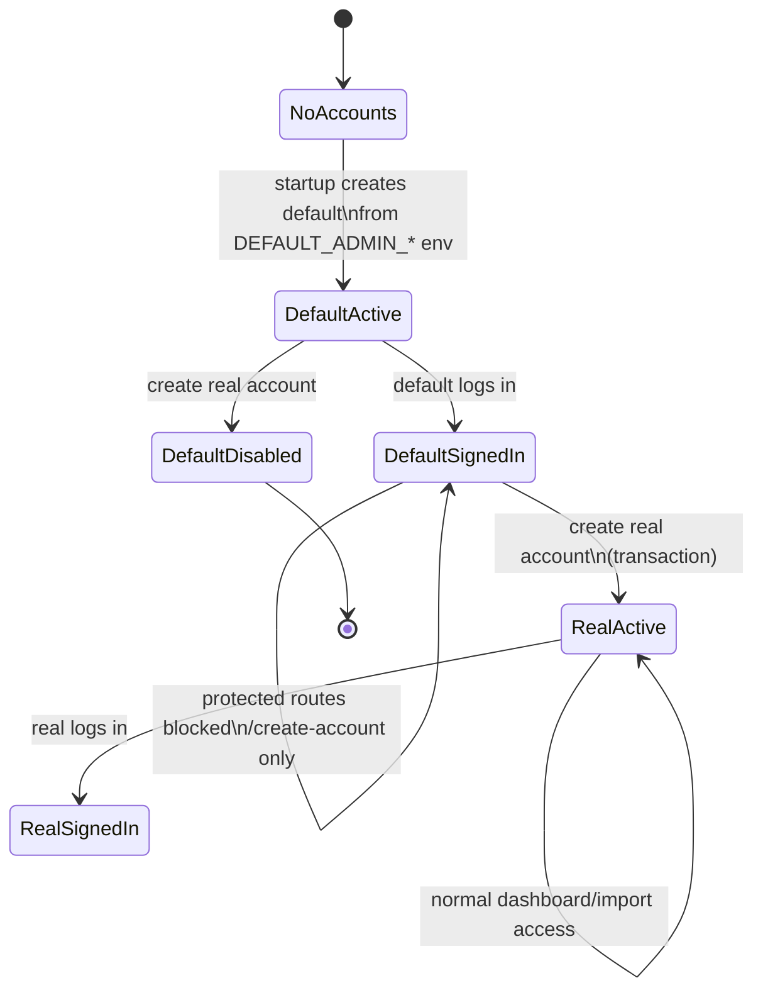
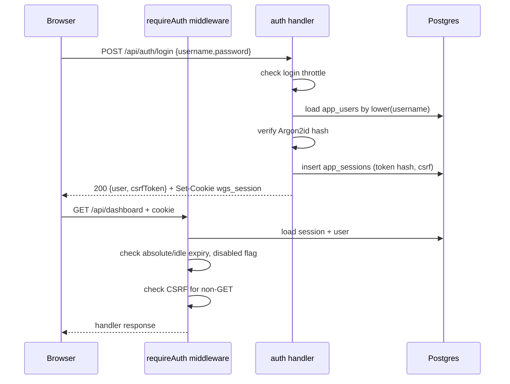

# Login system plan

## Goal

Add a first-party login system so that only a logged-in user can reach the SPA
pages and API endpoints. The site bootstraps with a default account. The first
time the default account signs in it must create a real account before it can
use the application. Creating the real account disables the default account and
signs the user in as the real account.

The protected application surface is:

| Surface | Routes |
| --- | --- |
| Pages | `/`, `/import`, `/search`, `/user`, `/common-games` |
| API | `GET /api/dashboard`, `POST /api/steamuser`, `GET /api/steamusers`, `GET /api/steamusers/search`, `GET /api/steamusers/by-ids`, `GET /api/steamusers/by-name`, `GET /api/import-jobs/{id}`, `POST /api/common-games` |

`GET /health`, the login page, the create-account page, static assets, and the
auth endpoints remain public.

## Decisions

| Topic | Decision |
| --- | --- |
| Authentication | Local username + password accounts. No passkeys, OAuth, or external identity provider. |
| Sessions | Opaque random session token in an `HttpOnly` cookie. Session rows live in Postgres. |
| Session token storage | Only a SHA-256 hash of the session token is stored. The raw token exists only in the cookie. |
| Session lifetime | 24-hour absolute expiry, 30-minute idle expiry. Idle activity slides `last_seen_at`. |
| Cookie | `wgs_session`, `Path=/`, `HttpOnly`, `SameSite=Lax`, `Secure` when `APP_ORIGIN` is HTTPS, `Max-Age=86400`. |
| CSRF | Existing POST Origin/Referer check plus an `X-CSRF-Token` header on authenticated state-changing requests. The token is stored with the session and returned by the session endpoint. |
| Password hashing | Argon2id via `golang.org/x/crypto/argon2`, PHC-encoded string, 16-byte salt, 32-byte hash, memory 19 MiB, 2 iterations, 1 thread. |
| Password policy | 12–128 characters, no composition rules. Do not trim the password. |
| Username policy | 3–64 characters, `A-Z a-z 0-9 . _ -`, must start with an alphanumeric. Case-insensitive uniqueness, stored with the entered case. |
| Default account | Created at startup from `DEFAULT_ADMIN_USERNAME` and `DEFAULT_ADMIN_PASSWORD` when no accounts exist. |
| Missing bootstrap env | Startup fails with a clear error when no accounts exist and either env var is missing. |
| Default account after real account | Row is kept and marked disabled with `disabled_at`. Its sessions are deleted. |
| Real account count | Exactly one real account. Enforced by a partial unique index. |
| Account creation | Only the signed-in default account may create the real account. The form re-enters the default password. |
| After account creation | The real account is created, the default is disabled, all default sessions are deleted, and the user is signed in as the real account. |
| Protected routes | All application pages and APIs except `/health`, `/login`, `/create-account`, static assets, and the auth endpoints. |
| Login throttling | 5 failures per username per 15 minutes and 20 failures per IP per 15 minutes. Successful login clears the username counter. |
| Migration strategy | Edit `internal/database/migrations/00001_initial_schema.sql` directly, matching the existing project convention. |

## Account lifecycle



After the real account exists:

- The default row remains in `app_users` with `is_default = true` and
  `disabled_at` set.
- Logging in as the default account returns the same generic
  “invalid username or password” response as any other failed login.
- There is no public registration route. The create-account API rejects callers
  that are not the default account and rejects a second real account.

## Request flow



## Phase 1: schema

Edit `internal/database/migrations/00001_initial_schema.sql`. Add the auth
tables before `steam_users`:

```sql
CREATE TABLE app_users (
    id BIGINT GENERATED ALWAYS AS IDENTITY PRIMARY KEY,
    username VARCHAR(64) NOT NULL,
    password_hash TEXT NOT NULL,
    is_default BOOLEAN NOT NULL DEFAULT FALSE,
    disabled_at TIMESTAMPTZ,
    last_login_at TIMESTAMPTZ,
    created_at TIMESTAMPTZ NOT NULL,
    updated_at TIMESTAMPTZ NOT NULL
);

-- Usernames are unique without regard to case.
CREATE UNIQUE INDEX app_users_username_lower ON app_users (lower(username));

-- At most one real account. The default account is excluded so both rows can
-- coexist while the real account is being created.
CREATE UNIQUE INDEX app_users_single_real
    ON app_users (is_default)
    WHERE is_default = FALSE;

CREATE TABLE app_sessions (
    token_hash BYTEA PRIMARY KEY,
    user_id BIGINT NOT NULL,
    csrf_token TEXT NOT NULL,
    created_at TIMESTAMPTZ NOT NULL,
    last_seen_at TIMESTAMPTZ NOT NULL,
    expires_at TIMESTAMPTZ NOT NULL,
    FOREIGN KEY (user_id) REFERENCES app_users(id) ON DELETE CASCADE
);

CREATE INDEX app_sessions_user_id ON app_sessions (user_id);
CREATE INDEX app_sessions_expires_at ON app_sessions (expires_at);
```

Add the matching drops at the top of the `-- +goose Down` section, after the
existing drops because `app_sessions` references `app_users`:

```sql
DROP TABLE app_sessions;
DROP TABLE app_users;
```

Because this edits the existing initial migration, any local database that has
already applied `00001` must be reset before starting the server. `dbtest`
always builds a fresh schema, so tests are unaffected. If preserving an
existing deployment becomes a requirement, move these statements into a new
`00002_auth.sql` migration instead.

## Phase 2: queries

Add `internal/database/queries/auth.sql`:

```sql
-- name: CountAppUsers :one
SELECT COUNT(*) FROM app_users;

-- name: CountRealAppUsers :one
SELECT COUNT(*) FROM app_users WHERE is_default = FALSE;

-- name: GetAppUserByID :one
SELECT * FROM app_users WHERE id = @id LIMIT 1;

-- name: GetAppUserByUsername :one
SELECT * FROM app_users
WHERE lower(username) = lower(@username)
LIMIT 1;

-- name: GetDefaultAppUserForUpdate :one
SELECT * FROM app_users
WHERE is_default = TRUE
FOR UPDATE;

-- name: CreateAppUser :one
INSERT INTO app_users (
    username,
    password_hash,
    is_default,
    created_at,
    updated_at
) VALUES (
    @username,
    @password_hash,
    @is_default,
    @now,
    @now
)
RETURNING *;

-- name: DisableAppUser :exec
UPDATE app_users SET
    disabled_at = @now,
    updated_at = @now
WHERE id = @id;

-- name: TouchAppUserLogin :exec
UPDATE app_users SET
    last_login_at = @now,
    updated_at = @now
WHERE id = @id;

-- name: CreateAppSession :exec
INSERT INTO app_sessions (
    token_hash,
    user_id,
    csrf_token,
    created_at,
    last_seen_at,
    expires_at
) VALUES (
    @token_hash,
    @user_id,
    @csrf_token,
    @created_at,
    @last_seen_at,
    @expires_at
);

-- name: GetAppSession :one
SELECT
    s.token_hash,
    s.user_id,
    s.csrf_token,
    s.created_at,
    s.last_seen_at,
    s.expires_at,
    u.username,
    u.is_default,
    u.disabled_at
FROM app_sessions s
JOIN app_users u ON u.id = s.user_id
WHERE s.token_hash = @token_hash
LIMIT 1;

-- name: TouchAppSession :exec
UPDATE app_sessions SET last_seen_at = @now
WHERE token_hash = @token_hash;

-- name: DeleteAppSession :exec
DELETE FROM app_sessions WHERE token_hash = @token_hash;

-- name: DeleteAppSessionsForUser :exec
DELETE FROM app_sessions WHERE user_id = @user_id;

-- name: DeleteExpiredAppSessions :exec
DELETE FROM app_sessions
WHERE expires_at < @now
   OR last_seen_at < @idle_cutoff;
```

Run `sqlc generate`. This creates `dbgen.AppUser`, `dbgen.AppSession`, and the
generated query methods.

## Phase 3: auth package

Add `internal/auth` with these files.

### `password.go`

Implement Argon2id hashing with a PHC-encoded result:

```text
$argon2id$v=19$m=19456,t=2,p=1$<base64 salt>$<base64 hash>
```

- `HashPassword(password string) (string, error)`
- `VerifyPassword(encoded, password string) (bool, error)`
- Validate password length before hashing and verification.
- Use `crypto/rand` for the 16-byte salt and `subtle.ConstantTimeCompare` for
  the hash comparison.
- A malformed hash returns `false`, not a panic.
- The parameters are constants, not environment variables.

Add `golang.org/x/crypto` to `go.mod`.

### `token.go`

- `NewSessionToken() (string, []byte, error)` returns a 32-byte
  `base64.RawURLEncoding` token and its SHA-256 hash.
- `HashSessionToken(token string) []byte`.
- `NewCSRFToken() (string, error)` returns a 32-byte
  `base64.RawURLEncoding` token.
- Use `crypto/rand`.

### `manager.go`

Define the auth service and its errors:

```go
const (
    SessionCookieName      = "wgs_session"
    SessionIdleTimeout     = 30 * time.Minute
    SessionAbsoluteTimeout = 24 * time.Hour
    sessionTouchInterval   = time.Minute
    minPasswordLength      = 12
    maxPasswordLength      = 128
    minUsernameLength      = 3
    maxUsernameLength      = 64
)

var (
    ErrInvalidCredentials      = errors.New("invalid credentials")
    ErrNoSession               = errors.New("no session")
    ErrAccountCreationRequired = errors.New("account creation required")
    ErrRealAccountExists       = errors.New("real account already exists")
    ErrUsernameTaken           = errors.New("username is already taken")
)

type Principal struct {
    UserID            int64
    Username          string
    IsDefault         bool
    MustCreateAccount bool
    CSRFToken         string
}

type LoginResult struct {
    Principal Principal
    Token     string
    ExpiresAt time.Time
}

type Manager struct {
    db      *sql.DB
    queries *dbgen.Queries
    logger  *logging.Logger
    now     func() time.Time
}
```

`NewManager(database *sql.DB, logger *logging.Logger) *Manager`.

#### `EnsureDefaultUser`

```go
func (manager *Manager) EnsureDefaultUser(ctx context.Context, username, password string) error
```

1. Start a transaction and take `pg_advisory_xact_lock` with a fixed key so two
   server instances cannot create the default account concurrently.
2. Count `app_users`. If any row exists, do nothing and commit. Never overwrite
   or recreate the default account.
3. Validate the env username and password. If either is missing, return:
   `no accounts exist; set DEFAULT_ADMIN_USERNAME and DEFAULT_ADMIN_PASSWORD`.
4. Hash the password and insert the row with `is_default = true`.
5. Commit and log `auth_default_user_created`.

The default password is used only at bootstrap. Changing the env var later does
not reset the existing account.

#### `Login`

```go
func (manager *Manager) Login(ctx context.Context, username, password string) (LoginResult, error)
```

1. Trim the username; leave the password untouched.
2. Load the user by lowercased username.
3. If the user is missing, run a dummy Argon2id verification against a fixed
   valid hash and return `ErrInvalidCredentials`.
4. If `disabled_at` is set, return `ErrInvalidCredentials`.
5. If the user is the default account and `CountRealAppUsers > 0`, return
   `ErrInvalidCredentials`. This is a safety net in case a previous account
   creation transaction was interrupted.
6. Verify the password. On failure return `ErrInvalidCredentials`.
7. Create a session and update `last_login_at`.
8. Return the principal, raw token, CSRF token, and absolute expiry.

#### `ResolveSession`

```go
func (manager *Manager) ResolveSession(ctx context.Context, token string) (Principal, error)
```

1. Hash the token and load the joined session/user row.
2. Missing row: `ErrNoSession`.
3. Disabled user: delete the session and return `ErrNoSession`.
4. Default user when a real account exists: delete the session and return
   `ErrNoSession`.
5. Absolute expiry passed, or `now >= last_seen_at + SessionIdleTimeout`:
   delete the session and return `ErrNoSession`.
6. If `now - last_seen_at >= sessionTouchInterval`, update `last_seen_at`.
7. Return a `Principal` with `MustCreateAccount = IsDefault` and the session's
   CSRF token.

#### `CreateRealAccount`

```go
func (manager *Manager) CreateRealAccount(
    ctx context.Context,
    current Principal,
    defaultPassword string,
    username string,
    password string,
) (LoginResult, error)
```

1. Reject if `!current.IsDefault` with `ErrAccountCreationRequired`.
2. Begin a transaction.
3. `GetDefaultAppUserForUpdate` and confirm it is still the current user, is
   the default account, and is not disabled.
4. Verify `defaultPassword` against the default account's stored hash. A
   mismatch returns `ErrInvalidCredentials`.
5. Check `CountRealAppUsers` inside the transaction. If non-zero, return
   `ErrRealAccountExists`.
6. Validate the new username and password.
7. Insert the real account. The partial unique index is the final race guard;
   map a unique violation to `ErrRealAccountExists` or `ErrUsernameTaken`.
8. Set `disabled_at` on the default account.
9. Delete all sessions for the default account.
10. Create a session for the real account.
11. Commit and return the new `LoginResult`.

The transaction guarantees that the default account is never disabled without
a real account, and that the caller is signed in as the real account
immediately.

#### `Logout`

```go
func (manager *Manager) Logout(ctx context.Context, token string) error
```

Hash the token, delete the session row, and ignore a missing row.

#### `PruneExpiredSessions`

```go
func (manager *Manager) PruneExpiredSessions(ctx context.Context) error
```

Call `DeleteExpiredAppSessions` with `now` and
`now - SessionIdleTimeout`. Run once at startup and best-effort on login.

## Phase 4: middleware and routing

### `internal/httpserver/auth.go`

Add `requireAuth` and a narrow interface so tests can stub it:

```go
type SessionResolver interface {
    ResolveSession(ctx context.Context, token string) (auth.Principal, error)
}
```

Public request predicate:

```go
func isPublicRequest(request *http.Request) bool {
    path := request.URL.Path
    switch {
    case request.Method == http.MethodGet && path == "/health":
        return true
    case request.Method == http.MethodGet && (path == "/login" || path == "/create-account"):
        return true
    case request.Method == http.MethodGet && (path == "/styles.css" || path == "/app.js" || path == "/favicon.ico"):
        return true
    case request.Method == http.MethodPost && path == "/api/auth/login":
        return true
    case request.Method == http.MethodGet && path == "/api/auth/session":
        return true
    case request.Method == http.MethodPost && path == "/api/auth/logout":
        return true
    default:
        return false
    }
}
```

Protected request behavior:

1. Read the `wgs_session` cookie. If missing, reject.
2. Resolve the session. If invalid, reject.
3. If `principal.MustCreateAccount` and the request is not
   `GET /create-account` or `POST /api/auth/account`, reject with
   account-creation-required.
4. For methods other than `GET`, `HEAD`, and `OPTIONS`, require
   `X-CSRF-Token` to match `principal.CSRFToken` with a constant-time compare.
   A missing or wrong token returns `403`.
5. Put the principal in the request context with
   `auth.WithPrincipal` / `auth.PrincipalFromContext`.

Rejections:

| Request kind | Response |
| --- | --- |
| API (`/api` or `/api/...`) | `401 {"error":"authentication required"}` |
| HTML page | `302 Location: /login?next=<url-encoded request URI>` |
| API while default must create account | `403 {"error":"account creation required"}` |
| HTML while default must create account | `302 Location: /create-account` |
| Missing/wrong CSRF | `403 {"error":"invalid CSRF token"}` |

Add `Cache-Control: no-store` to auth responses and protected API responses.

### `internal/httpserver/app.go`

Register the auth routes on `dynamicMux`:

```go
dynamicMux.HandleFunc("POST /api/auth/login", apiHandler.Login)
dynamicMux.HandleFunc("POST /api/auth/logout", apiHandler.Logout)
dynamicMux.HandleFunc("GET /api/auth/session", apiHandler.Session)
dynamicMux.HandleFunc("POST /api/auth/account", apiHandler.CreateAccount)
```

Add the auth service to `Options`:

```go
type Options struct {
    AppOrigin        string
    PublicDirectory  string
    TrustedProxyHops int
    SteamApiKey      string
    SteamClient      *steamapi.Client
    Importer         *importer.Importer
    Auth             api.AuthService
    Sessions         SessionResolver
}
```

Wrap the dynamic handler so every request is still load-shed, rate-limited, and
origin-checked before auth runs:

```go
dynamicHandler := applyMiddleware(
    dynamicMux,
    LoadShedder(MaxInFlight, RetryAfterSeconds),
    fixedWindowRateLimiter(rateLimitSettings),
    validateRequestOrigin(options.AppOrigin),
    requireAuth(options.Sessions, logger),
)
```

`GET /health` stays on `mainMux` and remains public. The SPA fallback already
serves `index.html` for extensionless paths, so `/login` and `/create-account`
work without a new file.

### `internal/api` handler wiring

Add an `AuthService` interface in `internal/api`:

```go
type AuthService interface {
    Login(ctx context.Context, username, password string) (auth.LoginResult, error)
    Logout(ctx context.Context, token string) error
    ResolveSession(ctx context.Context, token string) (auth.Principal, error)
    CreateRealAccount(ctx context.Context, current auth.Principal, defaultPassword, username, password string) (auth.LoginResult, error)
}
```

Add fields to `api.Handler`:

```go
auth         AuthService
cookieSecure bool
loginLimiter *LoginThrottle
```

Update `api.NewHandler` to accept the auth service, `cookieSecure`, and the
login limiter. `httpserver.New` passes
`strings.HasPrefix(options.AppOrigin, "https://")` as `cookieSecure`.

`internal/api/handler_test.go` uses a stub `AuthService`; auth handler tests use
the real `auth.Manager` with `dbtest.Open(t)`.

## Phase 5: auth endpoints

Add `internal/api/auth_handler.go`.

### Cookie helpers

```go
func setSessionCookie(w http.ResponseWriter, token string, expiresAt time.Time, secure bool) {
    http.SetCookie(w, &http.Cookie{
        Name:     auth.SessionCookieName,
        Value:    token,
        Path:     "/",
        HttpOnly: true,
        Secure:   secure,
        SameSite: http.SameSiteLaxMode,
        Expires:  expiresAt,
        MaxAge:   int(auth.SessionAbsoluteTimeout.Seconds()),
    })
}

func clearSessionCookie(w http.ResponseWriter, secure bool) {
    http.SetCookie(w, &http.Cookie{
        Name:     auth.SessionCookieName,
        Value:    "",
        Path:     "/",
        HttpOnly: true,
        Secure:   secure,
        SameSite: http.SameSiteLaxMode,
        MaxAge:   -1,
        Expires:  time.Unix(1, 0),
    })
}
```

### `POST /api/auth/login`

Request:

```json
{ "username": "admin", "password": "..." }
```

- Limit the body to 4 KiB.
- Trim the username; do not trim the password.
- Check the login throttle before verifying credentials.
- On `ErrInvalidCredentials`, record a throttle failure and return
  `401 {"error":"invalid username or password"}`.
- On success, record a throttle success, delete any session referenced by the
  old cookie (session fixation), set the new cookie, and return:

```json
{
  "user": { "id": 1, "username": "admin", "isDefault": true },
  "csrfToken": "...",
  "mustCreateAccount": true
}
```

- Return `429` with `Retry-After` when throttled.
- Database failures use `handler.internalError`.

### `GET /api/auth/session`

This endpoint is public and always returns `200`:

```json
{ "authenticated": false }
```

or:

```json
{
  "authenticated": true,
  "user": { "id": 2, "username": "colin", "isDefault": false },
  "csrfToken": "...",
  "mustCreateAccount": false
}
```

It resolves the cookie directly, not through the middleware. An invalid or
expired session returns the unauthenticated shape rather than `401`.

### `POST /api/auth/account`

Protected; the default account plus a valid CSRF token is required.

Request:

```json
{
  "defaultPassword": "...",
  "username": "colin",
  "password": "..."
}
```

- Decode and validate the fields.
- Call `CreateRealAccount` with the principal from the request context.
- On success, set the new session cookie and return `201` with the same shape
  as login, where `isDefault` is false and `mustCreateAccount` is false.
- Errors:
  - `403 {"error":"default password is incorrect"}` for a re-auth mismatch.
  - `403 {"error":"account creation required"}` when the caller is not the
    default account.
  - `409 {"error":"a real account already exists"}` when one exists.
  - `409 {"error":"username is already taken"}` for a duplicate username.
  - `400` for an invalid username or password.

### `POST /api/auth/logout`

Public and idempotent. Resolve the cookie if present, delete the session, clear
the cookie, and return `204`. A missing or already-expired session still
returns `204` and clears the cookie.

## Phase 6: login throttle

Add `internal/api/login_throttle.go`:

```go
const (
    loginUserLimit = 5
    loginIPLimit   = 20
    loginWindow    = 15 * time.Minute
)
```

`LoginThrottle` is an in-memory, mutex-protected map with two key spaces:

- `user:<lowercase username>`
- `ip:<client IP>`

Use `clientIPKeyWithTrustedProxies` for the IP. The API handler does not have
access to that helper today, so move the client-IP helpers into a small shared
package (for example `internal/httpx` or a new `internal/clientip`) or pass the
request's resolved IP into the handler. Prefer moving the helper to a shared
package rather than duplicating the trusted-proxy logic.

Methods:

```go
func (throttle *LoginThrottle) Check(ip, username string) (retryAfter time.Duration, blocked bool)
func (throttle *LoginThrottle) RecordFailure(ip, username string)
func (throttle *LoginThrottle) RecordSuccess(username string)
```

- `Check` returns blocked when either key is at its limit and the window has not
  expired.
- `RecordFailure` increments both keys and resets expired windows.
- `RecordSuccess` clears the username key only, so an attacker cannot reset an
  IP limit by knowing one valid password.
- Sweep expired entries opportunistically.
- The throttle is per-process and resets on restart. This is acceptable for a
  single-instance deployment; a shared store can replace it later.

## Phase 7: configuration and startup

### `internal/config/config.go`

Add optional fields:

```go
DefaultAdminUsername string
DefaultAdminPassword string
```

Parse them with `valueOrDefault(environment, "DEFAULT_ADMIN_USERNAME", "")` and
`valueOrDefault(environment, "DEFAULT_ADMIN_PASSWORD", "")`. Do not require
them in `config.Parse`; the requirement depends on whether the database already
has accounts. `EnsureDefaultUser` fails startup when bootstrap is needed and
either value is missing.

Session timeouts stay code constants. The cookie `Secure` flag is derived from
`APP_ORIGIN`.

### `cmd/server/main.go`

After migrations and logger setup:

```go
authManager := auth.NewManager(databaseConnection, appLogger)
if err := authManager.EnsureDefaultUser(
    ctx,
    appConfig.DefaultAdminUsername,
    appConfig.DefaultAdminPassword,
); err != nil {
    return fmt.Errorf("bootstrap default account: %w", err)
}
if err := authManager.PruneExpiredSessions(ctx); err != nil {
    _ = appLogger.Event("auth_session_prune_failed", map[string]any{"error": err.Error()})
}
```

Pass it to the HTTP server:

```go
application, err := httpserver.New(databaseConnection, appLogger, httpserver.Options{
    // existing options...
    Auth:     authManager,
    Sessions: authManager,
})
```

### `README.md`

Document:

```sh
# Used only when the database has no accounts yet.
DEFAULT_ADMIN_USERNAME=admin
DEFAULT_ADMIN_PASSWORD=change-this-before-first-login
```

Explain the first-login flow, that the default account is disabled after the
real account is created, that changing the env vars later does not reset the
account, and that there is no password recovery.

### `.env`

Add the two variables to the local `.env` file. Do not commit `.env` (it is
already ignored).

## Phase 8: frontend

### `web/public/index.html`

Add the auth views and header state.

Header:

```html
<header class="site-header">
    <a class="brand" href="/" data-route="/">Steam Decision Engine</a>
    <nav id="site-nav" class="site-nav" aria-label="Main">
        <!-- existing links -->
    </nav>
    <div class="auth-status">
        <span id="auth-username"></span>
        <button id="logout-button" type="button" class="button--secondary" hidden>
            Sign out
        </button>
    </div>
</header>
```

Login view:

```html
<section id="view-login" data-view="/login" hidden>
    <div class="card auth-card">
        <header class="card__header">
            <p class="eyebrow">Sign in</p>
            <h1 tabindex="-1">Sign in to Steam Decision Engine</h1>
        </header>

        <form id="login-form" class="lookup auth-form" novalidate>
            <label for="login-username">Username</label>
            <input id="login-username" name="username" type="text"
                   autocomplete="username" spellcheck="false" required />

            <label for="login-password">Password</label>
            <input id="login-password" name="password" type="password"
                   autocomplete="current-password" required />

            <button id="login-button" type="submit">Sign in</button>
        </form>

        <p id="login-status" class="status" role="status" aria-live="polite"></p>
    </div>
</section>
```

Create-account view:

```html
<section id="view-create-account" data-view="/create-account" hidden>
    <div class="card auth-card">
        <header class="card__header">
            <p class="eyebrow">First-time setup</p>
            <h1 tabindex="-1">Create your real account</h1>
            <p class="lede">
                The default account is temporary. Creating a real account
                disables the default account immediately.
            </p>
        </header>

        <form id="create-account-form" class="lookup auth-form" novalidate>
            <label for="create-username">New username</label>
            <input id="create-username" name="username" type="text"
                   autocomplete="username" spellcheck="false" required />

            <label for="create-password">New password</label>
            <input id="create-password" name="password" type="password"
                   autocomplete="new-password" required />

            <label for="create-password-confirm">Confirm new password</label>
            <input id="create-password-confirm" name="confirmPassword"
                   type="password" autocomplete="new-password" required />

            <label for="create-default-password">Current default password</label>
            <input id="create-default-password" name="defaultPassword"
                   type="password" autocomplete="current-password" required />

            <button id="create-account-button" type="submit">
                Create account
            </button>
        </form>

        <p id="create-account-status" class="status" role="status"
           aria-live="polite"></p>
    </div>
</section>
```

### `web/public/app.js`

Add auth state and bootstrap:

```js
const authState = {
    loaded: false,
    authenticated: false,
    user: null,
    csrfToken: null,
    mustCreateAccount: false,
};
```

- Add `/login` and `/create-account` to `ROUTES` and `ROUTE_TITLES`.
- Replace the unconditional `renderRoute()` at the bottom with an async
  `bootstrap()` that calls `refreshSession()`, updates the header, and then
  calls `renderRoute()`.
- `refreshSession()` calls `GET /api/auth/session` with
  `credentials: "same-origin"` and populates `authState`.
- `updateAuthChrome()`:
  - Shows the username and Sign out button when authenticated.
  - Hides the main nav on `/login` and `/create-account`.
  - Shows a `Setup required` label for the default account.
- `renderRoute()` gains an auth guard before showing a view:

```js
function authRedirectFor(routePath) {
    if (!authState.authenticated) {
        if (routePath === "/login") {
            return null;
        }
        return `/login?next=${encodeURIComponent(currentHref)}`;
    }
    if (authState.mustCreateAccount) {
        return routePath === "/create-account" ? null : "/create-account";
    }
    if (routePath === "/login" || routePath === "/create-account") {
        return "/";
    }
    return null;
}
```

If a redirect is needed, use `history.replaceState` and re-run the route
resolution so the correct view is shown.

#### API wrapper

Add `apiFetch` and replace the existing `fetch(` calls for data endpoints:

```js
async function apiFetch(url, options = {}) {
    const headers = new Headers(options.headers || {});
    const method = (options.method || "GET").toUpperCase();
    if (!["GET", "HEAD", "OPTIONS"].includes(method) && authState.csrfToken) {
        headers.set("X-CSRF-Token", authState.csrfToken);
    }

    const response = await fetch(url, {
        ...options,
        headers,
        credentials: "same-origin",
    });

    if (response.status === 401) {
        authState.authenticated = false;
        authState.user = null;
        authState.csrfToken = null;
        const next = encodeURIComponent(location.pathname + location.search);
        history.replaceState({}, "", `/login?next=${next}`);
        renderRoute();
        throw new Error("Authentication required.");
    }

    if (response.status === 403) {
        const body = await response.clone().json().catch(() => null);
        if (body?.error === "account creation required") {
            history.replaceState({}, "", "/create-account");
            renderRoute();
            throw new Error(body.error);
        }
    }

    return response;
}
```

Keep the login and session calls on plain `fetch` so a `401` can be displayed
as an inline form error instead of triggering a redirect. All dashboard,
import, search, view-user, and common-games requests use `apiFetch`.

#### Login

- On submit, trim the username, require both fields, disable the button, and
  POST JSON to `/api/auth/login`.
- `200`: copy the response into `authState`, update the header, and
  `history.replaceState` to:
  - `/create-account` when `mustCreateAccount` is true.
  - the validated `next` parameter when present.
  - `/` otherwise.
- `401`: show `Invalid username or password.`
- `429`: show `Too many attempts. Try again shortly.`
- Network/other errors: show the generic error message.
- `next` must start with `/` and must not start with `//`; otherwise use `/`.

#### Create account

- Validate that the two new passwords match before sending.
- POST to `/api/auth/account` with `defaultPassword`, `username`, and
  `password` via `apiFetch`.
- `201`: copy the response into `authState`, replace the URL with `/`, and
  render the dashboard.
- `400`/`403`/`409`: show the returned error.
- The form is only reachable when `authState.mustCreateAccount` is true.

#### Logout

- `POST /api/auth/logout` via `apiFetch`.
- On success, clear `authState`, replace the URL with `/login`, and render.
- If the request fails because the session already expired, still clear the
  client state and show the login page.

#### Polling and abort behavior

The existing abort/token patterns stay. A `401` from `apiFetch` throws, so the
existing `catch` blocks stop the current operation. The route change to
`/login` also runs the current page's `leave` lifecycle and aborts in-flight
requests.

### `web/public/styles.css`

Add styles using the existing variables:

- `.auth-card` with a narrower max width.
- `.auth-form` with stacked labels and full-width inputs.
- `.auth-status` in the header, right-aligned and wrapping on small screens.
- Error/status states reuse the existing `.status[data-state="error"]` rules.
- Hide the nav when the auth page is active, or let the existing header layout
  wrap cleanly on mobile.
- Keep the existing focus styles and accessible contrast.

## Phase 9: tests

### `internal/auth/password_test.go`

- Hash and verify the same password.
- Reject a wrong password.
- Reject a malformed encoded hash.
- Two hashes of the same password differ (random salt).
- Reject passwords shorter than 12 and longer than 128 characters.
- Reject blank/whitespace-only passwords.

### `internal/auth/manager_test.go`

Use `dbtest.Open(t)` and a fake clock where useful:

- `EnsureDefaultUser` creates exactly one default account.
- Calling it again does not overwrite the password or create another row.
- It does nothing when a real account already exists.
- It returns a clear error when no accounts exist and the env values are
  missing.
- `Login` succeeds for the default account and returns `MustCreateAccount`.
- `Login` fails with the generic error for a bad password, a disabled account,
  and a default account when a real account exists.
- `ResolveSession` returns a principal for a valid session.
- Expired absolute sessions and idle-expired sessions are rejected and deleted.
- `ResolveSession` rejects a disabled user and deletes the session.
- `Logout` deletes the session and is idempotent.
- `CreateRealAccount`:
  - Creates the real account, disables the default, deletes default sessions,
    and returns a session for the real account.
  - Rejects a wrong default password.
  - Rejects a non-default caller.
  - Rejects a second real account.
  - Rejects a duplicate username, case-insensitively.
  - Rolls back everything if the insert fails.
- `PruneExpiredSessions` deletes only expired/idle rows.

### `internal/api/auth_handler_test.go`

Use the real `auth.Manager` with `dbtest.Open(t)` and a test mux that registers
the auth routes:

- Login returns `200`, sets `wgs_session`, and returns a CSRF token.
- Invalid credentials return `401` with the generic message.
- A disabled default account returns `401`.
- Five failures for the same username return `429` with `Retry-After`.
- Session endpoint returns `{"authenticated":false}` without a cookie and the
  user/CSRF shape with a valid cookie.
- Account creation returns `201`, sets a new cookie, and disables the default.
- Account creation rejects a wrong default password, a non-default caller, a
  second real account, and a duplicate username.
- Logout returns `204`, deletes the session, and clears the cookie.
- No response body ever contains a password hash or raw session token.

### `internal/httpserver/auth_test.go`

Use a fake `SessionResolver`:

- Public paths pass without a session: `/health`, `/login`, `/create-account`,
  `/styles.css`, `/app.js`, `GET /api/auth/session`,
  `POST /api/auth/login`, `POST /api/auth/logout`.
- An anonymous HTML request to `/` redirects to
  `/login?next=%2F` with `302`.
- An anonymous API request to `/api/dashboard` returns `401` JSON.
- A real-user session reaches `/` and `/api/dashboard`.
- A default-user session is redirected to `/create-account` for HTML and
  returns `403` for APIs.
- A default-user session may reach `GET /create-account` and
  `POST /api/auth/account`.
- A missing or wrong `X-CSRF-Token` on a protected POST returns `403`.
- A valid CSRF token on a protected POST reaches the handler.
- A disabled or expired session is rejected.

### `internal/httpserver/app_test.go`

Update the existing static/SPA tests:

- `/styles.css` and `/app.js` remain `200` without a session.
- `/` without a session is `302` to `/login`.
- `/login` and `/create-account` serve the SPA shell without a session.
- `/api/does-not-exist` still returns `404` after authentication, or `401`
  before authentication; assert the chosen behavior explicitly.
- Existing SPA route tests that need `200` must attach a valid session cookie
  or use the fake resolver.

### `internal/api/handler_test.go`

- Update `newHandlerEnv` for the new `NewHandler` signature.
- Keep existing non-auth handler tests direct; they bypass the auth middleware.
- Add a stub `AuthService` so the handler can be constructed without a real
  auth manager.

### Verification commands

```sh
sqlc generate
gofmt -l internal cmd
go build ./...
go vet ./...
TEST_DATABASE_URL=postgres://... go test ./...
TEST_DATABASE_URL=postgres://... go test -race ./internal/auth/ ./internal/api/ ./internal/httpserver/
```

## Phase 10: manual verification

1. Reset the local database, set `DEFAULT_ADMIN_USERNAME` and
   `DEFAULT_ADMIN_PASSWORD`, and start the server.
2. Open `/` in a fresh browser. Confirm the redirect to `/login?next=%2F`.
3. Try `/api/dashboard` directly. Confirm `401` JSON.
4. Sign in with the default account. Confirm the forced redirect to
   `/create-account`; confirm `/` and `/api/dashboard` remain blocked.
5. Submit the create-account form with the wrong default password. Confirm it
   is rejected and the default account is still usable.
6. Submit valid values. Confirm the user is signed in as the real account,
   lands on `/`, and the dashboard loads.
7. Confirm the default account is now disabled:
   - Sign out.
   - Try the default username/password. Confirm the generic invalid-credentials
     message.
8. Sign in as the real account and confirm:
   - Dashboard loads.
   - Importing a Steam user works.
   - `GET /api/import-jobs/{id}` works.
   - Search, View User, and Common Games work.
9. Sign out. Confirm the cookie is cleared and `/` redirects to login.
10. Open DevTools and confirm the cookie is `HttpOnly`, `SameSite=Lax`, and
    `Secure` when using HTTPS.
11. Confirm a POST without `X-CSRF-Token` returns `403` while authenticated.
12. Restart the server and confirm the real account and its session still work
    until the 24-hour absolute expiry.
13. Leave a session idle for more than 30 minutes and confirm it is rejected.

## Files touched

| File | Change |
| --- | --- |
| `internal/database/migrations/00001_initial_schema.sql` | Add `app_users` and `app_sessions` tables, indexes, and drops. |
| `internal/database/queries/auth.sql` | New account and session queries. |
| `internal/database/dbgen/*` | Regenerated by `sqlc generate`. |
| `internal/auth/password.go` | Argon2id hashing and verification. |
| `internal/auth/token.go` | Session and CSRF token helpers. |
| `internal/auth/manager.go` | Bootstrap, login, session resolution, account creation, logout, pruning. |
| `internal/auth/*_test.go` | Password and manager tests. |
| `internal/api/auth_handler.go` | Login, logout, session, and create-account handlers. |
| `internal/api/login_throttle.go` | Per-IP and per-username failure throttle. |
| `internal/api/handler.go` | Add auth fields and update the constructor. |
| `internal/api/import_handler.go` | Remove the login TODO. |
| `internal/httpserver/auth.go` | `requireAuth` middleware and public-route predicate. |
| `internal/httpserver/app.go` | Register auth routes, wire the auth service, apply middleware. |
| `internal/httpserver/middleware.go` | Share the client-IP helper if needed. |
| `internal/config/config.go` | Add optional default-admin env fields. |
| `cmd/server/main.go` | Construct the auth manager, bootstrap, prune, and pass it to the server. |
| `internal/logging/logger.go` | Redact password/session/CSRF fields. |
| `web/public/index.html` | Login and create-account views, header auth area. |
| `web/public/app.js` | Session bootstrap, route guards, login/create-account/logout, `apiFetch`. |
| `web/public/styles.css` | Auth card, form, header, and status styles. |
| `README.md` | Document the env vars and first-login flow. |
| `.env` | Add local default-admin values. |

## Out of scope

- Password reset, password change, email verification, or account recovery.
- More than one real account.
- Roles, permissions, admin/user separation, or account management UI.
- Passkeys, WebAuthn, OAuth, SSO, or an external identity provider.
- “Remember me”, session management UI, or device lists.
- Account deletion or disabling a real account from the UI.
- Database-backed or distributed login lockout. The throttle is per-process.
- API tokens for non-browser clients.
- Auditing UI. Auth events are written to the existing application log.
- Changing the Steam user/import data model.

## Notes and trade-offs

- **Editing `00001` requires a reset.** Existing databases that already applied
  the initial migration will not get the auth tables automatically. This is the
  project's current convention, but it is the main operational risk in this
  plan. If the app is already deployed, use a new migration instead.
- **One real account is enforced in the database.** The partial unique index
  prevents a race between two account-creation requests. Adding multiple users
  later requires a migration and a role model.
- **The default password is bootstrap-only.** It is hashed into the default row
  and is never read again. Rotating the env var after the first startup has no
  effect.
- **No recovery path.** If the real account password is lost, the app cannot be
  accessed without manually changing the database. Document this clearly.
- **Argon2id cost.** 19 MiB per verification is intentionally modest. The login
  throttle and the global load shedder bound concurrent work. Tune the
  parameters if login latency or memory use becomes a problem.
- **Session revocation is immediate.** Because sessions are database rows,
  logout, disabling the default account, and deleting a user all take effect on
  the next request.
- **CSRF token storage.** Session tokens are stored only as hashes. The CSRF
  token is stored in the session row because the session endpoint must return
  it after a page reload. It is not sufficient on its own without the
  `HttpOnly` session cookie.
- **In-memory throttle.** Restarting the server clears counters, and multiple
  instances do not share them. This is acceptable for the current
  single-instance deployment.
- **Cookie `Secure` depends on `APP_ORIGIN`.** Local HTTP development works;
  production must set `APP_ORIGIN` to the HTTPS origin so the cookie is marked
  `Secure`.
- **The SPA shell is public for `/login` and `/create-account`.** These pages
  contain no application data. The APIs behind them still enforce the session
  and default-account rules.
- **Static assets remain public.** `/styles.css` and `/app.js` are not secrets.
  Every data-bearing route is protected.
