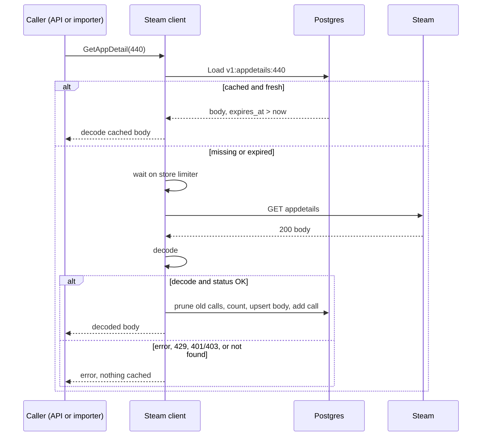

# Steam API response cache plan

## Goal

Cache every live Steam API response in Postgres so a repeated call for the same
resource is served from the database instead of Steam. Each normalized resource
key has its own freshness window:

- It starts at **24 hours**.
- It shrinks after each successful fetch using a **logistic S-curve**.
- It floors at **1 hour** after **90** successful fetches.
- Only successful fetches in the last **30 days** count.

The cache is best-effort: a cache read or write failure never fails the Steam
call. The importer's per-app `apps.updated_at` freshness check is replaced by
the cache. `STEAM_REFRESH_INTERVAL` still controls how often a new import job is
created.



## Decisions

| Topic | Decision |
| --- | --- |
| Maximum TTL | 24 hours. |
| Minimum TTL | 1 hour. |
| Algorithm | Logistic S-curve with midpoint 45, steepness 10, normalized so call 0 is 24h and call 90 is 1h. |
| Call history | 30-day sliding window. Events older than 30 days are ignored and pruned. |
| Count trigger | One count per successful cache miss that produced a decodable `200` response. Cache hits, 429s, other non-200s, private wishlists, and app-not-found responses do not count. |
| Scope | All live Steam calls: app details, owned games, wishlist, vanity resolution, user groups, and friend list. |
| Cache key | Normalized resource key such as `v1:appdetails:440`, `v1:owned_games:<steamid>`, `v1:wishlist:<steamid>`, `v1:vanity:<slug>`. The API key and query parameter order are excluded. |
| Stored value | The raw response body as `BYTEA`, so decoding stays in the existing per-endpoint code. |
| Importer freshness | The cache replaces the per-app `apps.updated_at` check. The 7-day job refresh interval remains. |
| Cache failures | Best effort. Log load/record failures, then continue with the Steam request or return the decoded response. |
| Negative results | HTTP errors, 429s, private wishlists, and app-not-found are not cached or counted. A `200` vanity no-match is a valid response and is cached. |
| Rate limiter | Move the importer's store limiter into the Steam client. Only actual Steam requests wait; cache hits return immediately. |
| Old in-memory cache | Delete `internal/steamapi/steam_cache.go` and `STEAM_API_CACHE_INTERVAL`; replace them with the database cache. |
| Cache key version | Prefix keys with `v1:`. Bump the prefix if the cached response format becomes incompatible. |
| Cleanup | Prune the current key's old call events on every record. Prune expired rows once at startup. |
| Concurrency | No single-flight. The importer has one worker; a rare concurrent duplicate fetch only records an extra call, which shortens the TTL slightly. |

## Algorithm

For `n` successful fetches in the sliding window:

```text
L(n)   = 1 / (1 + exp((n - 45) / 10))
TTL(n) = clamp(1 + 23 * (L(n) - L(90)) / (L(0) - L(90)), 1, 24) hours
```

`n <= 0` returns 24 hours. Values at or above 90 are clamped to 1 hour. The
result is rounded to the nearest second.

| Successful calls | TTL |
| ---: | ---: |
| 1 | 23h 58m 23s |
| 10 | 23h 34m 09s |
| 50 | 9h 37m 13s |
| 90 | 1h 00m 00s |

The curve barely moves for the first few calls, drops through the middle, and
flattens at the minimum. It is monotonic: more calls never increase the TTL.

```go
const (
    CacheMaxTTL      = 24 * time.Hour
    CacheMinTTL      = time.Hour
    CacheWindow      = 30 * 24 * time.Hour
    CacheCurveMid    = 45.0
    CacheCurveWidth  = 10.0
    CacheCurveTarget = 90
)

// CacheTTL returns the lifetime for a cached response after the given number
// of successful fetches in the sliding window. A non-positive count returns
// the maximum.
func CacheTTL(calls int) time.Duration {
    if calls <= 0 {
        return CacheMaxTTL
    }
    logistic := func(n float64) float64 {
        return 1 / (1 + math.Exp((n-CacheCurveMid)/CacheCurveWidth))
    }
    low := logistic(CacheCurveTarget)
    high := logistic(0)
    minHours := CacheMinTTL.Hours()
    maxHours := CacheMaxTTL.Hours()
    hours := minHours + (maxHours-minHours)*(logistic(float64(calls))-low)/(high-low)
    if hours < minHours {
        hours = minHours
    }
    if hours > maxHours {
        hours = maxHours
    }
    return time.Duration(math.Round(hours*3600)) * time.Second
}
```

The constants are code constants, not environment variables. The old
`STEAM_API_CACHE_INTERVAL` was a five-second in-memory reap interval and does
not map to this design, so remove it.

### Algorithms considered

All candidates start at 24 hours, floor at 1 hour, and reach the floor at 90
calls. The table shows the TTL after the given number of successful calls.

| Algorithm | 1 call | 10 calls | 50 calls | 90 calls |
| --- | ---: | ---: | ---: | ---: |
| **Logistic S-curve (selected)** | 23h 58m | 23h 34m | 9h 37m | 1h |
| Linear | 23h 45m | 21h 27m | 11h 13m | 1h |
| Geometric | 23h 10m | 16h 52m | 4h 06m | 1h |
| Normalized exponential | 22h 50m | 14h 41m | 2h 33m | 1h |
| Hyperbolic | 19h 07m | 6h 45m | 1h 45m | 1h |

The logistic curve was selected because it barely changes for infrequent calls,
drops through the middle of the range, and flattens at the minimum. Linear is
too flat for most of the range. Geometric and normalized exponential drop
noticeably by call 10. Hyperbolic is too aggressive for infrequently used
resources.

## Phase 0: schema and queries

The project edits `00001_initial_schema.sql` directly. After the change, reset
the local development database or apply the migration to a fresh schema. Tests
use `internal/database/dbtest`, which starts from a fresh schema.

### `steam_api_cache` and `steam_api_cache_calls`

Add both tables before `import_jobs`:

```sql
-- One row per normalized Steam resource. response_body is the raw HTTP body.
CREATE TABLE steam_api_cache (
    cache_key TEXT PRIMARY KEY,
    response_body BYTEA NOT NULL,
    fetched_at TIMESTAMPTZ NOT NULL,
    expires_at TIMESTAMPTZ NOT NULL,
    call_count INT NOT NULL,
    created_at TIMESTAMPTZ NOT NULL,
    updated_at TIMESTAMPTZ NOT NULL
);
CREATE INDEX steam_api_cache_expires_at ON steam_api_cache (expires_at);

-- One row per successful cache miss. Old rows are pruned per key on write and
-- globally at startup.
CREATE TABLE steam_api_cache_calls (
    id BIGINT GENERATED ALWAYS AS IDENTITY PRIMARY KEY,
    cache_key TEXT NOT NULL,
    fetched_at TIMESTAMPTZ NOT NULL,
    FOREIGN KEY (cache_key) REFERENCES steam_api_cache(cache_key) ON DELETE CASCADE
);
CREATE INDEX steam_api_cache_calls_key_fetched_at
    ON steam_api_cache_calls (cache_key, fetched_at);
```

`call_count` is informational: it is the number of calls in the window that
were used to compute `expires_at`. The authoritative count is the call-event
table.

### `-- +goose Down`

Drop the call table before the cache table:

```sql
DROP TABLE steam_api_cache_calls;
DROP TABLE steam_api_cache;
```

Add these lines anywhere in the `-- +goose Down` section, with the call table
first. They have no dependency on `steam_users` or `app_alias`.

### `queries/steam_api_cache.sql` (new)

```sql
-- name: GetSteamAPICache :one
SELECT response_body, expires_at > @now::timestamptz AS fresh
FROM steam_api_cache
WHERE cache_key = @cache_key
LIMIT 1;

-- name: UpsertSteamAPICache :one
INSERT INTO steam_api_cache (
    cache_key,
    response_body,
    fetched_at,
    expires_at,
    call_count,
    created_at,
    updated_at
) VALUES (
    @cache_key,
    @response_body,
    @fetched_at,
    @expires_at,
    @call_count,
    @created_at,
    @updated_at
)
ON CONFLICT (cache_key) DO UPDATE SET
    response_body = EXCLUDED.response_body,
    fetched_at = EXCLUDED.fetched_at,
    expires_at = EXCLUDED.expires_at,
    call_count = EXCLUDED.call_count,
    updated_at = EXCLUDED.updated_at
RETURNING *;

-- name: AddSteamAPICacheCall :exec
INSERT INTO steam_api_cache_calls (cache_key, fetched_at)
VALUES (@cache_key, @fetched_at);

-- name: CountSteamAPICacheCallsSince :one
SELECT COUNT(*) FROM steam_api_cache_calls
WHERE cache_key = @cache_key
    AND fetched_at >= @since::timestamptz;

-- name: DeleteOldSteamAPICacheCalls :exec
DELETE FROM steam_api_cache_calls
WHERE cache_key = @cache_key
    AND fetched_at < @before::timestamptz;

-- name: DeleteStaleSteamAPICache :exec
DELETE FROM steam_api_cache
WHERE expires_at < @before::timestamptz;
```

Run `sqlc generate`. The generated models are `dbgen.SteamAPICache` and
`dbgen.SteamAPICacheCall`.

## Phase 1: cache implementation

### `internal/steamapi/cache.go`

Define the cache contract and the pure TTL function:

```go
type Cache interface {
    // Load returns the cached body and whether it is still fresh at now.
    // A missing key returns found=false and a nil error.
    Load(ctx context.Context, key string, now time.Time) (body []byte, fresh, found bool, err error)
    // Record stores body and records a successful fetch at now.
    Record(ctx context.Context, key string, body []byte, now time.Time) error
}
```

The interface keeps the client testable without Postgres. `steamapi` must not
import `internal/importer` or `internal/api`.

### `internal/steamapi/cache_store.go`

Implement `Cache` on Postgres. `steamapi` already needs no database layer, but
importing the generated `dbgen` and `logging` packages is allowed: `dbgen` has
no dependency on `steamapi`, and `logging` only imports the standard library.

```go
type PostgresCache struct {
    database *sql.DB
    queries  *dbgen.Queries
    logger   *logging.Logger
    window   time.Duration
}

func NewPostgresCache(database *sql.DB, logger *logging.Logger) *PostgresCache {
    return &PostgresCache{
        database: database,
        queries:  dbgen.New(database),
        logger:   logger,
        window:   CacheWindow,
    }
}
```

`Load`:

```go
row, err := cache.queries.GetSteamAPICache(ctx, dbgen.GetSteamAPICacheParams{
    CacheKey: key,
    Now:      now,
})
if errors.Is(err, sql.ErrNoRows) {
    return nil, false, false, nil
}
if err != nil {
    return nil, false, false, err
}
return row.ResponseBody, row.Fresh, true, nil
```

Comparing `expires_at` to the caller's `now` in SQL avoids clock differences
between the application and Postgres, and lets tests pass a fake clock.

`Record` runs in one transaction:

1. Delete events for `key` older than `now - CacheWindow`.
2. Count the remaining events.
3. `calls = count + 1` (the current fetch).
4. `expiresAt = now + CacheTTL(calls)`.
5. Upsert the cache row with the body, timestamps, and `call_count`.
6. Insert the new call event.
7. Commit.

If any step fails, roll back and return the error. The client logs and ignores
it. The transaction ordering also satisfies the call table's foreign key: the
cache row exists before the call event is inserted.

```go
func (cache *PostgresCache) Record(ctx context.Context, key string, body []byte, now time.Time) error {
    tx, err := cache.database.BeginTx(ctx, nil)
    if err != nil {
        return err
    }
    defer func() { _ = tx.Rollback() }()

    queries := cache.queries.WithTx(tx)
    cutoff := now.Add(-cache.window)
    if err := queries.DeleteOldSteamAPICacheCalls(ctx, dbgen.DeleteOldSteamAPICacheCallsParams{
        CacheKey: key,
        Before:   cutoff,
    }); err != nil {
        return err
    }
    count, err := queries.CountSteamAPICacheCallsSince(ctx, dbgen.CountSteamAPICacheCallsSinceParams{
        CacheKey: key,
        Since:    cutoff,
    })
    if err != nil {
        return err
    }
    calls := int(count) + 1
    if _, err := queries.UpsertSteamAPICache(ctx, dbgen.UpsertSteamAPICacheParams{
        CacheKey:     key,
        ResponseBody: body,
        FetchedAt:    now,
        ExpiresAt:    now.Add(CacheTTL(calls)),
        CallCount:    int32(calls),
        CreatedAt:    now,
        UpdatedAt:    now,
    }); err != nil {
        return err
    }
    if err := queries.AddSteamAPICacheCall(ctx, dbgen.AddSteamAPICacheCallParams{
        CacheKey:  key,
        FetchedAt: now,
    }); err != nil {
        return err
    }
    return tx.Commit()
}
```

`Record` prunes only the current key. Add a `Prune` method that removes cache
rows expired for more than the window:

```go
func (cache *PostgresCache) Prune(ctx context.Context, now time.Time) error {
    return cache.queries.DeleteStaleSteamAPICache(ctx, now.Add(-cache.window))
}
```

Call `Prune` once at startup. The `ON DELETE CASCADE` removes that row's call
events. Per-key pruning during `Record` keeps event history bounded for active
keys. A long-running server can add a daily ticker later; that is out of scope.

Log failures without the response body or API key. Guard every log call so a
nil logger works in tests:

- `steam_cache_load_failed` with `key`, `error`.
- `steam_cache_record_failed` with `key`, `error`.
- `steam_cache_prune_failed` with `error`.

The cache key contains only an app ID, Steam ID, or vanity name, all already
stored in the database.

## Phase 2: Steam client integration

### `Client` and `NewClient`

Replace the in-memory `SteamCache` with the database-backed `Cache` and move the
store limiter into the client:

```go
type Client struct {
    cache       Cache
    httpClient  http.Client
    steamApiKey string
    limiter     *rate.Limiter
    now         func() time.Time
}

func NewClient(
    timeout time.Duration,
    steamApiKey string,
    cache Cache,
    limiter *rate.Limiter,
) Client {
    return Client{
        cache:       cache,
        httpClient:  http.Client{Timeout: timeout},
        steamApiKey: steamApiKey,
        limiter:     limiter,
        now:         time.Now,
    }
}
```

Pass `nil` for `cache` or `limiter` in tests. A nil cache disables caching; a
nil limiter disables waiting. Add `steamapi.DefaultStoreInterval = 1500 *
time.Millisecond` so main can construct the shared limiter.

Delete `internal/steamapi/steam_cache.go`. It is unused after this change.

### Shared fetch helper

Add one helper that handles cache lookup, the limiter, the HTTP request, the
status check, decoding, and recording:

```go
func (client *Client) fetch(
    ctx context.Context,
    key string,
    req *http.Request,
    check func(*http.Response) error,
    decode func([]byte) error,
) error {
    if client.cache != nil {
        body, fresh, found, err := client.cache.Load(ctx, key, client.now())
        if err == nil && found && fresh {
            if err := decode(body); err == nil {
                return nil
            }
            // Corrupt or incompatible cached body: fall through and refetch.
        }
        // Cache errors are logged by the store and treated as a miss.
    }

    if client.limiter != nil {
        if err := client.limiter.Wait(ctx); err != nil {
            return err
        }
    }
    resp, err := client.httpClient.Do(req)
    if err != nil {
        return err
    }
    defer resp.Body.Close()
    if err := check(resp); err != nil {
        return err
    }
    body, err := io.ReadAll(resp.Body)
    if err != nil {
        return err
    }
    if err := decode(body); err != nil {
        return err
    }
    if client.cache != nil {
        _ = client.cache.Record(ctx, key, body, client.now())
    }
    return nil
}
```

Properties:

- The limiter runs only on a cache miss, before the HTTP request.
- Nothing is cached unless the status is 200 and decoding succeeds.
- A failed cache write is ignored after the response is decoded.
- A cache hit with a body that no longer decodes is treated as a miss and
  overwritten on the next successful fetch.
- Not-found (`200` with `success: false`) is decoded by the app-detail callback
  as `ErrAppNotFound`, so it is not cached or counted.

### Resource keys

| Method | Key | Status check |
| --- | --- | --- |
| `GetAppDetail` | `v1:appdetails:<appID>` | `checkStatus` |
| `GetOwnedGames` | `v1:owned_games:<steamid>` | `checkStatus` |
| `GetWishlistItems` | `v1:wishlist:<steamid>` | `checkWishlistStatus` |
| `ResolveVanityURL` | `v1:vanity:<lowercased slug>` | `checkStatus` |
| `GetUserGroupList` | `v1:groups:<steamid>` | `checkStatus` |
| `GetFriendList` | `v1:friends:<steamid>` | `checkStatus` |

Normalize numeric Steam IDs with `strconv.ParseInt` and reformat them, so
`0765...` and `765...` share one key:

```go
func normalizeSteamID(steamID string) string {
    trimmed := strings.TrimSpace(steamID)
    if id, err := strconv.ParseInt(trimmed, 10, 64); err == nil {
        return strconv.FormatInt(id, 10)
    }
    return trimmed
}
```

Trim and lowercase vanity slugs. App IDs are decimal integers.

`GetAppDetails` (plural, bulk) has no call sites. Delete it. It also contains a
debug `fmt.Printf` of the request URL. If it is kept for future use, it must
use `fetch` with a deterministic bulk key and must not print the URL.

### Per-endpoint changes

- `GetAppDetail`: decode `map[string]AppDetail` inside the callback and return
  `ErrAppNotFound` when the requested entry is missing, unsuccessful, or has no
  data.
- `GetOwnedGames`: decode into `OwnedGamesResponse`; keep the existing
  nil-to-empty normalization.
- `GetWishlistItems`: decode into `GetWishlistResponse`; keep the existing
  nil-to-empty normalization.
- `ResolveVanityURL`, `GetUserGroupList`, `GetFriendList`: decode into their
  existing response types. Add `checkStatus`; these methods previously decoded
  error bodies directly.
- `GetAppDetails`: delete.

The importer's `SteamClient` interface does not change. The cache is transparent
to callers.

## Phase 3: importer and wiring

### Replace per-app freshness

`ensureApp` currently skips a detail fetch when
`apps.updated_at + refreshInterval` is still in the future. Remove that check.
The cache decides whether Steam is called. Keep a per-job set of canonical app
IDs so an app is not fetched or saved twice within one job, including through
aliases and owned/wishlist overlap:

```go
func (importer *Importer) ensureApp(
    ctx context.Context,
    fields map[string]any,
    appID int32,
    savedApps map[int32]struct{},
) appResult {
    existing, err := importer.queries.GetAppByAlias(ctx, appID)
    switch {
    case err == nil:
        if _, saved := savedApps[existing.SteamAppid]; saved {
            return resultProcessed
        }
    case !errors.Is(err, sql.ErrNoRows):
        return importer.appFailed(ctx, fields, fmt.Errorf("look up app: %w", err))
    }

    detail, err := importer.fetchAppDetail(ctx, fields, appID)
    if err != nil {
        if errors.Is(err, steamapi.ErrAppNotFound) {
            importer.log("import_app_skipped", withError(fields, err))
            return resultSkipped
        }
        return importer.appFailed(ctx, fields, err)
    }

    if err := importer.saveAppDetails(ctx, appID, detail); err != nil {
        return importer.appFailed(ctx, fields, fmt.Errorf("save app: %w", err))
    }
    savedApps[canonicalAppID(appID, detail)] = struct{}{}
    return resultProcessed
}
```

`canonicalAppID` is the same calculation currently inside `saveAppDetails`:

```go
func canonicalAppID(requestedID int32, detail *steamapi.AppDetail) int32 {
    if detail.Data.AppID != 0 {
        return int32(detail.Data.AppID)
    }
    return requestedID
}
```

Use it in `saveAppDetails` too, so both paths agree.

`runJob` creates `savedApps := make(map[int32]struct{})` and passes it to
`importOwnedApp` and `importWishlistApp`. The map is only touched by the single
worker, so it needs no lock. This preserves:

- `TestTwoOwnedIDsForOneAppFetchOnce`: 100 saves canonical 80, then 80 finds
  canonical 80 in `savedApps` and skips.
- `TestWishlistOverlapsOwnedApp`: the owned pass saves app 10, then the
  wishlist pass skips the detail fetch and only links it.

Across jobs, the map is empty, so the cache is the only freshness gate. A
previous job's app row is refreshed when the client's cache entry expires.

### Remove the importer limiter

`fetchAppDetail` currently calls `importer.limiter.Wait`. The client now owns
that wait. Remove the `limiter` field, the `defaultStoreInterval` constant, and
the `Wait` call. Keep the retry/backoff loop and the `ErrRateLimited` handling.
The test environment's `importer.limiter = rate.NewLimiter(...)` line is no
longer needed.

### Configuration

In `internal/config/config.go`:

- Remove `defaultSteamApiCacheInterval`.
- Remove `SteamApiCacheInterval` from `Config`.
- Remove the `STEAM_API_CACHE_INTERVAL` parse block.
- Update the `SteamRefreshInterval` comment to describe the new relationship:

```go
// SteamRefreshInterval controls how often a user's library and stored app
// details are re-imported. The per-URL Steam response cache controls whether an
// individual request is served from Postgres or fetched from Steam.
```

`STEAM_REFRESH_INTERVAL` and `Config.SteamRefreshInterval` stay.

### `cmd/server/main.go`

Open and migrate the database before constructing the Steam client, because the
client needs the cache store:

```go
databaseConnection, err := database.Open(ctx, appConfig.DatabaseURL, appConfig.DatabaseMaxOpenConns)
if err != nil {
    return err
}
defer databaseConnection.Close()
if err := database.Migrate(ctx, databaseConnection); err != nil {
    return err
}
appLogger, err := logging.Open(filepath.Join(workingDirectory, "data", "wgswp.log"))
if err != nil {
    return err
}
defer appLogger.Close()

steamCache := steamapi.NewPostgresCache(databaseConnection, appLogger)
if err := steamCache.Prune(ctx, time.Now()); err != nil {
    _ = appLogger.Event("steam_cache_prune_failed", map[string]any{"error": err.Error()})
}
steamLimiter := rate.NewLimiter(rate.Every(steamapi.DefaultStoreInterval), 1)
steamClient := steamapi.NewClient(
    appConfig.SteamApiTimeout,
    appConfig.SteamApiKey,
    steamCache,
    steamLimiter,
)
```

The importer and HTTP server receive `&steamClient` as before. Adding the
`golang.org/x/time/rate` import to main is the only new dependency; it is
already in `go.mod`.

## Phase 4: tests and verification

### Cache unit tests (`internal/steamapi/cache_test.go`)

No database:

- `CacheTTL(0)` and negative values return 24h.
- `CacheTTL(1)`, `CacheTTL(10)`, `CacheTTL(50)`, `CacheTTL(90)` match the table
  within one second.
- `CacheTTL(91)` and larger return 1h.
- The function is non-increasing over 0..200.

### Cache store tests (`internal/steamapi/cache_store_test.go`)

Use `dbtest.Open(t)` and `NewPostgresCache(db, nil)`:

- A missing key returns `found=false`, `fresh=false`, and no error.
- `Record` followed by `Load` returns the exact body and `fresh=true`.
- `Load` at `now >= expires_at` returns `fresh=false`.
- Recording N times at the same timestamp gives `call_count = N` and
  `expires_at - fetched_at = CacheTTL(N)`.
- A body is replaced by a later `Record`, and `created_at` is preserved while
  `updated_at` advances.
- Sliding window: record many calls with timestamps older than 30 days, then
  record once with `now`; the old events are pruned, `call_count` is 1, and the
  TTL is 24h.
- `Prune` deletes expired rows and their call events; it leaves fresh rows.
- A failed record (for example, a temporary trigger) rolls back both the cache
  row and the call event.

### Steam client tests (`internal/steamapi/*_test.go`)

Update the existing `newWishlistTestClient` helper to the new `NewClient`
signature, passing a nil cache and nil limiter by default. Extend the
`httptest` setup with a fake `Cache` that records `Load`/`Record` calls:

- `GetAppDetail` uses `v1:appdetails:440`; `GetOwnedGames` uses
  `v1:owned_games:<id>`; `GetWishlistItems` uses `v1:wishlist:<id>`;
  `ResolveVanityURL` lowercases the slug; groups/friends use their own keys.
- Numeric Steam IDs are normalized (`0765...` and `765...` share a key).
- A fresh cache entry returns the decoded value without an HTTP request and
  without consulting the limiter. Use a limiter with zero burst to prove the
  limiter is skipped.
- A missing or stale entry performs one HTTP request, records the raw body,
  and returns the decoded value.
- A cache load error still performs the HTTP request.
- A cache record error still returns the decoded value.
- A cache hit whose body does not decode falls through to Steam and overwrites
  the entry.
- 429, 500, 401/403 wishlist, and app-not-found responses are not recorded.
- The existing wishlist status tests continue to pass with the new
  `NewClient` signature.

### Importer tests

- Remove the `importer.limiter` setup from the test environment.
- Remove or rename `TestFreshAppIsNotRefetched` and
  `TestFreshWishlistAppIsNotRefetched`. They assert the old `apps.updated_at`
  behavior. Replace them with a test that the importer always calls
  `GetAppDetail` across jobs and relies on the client cache for freshness.
- Keep `TestTwoOwnedIDsForOneAppFetchOnce` and `TestWishlistOverlapsOwnedApp`;
  the per-job `savedApps` set should keep them passing.
- Keep `TestStaleAppIsRefetched` and `TestStaleWishlistAppIsRefetched`; the fake
  client returns new data on the second job.
- All other importer tests should continue to pass unchanged.

### Verification commands

```sh
gofmt -l internal cmd
go build ./...
go vet ./...
TEST_DATABASE_URL=postgres://... go test ./...
go test -race ./internal/steamapi/ ./internal/importer/ ./internal/api/
```

Use the same Postgres URL as `GOOSE_DBSTRING` for `TEST_DATABASE_URL`. The
database tests create and drop an isolated schema, so they can run against the
development database.

### Manual verification

```sh
docker compose up -d
go run ./cmd/server
```

1. Submit a vanity name and let the import finish.
2. Inspect the cache:

```sql
SELECT cache_key, fetched_at, expires_at, call_count,
       expires_at - fetched_at AS ttl
FROM steam_api_cache
ORDER BY fetched_at DESC
LIMIT 20;

SELECT cache_key, count(*)
FROM steam_api_cache_calls
WHERE fetched_at > now() - interval '30 days'
GROUP BY cache_key
ORDER BY count(*) DESC
LIMIT 20;
```

3. Submit the same vanity name again within the cache window. The
   `v1:vanity:<slug>` row's `fetched_at` should not change.
4. Submit a second user who owns an app imported by the first user. The shared
   `v1:appdetails:<id>` row should be reused, and its `fetched_at` should not
   change unless the entry expired.
5. Force a 429 or a private wishlist and confirm no cache row or call event is
   created for that attempt.
6. Confirm `GET /api/import-jobs/{id}` still reports the owned and wishlist
   counters correctly. The cache does not change the response shape.

## Files touched

| File | Change |
| --- | --- |
| `internal/database/migrations/00001_initial_schema.sql` | Add `steam_api_cache` and `steam_api_cache_calls`. |
| `internal/database/queries/steam_api_cache.sql` | New cache load, upsert, call-event, and prune queries. |
| `internal/database/dbgen/*` | Regenerated by `sqlc generate`. |
| `internal/steamapi/cache.go` | New cache interface and TTL algorithm. |
| `internal/steamapi/cache_store.go` | New Postgres-backed cache store. |
| `internal/steamapi/cache_test.go` | New TTL tests. |
| `internal/steamapi/cache_store_test.go` | New database cache tests. |
| `internal/steamapi/client.go` | Replace the in-memory cache, add the limiter and clock. |
| `internal/steamapi/steam_cache.go` | Delete. |
| `internal/steamapi/app_detail_handler.go` | Route app details through `fetch`; delete the unused bulk method and debug print. |
| `internal/steamapi/player_service.go` | Route owned games through `fetch`. |
| `internal/steamapi/wishlist_service_handler.go` | Route wishlist through `fetch`. |
| `internal/steamapi/wishlist_service_handler_test.go` | Update the test client constructor. |
| `internal/steamapi/steam_user_handler.go` | Route vanity/groups/friends through `fetch`; add status checks. |
| `internal/importer/importer.go` | Replace per-app freshness with `savedApps`; remove the limiter. |
| `internal/importer/importer_test.go` | Remove the limiter setup and update the freshness tests. |
| `internal/config/config.go` | Remove `STEAM_API_CACHE_INTERVAL`. |
| `cmd/server/main.go` | Open the database before the client; construct the cache, limiter, and client. |

## Out of scope

- Caching error, 429, private, or not-found responses.
- A manual cache invalidation endpoint or admin UI.
- Per-user cache isolation; app details are intentionally shared across users.
- A separate cache service such as Redis.
- Compressing, encrypting, or versioning cached bodies beyond the `v1:` key
  prefix.
- Single-flight deduplication of concurrent misses.
- Changing `STEAM_REFRESH_INTERVAL` or the import job schedule.
- Caching the unused bulk `GetAppDetails` endpoint.

## Notes and trade-offs

- **Cache benefit is mostly cross-user.** `STEAM_REFRESH_INTERVAL` defaults to
  7 days, while the cache maximum is 24 hours. A single user's scheduled
  re-import will usually miss the cache. Shared app details across users,
  repeated vanity lookups, failed-job retries, and same-job overlap are where
  the cache saves Steam calls.
- **A cache hit still writes app details.** The importer calls
  `saveAppDetails` after every successful `GetAppDetail`, including a cache hit,
  because the cache may have been populated by a different user and the local
  app row may be missing or stale. The writes are idempotent and happen at the
  existing job cadence. A future optimization could return a `fromCache` flag
  and skip the write when the app row is already current.
- **Alias IDs have separate keys.** `appdetails:100` and `appdetails:80` are
  different keys even when Steam reports that 100 and 80 are the same game. The
  per-job `savedApps` map prevents the duplicate within a job; a later job may
  fetch the alias again. This is bounded by the TTL.
- **Cache table growth.** Cache rows are one per resource, and call events are
  pruned per key and at startup. Postgres TOAST compresses large `BYTEA` values
  automatically.
- **Best-effort cache.** A database outage does not break imports or vanity
  lookups. The only cost is that every request reaches Steam and the failure is
  logged.
- **The limiter is shared.** Moving it into the client means an API vanity
  lookup can wait behind an in-flight import request. Cache hits bypass the
  wait. A cold lookup waits at most about one store interval, which is 1.5
  seconds by default.
- **Vanity renames can be stale.** A successful vanity resolution is cached for
  up to the current TTL. If a user renames their vanity URL, the old mapping can
  continue to resolve until the entry expires.
- **Owned games and wishlists can be stale for the TTL.** The 7-day job interval
  normally dominates, so this matters mainly for a retry within 24 hours of a
  failed job. The next scheduled job refreshes the data.
- **Cached user data.** The cache stores response bodies for user-specific
  endpoints, including owned games, wishlists, friends, and groups. Treat the
  table with the same access controls as the rest of the database. It never
  stores the Steam API key.
