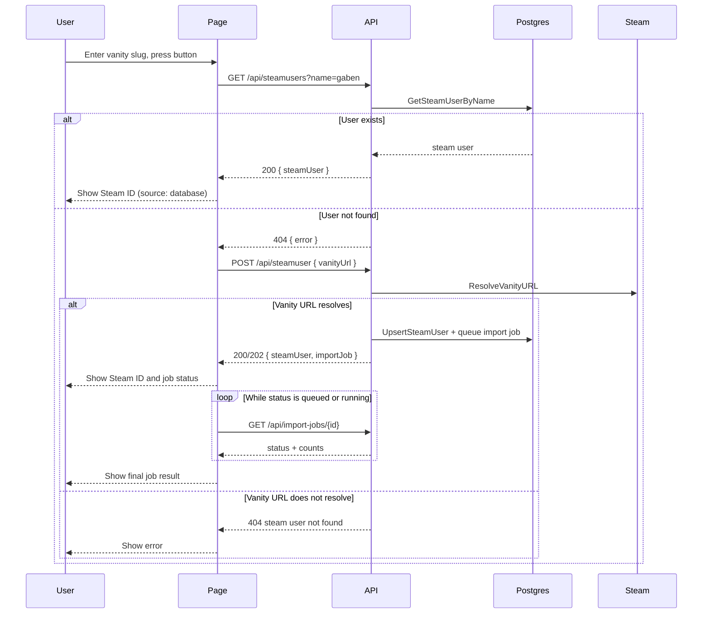

# Steam lookup front end plan

## Goal

Add a small server-rendered-by-Go static page at `/` with a text box and a
button. The user enters a Steam vanity URL slug (for example `gaben`). On
submit the page:

1. Looks the name up in `steam_users` with a new
   `GET /api/steamusers?name=...` endpoint.
2. If the user exists, shows their stored Steam ID.
3. If the user does not exist, calls the existing
   `POST /api/steamuser` (`InsertSteamUser`) endpoint, which resolves the
   vanity URL through Steam, saves the user and queues a library import.
4. Shows the Steam ID and polls `GET /api/import-jobs/{id}` until the import
   finishes.

No framework or build step is introduced. The page is plain HTML, CSS and
JavaScript served from `web/public`.



## Decisions

| Topic                | Decision                                                                                                                   |
| -------------------- | -------------------------------------------------------------------------------------------------------------------------- |
| Input                | A Steam vanity URL slug, matching the existing `InsertSteamUser` request. Full profile URLs are not accepted (see below).  |
| Where the page lives | `web/public/index.html`, `styles.css` and `app.js`, served by the Go server at `/`.                                         |
| Why not inline JS    | The commented-out `cspNonce` middleware suggests a future strict CSP; separate files avoid needing `unsafe-inline`.          |
| Lookup endpoint      | `GET /api/steamusers?name=<slug>`. A query parameter avoids colliding with the planned `GET /api/steamuser/{id}` route.      |
| Matching             | Case-insensitive exact match on `steam_users.name`, newest `updated_at` first, one result.                                  |
| Not found            | The lookup returns `404`; the page then falls back to `POST /api/steamuser`, as requested.                                   |
| Known user           | The page only displays the stored ID. It does not queue a refresh import.                                                   |
| Missing user         | The existing `InsertSteamUser` already resolves the vanity URL, upserts the user and queues the import. No backend change.  |
| Response shape       | Lookup returns `{ "steamUser": { ... } }` to match `InsertSteamUser`. `dbgen.SteamUser` keeps its snake_case JSON tags.      |
| Serving              | `http.FileServer(http.FS(publicRoot.FS()))` registered as `GET /`. Go 1.27 supports `os.Root.FS`, so path traversal stays contained. |
| Polling              | Every 2 seconds while status is `queued` or `running`. Stop on `succeeded` or `failed`, on a new search, or after 5 minutes. |
| Errors               | API `error` messages are shown when present; otherwise a generic message is used.                                           |

> Note: `web/public` does not exist today. Because `httpserver.New` calls
> `os.OpenRoot` on it, the server currently fails to start on a fresh clone.
> Phase 1 creates the directory and fixes that as a side effect.

## Phase 1: static page and static serving

### Files

```text
web/public/index.html
web/public/styles.css
web/public/app.js
```

### `index.html`

Keep the markup small and accessible:

- `<form id="lookup-form">` with a `<label>` and
  `<input id="steam-name" name="steamName" type="text" required
  autocomplete="off" spellcheck="false">`.
- `<button id="lookup-button" type="submit">Look up</button>`.
- `<p id="status" role="status" aria-live="polite">` for progress and errors.
- `<section id="result" hidden>` containing a Steam ID `<output>` and a line
  saying whether it came from the database or Steam.
- `<section id="job" hidden>` containing status text and
  `processed / total`, `skipped`, and `failed` counts.
- Link `styles.css` in `<head>` and `app.js` with `defer` at the end of
  `<body>`.

### `styles.css`

Simple centred card layout, system font stack, visible focus styles, and a
`[hidden] { display: none; }` rule. No frameworks, no external assets.

### `internal/httpserver/app.go`

1. Add the root file handler:

   ```go
   fileServer := http.FileServer(http.FS(publicRoot.FS()))
   ```

2. Register it on the same mux as the API routes:

   ```go
   mainMux := http.NewServeMux()
   mainMux.Handle("GET /api/steamusers", http.HandlerFunc(apiHandler.GetSteamUserByName))
   mainMux.HandleFunc("POST /api/steamuser", apiHandler.InsertSteamUser)
   mainMux.HandleFunc("GET /api/import-jobs/{id}", apiHandler.GetImportJob)
   mainMux.Handle("GET /", fileServer)
   ```

   Go's `ServeMux` picks the most specific pattern, so `/api/...` requests
   never reach the file server.

3. Return `mainMux` as `Application.Handler`. The existing commented
   middleware block can stay as-is.

`http.FileServer` serves `index.html` for `/` and handles `/styles.css` and
`/app.js`. Because the files are served from the same origin as the API, no
CORS configuration is needed. `APP_ORIGIN` stays unused by this page.

## Phase 2: lookup query and handler

### `internal/database/queries/steam_users.sql`

Add:

```sql
-- name: GetSteamUserByName :one
SELECT * FROM steam_users
WHERE lower(name) = lower(sqlc.arg(name))
ORDER BY updated_at DESC
LIMIT 1;
```

Then run `sqlc generate` to add `GetSteamUserByName` to
`internal/database/dbgen/steam_users.sql.go`.

Optionally add an index to `00001_initial_schema.sql`:

```sql
CREATE INDEX steam_users_name_lower ON steam_users (lower(name));
```

The table is small, so the index is not required for the first version. If it
is added, reset the local database (the project's convention is to edit the
initial migration rather than add a new one).

### `internal/api/handler.go`

Implement the existing empty `GetSteamUserByName` method. It is already
declared, but not registered.

```go
func (handler *Handler) GetSteamUserByName(responseWriter http.ResponseWriter, request *http.Request) {
    name := strings.TrimSpace(request.URL.Query().Get("name"))
    if name == "" {
        httpx.RespondWithError(responseWriter, http.StatusBadRequest, "name is required")
        return
    }

    steamUser, err := handler.apiStore.queries.GetSteamUserByName(request.Context(), name)
    if errors.Is(err, sql.ErrNoRows) {
        httpx.RespondWithError(responseWriter, http.StatusNotFound, "steam user not found")
        return
    }
    if err != nil {
        handler.internalError(responseWriter, request, err)
        return
    }

    httpx.RespondWithJSON(responseWriter, http.StatusOK, map[string]any{
        "steamUser": steamUser,
    })
}
```

Notes:

- Reuse `errors`, `sql`, `strings` and `httpx`, which are already imported by
  `handler.go`.
- `internalError` already logs and masks 5xx messages.
- The handler must not call Steam. A miss is what triggers the client-side
  fallback to `InsertSteamUser`.
- `GET /api/steamusers` is also the natural future home of the
  `GetSteamUsers` list stub. When that is implemented, branch on an empty
  `name` (or move the list to another path). For now, a missing `name` is
  `400`.

### Response examples

Found:

```json
{
  "steamUser": {
    "steam_id": 76561197960287930,
    "name": "gaben",
    "created_at": "2026-01-01T00:00:00Z",
    "updated_at": "2026-01-01T00:00:00Z"
  }
}
```

Not found: `404 {"error":"steam user not found"}`.

Missing name: `400 {"error":"name is required"}`.

## Phase 3: page behaviour (`app.js`)

Use `async`/`await` and `fetch`; no dependencies.

### Elements and state

- Cache elements by ID.
- Keep a `searchToken` integer. Increment it at the start of every search and
  capture the value locally. Any async continuation or polling callback that
  sees a different token stops.
- Use an `AbortController` per search so a new search cancels in-flight
  requests.
- Disable the input and button while a lookup/create request is in flight,
  then re-enable them. Polling must not keep the form disabled.

### Lookup flow

```text
on submit:
  token = ++searchToken
  name = input.value.trim()
  if name is empty: show "Enter a Steam name"; return
  reset result and job sections; show "Looking up <name>..."
  disable form
  response = GET /api/steamusers?name=<encodeURIComponent(name)>
  if response.status == 200:
      body = await response.json()
      showSteamUser(body.steamUser, "database")
      show "Found in database. No import needed."
      enable form; return
  if response.status != 404:
      throw await readError(response)
  show "Not in the database. Resolving with Steam..."
  response = POST /api/steamuser
             Content-Type: application/json
             body: {"vanityUrl": name}
  if response.status == 404:
      throw new Error("Steam user not found")
  if !response.ok:
      throw await readError(response)
  body = await response.json()
  showSteamUser(body.steamUser, "Steam")
  enable form
  if body.importJob:
      startPolling(body.importJob, token)
  else:
      show "User saved. No import job returned."
```

`readError` should try `response.json()` and fall back to
`"Request failed (HTTP <status>)"`. Show `body.error` when it exists.

### Displaying the user

`steamUser` uses the sqlc JSON tags, so read `steamUser.steam_id` (treat
`int64` as a string in the DOM to avoid precision loss; never parse it as a
JavaScript number). Also show `steamUser.name`.

### Polling the import job

```text
startPolling(job, token):
  show job section
  async poll():
    if token != searchToken: return
    if elapsed > 5 minutes: show "Import is taking longer than expected."; return
    response = GET /api/import-jobs/<job.id>
    if response.status == 200:
        job = await response.json()
        render status, processedApps / totalApps, skippedApps, failedApps
        if job.status is "succeeded": show "Import complete."; return
        if job.status is "failed":  show job.error or "Import failed."; return
    else if response.status == 404:
        show "Import job not found."; return
    else:
        show "Could not read import status; retrying..."
    setTimeout(poll, 2000)
  poll()
```

Notes:

- `InsertSteamUser` may return `200` with an already-finished job, so the
  first poll can immediately show the final state.
- Statuses are `queued`, `running`, `succeeded` and `failed`
  (`internal/importer`).
- A network error while polling shows a soft message and retries. A new
  search stops the old loop through `searchToken`.
- The form is enabled before polling starts, so the user can look up someone
  else while an import runs.

### Input normalisation (optional, low risk)

Trim whitespace. If the input starts with
`https://steamcommunity.com/id/`, strip that prefix and any trailing slash
before sending. Do not accept `/profiles/<digits>` URLs: those already
contain an ID, and `InsertSteamUser` only accepts vanity URLs.

## Phase 4: tests and verification

### Handler tests (`internal/api/handler_test.go`)

Register the new route in `newHandlerEnv`'s mux:

```go
mux.HandleFunc("GET /api/steamusers", handler.GetSteamUserByName)
```

Add table-driven tests:

- **Found:** seed a user with `CreateSteamUser`, then
  `GET /api/steamusers?name=<name>` returns `200` and the same `steam_id`.
- **Case-insensitive:** stored `SomePlayer`, request `someplayer`, `200`.
- **Newest match:** insert two distinct Steam IDs with names that differ only
  by case, update the older row's `updated_at`, and assert the newest row is
  returned. Because `steam_id` is the primary key, rows must use different
  IDs and names such as `SomePlayer` and `someplayer`.
- **Not found:** `404`.
- **Missing name:** `400` for no query parameter and for `?name=%20`.
- **No Steam call:** use a `fakeResolver` that fails the test if called, to
  prove the lookup never resolves through Steam. (The existing `fakeResolver`
  only returns errors, so a dedicated fake or a field on the existing one is
  needed.)

### Static serving test (optional but useful)

Add a small `internal/httpserver/app_test.go`:

1. Create a temp directory with `index.html` and `app.js`.
2. Call `New(nil, nil, Options{PublicDirectory: tempDir, ...})`.
3. Use `httptest` to request `/` and `/app.js`, asserting `200` and the file
   contents.
4. Assert an unknown `/api/...` path does not return `index.html`.

If constructing `New` with a nil database is awkward, skip this and rely on
manual verification. The handler tests are the important coverage.

### Manual verification

```sh
docker compose up -d
go run ./cmd/server
```

1. Open `http://localhost:3030/`.
2. Enter a vanity slug already in `steam_users` → ID is shown immediately and
   the status says it came from the database.
3. Enter a new valid Steam vanity slug → the user is created, the ID is
   shown, and progress updates until the import finishes.
4. Enter an unknown slug → "Steam user not found".
5. Submit an empty value → client-side message, no request.
6. Submit twice quickly → the old request/poll loop does not overwrite the
   new result.
7. Check the API directly:

   ```sh
   curl -i 'http://localhost:3030/api/steamusers?name=gaben'
   curl -i 'http://localhost:3030/api/steamusers?name=does-not-exist'
   ```

## Files touched

| File                                                       | Change                                                          |
| ---------------------------------------------------------- | --------------------------------------------------------------- |
| `web/public/index.html`                                    | New: page markup.                                               |
| `web/public/styles.css`                                    | New: page styles.                                               |
| `web/public/app.js`                                        | New: lookup, fallback and polling logic.                        |
| `internal/database/queries/steam_users.sql`                | Add `GetSteamUserByName`.                                       |
| `internal/database/dbgen/steam_users.sql.go`               | Regenerated by `sqlc generate`.                                 |
| `internal/api/handler.go`                                  | Implement `GetSteamUserByName`.                                 |
| `internal/httpserver/app.go`                               | Register lookup route and static file handler.                  |
| `internal/api/handler_test.go`                             | Lookup tests.                                                   |
| `internal/database/migrations/00001_initial_schema.sql`    | Optional `lower(name)` index.                                   |
| `README.md`                                                | Optional: mention `http://localhost:3030/`.                     |

## Out of scope

- Authentication or write permissions (there is already a TODO on
  `InsertSteamUser`).
- Looking users up by Steam persona/display name; only vanity slugs are
  supported.
- Fuzzy, partial or paginated search.
- Refreshing an existing user's library from the page. Known users are only
  displayed; the existing import refresh rules are unchanged.
- Editing or deleting users.
- Server-sent events or WebSockets; job progress uses polling.
- A JavaScript framework, bundler or external CSS.
- CORS for opening the HTML file directly from disk.
- Adding security headers/CSP; the existing middleware remains commented out.
