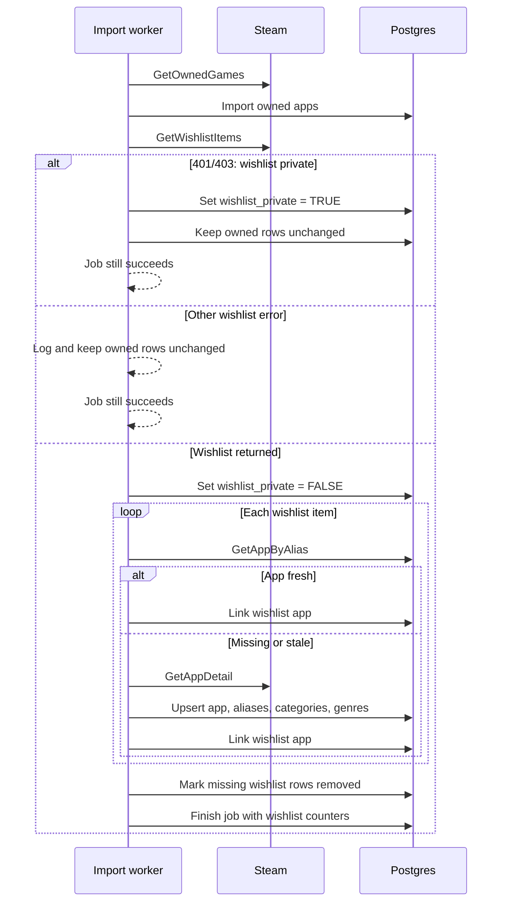

# Steam wishlist import plan

## Goal

After a user's owned games are imported, fetch their Steam wishlist and store
the wishlisted apps in a new per-user table. Wishlisted apps use the existing
app alias, app detail, category and genre logic. An app that is already stored
and fresh is not fetched again; a missing or stale app calls the same
`GetAppDetail` function used by the owned-games import.

The wishlist import runs in the same background job as the owned-games import,
reports separate counters, and does not fail the job when Steam rejects or
hides the wishlist. A `steam_users.wishlist_private` flag records a private
wishlist.



## Decisions

| Topic                 | Decision                                                                                                                   |
| --------------------- | -------------------------------------------------------------------------------------------------------------------------- |
| Storage               | New `steam_user_wishlist` table. Owned and wishlist rows stay separate.                                                     |
| Wishlist app ID       | The ID returned by Steam. It is linked through `app_alias`, exactly like `steam_user_apps.app_id`.                          |
| Owned/wishlist overlap| Allowed. The same app may exist in both tables.                                                                             |
| Job                   | Same import job, after owned apps are processed. Add separate wishlist counters to `import_jobs`.                           |
| Progress              | Wishlist counters are separate from owned counters. The job status endpoint returns both sets.                              |
| App details           | Reuse `GetAppByAlias`, `GetAppDetail`, `saveAppDetails`, categories and genres. Skip detail fetches for fresh apps.          |
| Rate limit            | Wishlist detail fetches share the importer's existing store limiter.                                                        |
| Privacy flag          | Add `steam_users.wishlist_private BOOLEAN NOT NULL DEFAULT FALSE`. Set true only on 401/403; reset false on a successful 200. |
| Other wishlist errors | Log, leave the privacy flag unchanged, and finish the job as succeeded. Do not mark wishlist rows removed.                  |
| Empty wishlist        | A successful empty wishlist does not mark any rows removed.                                                                 |
| Removed wishlist apps | Set `steam_user_wishlist.removed = TRUE`. Re-adding restores `removed = FALSE`.                                              |
| Date added            | Store Steam's `date_added` epoch value as nullable `TIMESTAMPTZ`.                                                           |
| API exposure          | Storage only for now. No new wishlist HTTP endpoint.                                                                        |
| Failed wishlist apps  | A per-app detail failure is counted in `wishlist_failed_apps`; the job keeps going.                                         |

## Phase 0: fix the wishlist Steam client

`internal/steamapi/wishlist_service_handler.go` currently decodes the body
directly into `[]WishlistItem`. Steam returns:

```json
{
    "response": {
        "items": [
            { "appid": 440, "date_added": 1700000000 }
        ]
    }
}
```

It also does not check the HTTP status. Fix both:

1. Decode into `GetWishlistResponse` and return `result.Response.Items`.
2. Normalize a missing/empty `items` field to an empty slice.
3. Add a wishlist-specific status check. Do **not** reuse the existing
   `checkStatus`, because it treats 403 as `ErrRateLimited`; the wishlist
   client needs 401/403 to mean private.

In `internal/steamapi/errors.go`, add:

```go
var ErrWishlistPrivate = errors.New("Steam wishlist is private")
```

Add a helper, either in `errors.go` or the wishlist handler:

```go
func checkWishlistStatus(resp *http.Response, operation string) error {
    switch resp.StatusCode {
    case http.StatusOK:
        return nil
    case http.StatusUnauthorized, http.StatusForbidden:
        return fmt.Errorf("%s: %w", operation, ErrWishlistPrivate)
    case http.StatusTooManyRequests:
        return fmt.Errorf("%s: %w", operation, &RateLimitError{
            StatusCode: resp.StatusCode,
            RetryAfter: parseRetryAfter(resp.Header.Get("Retry-After"), time.Now()),
        })
    default:
        return fmt.Errorf("%s returned status %d", operation, resp.StatusCode)
    }
}
```

Call it after `httpClient.Do` and before decoding.

`GetWishlistItems` keeps its current signature:

```go
func (client *Client) GetWishlistItems(ctx context.Context, steamID string) ([]WishlistItem, error)
```

The importer passes `strconv.FormatInt(steamID, 10)`.

## Phase 1: schema and queries

The project convention is to edit `00001_initial_schema.sql` and reset local
databases. After editing, run `sqlc generate`.

### `steam_users`

Add:

```sql
wishlist_private BOOLEAN NOT NULL DEFAULT FALSE,
```

### `steam_user_wishlist` (new)

Place it after `steam_user_apps` and before `import_jobs`, since it references
both `steam_users` and `app_alias`.

```sql
CREATE TABLE steam_user_wishlist (
    steam_id BIGINT NOT NULL,
    app_id INT NOT NULL,
    date_added TIMESTAMPTZ,
    removed BOOLEAN NOT NULL DEFAULT FALSE,
    created_at TIMESTAMPTZ NOT NULL,
    updated_at TIMESTAMPTZ NOT NULL,
    PRIMARY KEY (steam_id, app_id),
    FOREIGN KEY (steam_id) REFERENCES steam_users(steam_id),
    FOREIGN KEY (app_id) REFERENCES app_alias(alias_id)
);
```

`app_id` is the ID returned by Steam, not the canonical app ID. `app_alias`
resolves it to `apps.steam_appid`, matching how owned apps work.

### `import_jobs`

Add four counters:

```sql
wishlist_total_apps INT NOT NULL DEFAULT 0,
wishlist_processed_apps INT NOT NULL DEFAULT 0,
wishlist_skipped_apps INT NOT NULL DEFAULT 0,
wishlist_failed_apps INT NOT NULL DEFAULT 0,
```

### `-- +goose Down`

Add the new table before `app_alias` and `steam_users`:

```sql
DROP TABLE import_jobs;
DROP TABLE steam_user_wishlist;
DROP TABLE steam_user_apps;
DROP TABLE app_alias;
...
```

### `queries/steam_user_wishlist.sql` (new)

```sql
-- name: AddSteamUserWishlistApp :exec
INSERT INTO steam_user_wishlist (
    steam_id,
    app_id,
    date_added,
    removed,
    created_at,
    updated_at
) VALUES (
    $1,
    $2,
    $3,
    FALSE,
    NOW(),
    NOW()
)
ON CONFLICT (steam_id, app_id) DO UPDATE SET
    date_added = COALESCE(EXCLUDED.date_added, steam_user_wishlist.date_added),
    removed = FALSE,
    updated_at = NOW();

-- name: MarkSteamUserWishlistAppsRemoved :exec
UPDATE steam_user_wishlist SET
    removed = TRUE,
    updated_at = NOW()
WHERE steam_id = @steam_id
    AND removed = FALSE
    AND NOT (app_id = ANY(@wishlist_ids::int[]));

-- name: ListActiveSteamUserWishlist :many
SELECT DISTINCT a.* FROM apps a
JOIN app_alias aa ON aa.app_id = a.steam_appid
JOIN steam_user_wishlist suw ON suw.app_id = aa.alias_id
WHERE suw.steam_id = $1 AND suw.removed = FALSE
ORDER BY a.name;
```

Add these for symmetry and future tests:

```sql
-- name: RemoveSteamUserWishlistApp :exec
DELETE FROM steam_user_wishlist WHERE steam_id = $1 AND app_id = $2;

-- name: ClearSteamUserWishlist :exec
DELETE FROM steam_user_wishlist WHERE steam_id = $1;
```

### `queries/steam_users.sql`

```sql
-- name: UpdateSteamUserWishlistPrivate :exec
UPDATE steam_users SET
    wishlist_private = @wishlist_private,
    updated_at = NOW()
WHERE steam_id = @steam_id;
```

### `queries/import_jobs.sql`

Update three statements:

- `MarkImportJobRunning`: reset all four wishlist counters to zero.
- `UpdateImportJobProgress`: set the four wishlist counters.
- `FinishImportJob`: set the four wishlist counters.

`MarkSteamUserWishlistAppsRemoved` uses `@wishlist_ids::int[]` for the same
reason as `MarkSteamUserAppsRemoved`; the project already depends on
`github.com/lib/pq` for `pq.Array`.

## Phase 2: importer

### Interface

Extend `importer.SteamClient`:

```go
type SteamClient interface {
    GetOwnedGames(ctx context.Context, steamID int64) (*steamapi.OwnedGamesResponse, error)
    GetWishlistItems(ctx context.Context, steamID string) ([]steamapi.WishlistItem, error)
    GetAppDetail(ctx context.Context, appID int) (*steamapi.AppDetail, error)
}
```

`*steamapi.Client` already satisfies the method once Phase 0 is done. The test
fake must add `GetWishlistItems`.

### Refactor app import

The current `importApp` both ensures app data exists and links it to
`steam_user_apps`. Split it into:

1. `ensureApp(ctx, fields, appID) appResult`
   - `GetAppByAlias`.
   - If the app is fresh, return `resultProcessed` without calling Steam.
   - If the app is missing or stale, call `fetchAppDetail`.
   - `ErrAppNotFound` → `resultSkipped`.
   - Other errors → `resultFailed`.
   - On success, call `saveAppDetails` (the old `saveApp` without the
     `AddSteamUserApp` call).
2. `importOwnedApp(ctx, jobID, steamID, ownedID) appResult`
   - `ensureApp`; on `resultProcessed`, call `AddSteamUserApp`.
3. `importWishlistApp(ctx, jobID, steamID, item) appResult`
   - `ensureApp`; on `resultProcessed`, call `AddSteamUserWishlistApp` with
     the wishlist ID and date added.

This reuses the same app-detail fetch, alias handling, category handling and
genre handling for both lists. Moving the user link outside the app-save
transaction is safe: if the link fails, the app remains stored, and the next
import takes the fresh path and links it.

Add a helper for the date:

```go
func wishlistDateAdded(seconds int) sql.NullTime {
    if seconds <= 0 {
        return sql.NullTime{}
    }
    return sql.NullTime{Time: time.Unix(int64(seconds), 0).UTC(), Valid: true}
}
```

Add a deduplicating helper. If Steam repeats an app ID, keep one entry and the
largest `date_added`:

```go
func uniqueWishlistItems(items []steamapi.WishlistItem) []steamapi.WishlistItem
```

### Job counts

Extend `jobCounts`:

```go
type jobCounts struct {
    total, processed, skipped, failed int32
    wishlistTotal, wishlistProcessed, wishlistSkipped, wishlistFailed int32
}
```

Update `updateProgress` and `finish` to pass the new values. `total` and the
other existing counters remain owned-only.

### `importWishlist`

Call this from `runJob` after owned apps are linked and
`MarkSteamUserAppsRemoved` has run, before `FinishImportJob`.

Pseudocode:

```text
items, err = steam.GetWishlistItems(ctx, strconv.FormatInt(steamID, 10))
if err is ErrWishlistPrivate:
    UpdateSteamUserWishlistPrivate(true)
    log wishlist_private
    return nil
if err:
    if ctx cancelled: return ctx.Err()
    log wishlist_fetch_failed
    return nil

UpdateSteamUserWishlistPrivate(false)

unique = uniqueWishlistItems(items)
counts.wishlistTotal = len(unique)
updateProgress()

for each item:
    if ctx cancelled: return ctx.Err()
    switch importWishlistApp(...):
        processed: counts.wishlistProcessed++
        skipped:   counts.wishlistSkipped++
        failed:    counts.wishlistFailed++
    every 10 items: updateProgress()

if len(unique) > 0:
    MarkSteamUserWishlistAppsRemoved(steamID, all unique IDs)

return nil
```

Rules:

- A private or failed wishlist fetch never marks existing wishlist rows removed
  and never fails the job.
- A successful empty wishlist also does not mark rows removed, mirroring the
  owned-games empty-library rule.
- DB failures from `UpdateSteamUserWishlistPrivate`,
  `MarkSteamUserWishlistAppsRemoved`, or progress updates should fail the job
  through the existing `fail` path. Wishlist fetch errors are the exception.
- If the context is cancelled, leave the job `running`. The existing shutdown
  behavior applies.
- If `wishlist_private` is already true, still call Steam on the next import so
  a user who makes the wishlist public is detected and the flag is cleared.

Log events:

- `wishlist_fetch_failed` with `jobId`, `steamId`, `error`.
- `wishlist_private` with `jobId`, `steamId`.
- Reuse `import_app_skipped`, `import_app_failed` and
  `import_app_rate_limited` with a `"source": "wishlist"` field.

## Phase 3: job status response

Add to `importJobView` in `internal/api/handler.go`:

```go
WishlistTotalApps     int32 `json:"wishlistTotalApps"`
WishlistProcessedApps int32 `json:"wishlistProcessedApps"`
WishlistSkippedApps   int32 `json:"wishlistSkippedApps"`
WishlistFailedApps    int32 `json:"wishlistFailedApps"`
```

Populate them in `newImportJobView`. This changes the response of
`GET /api/import-jobs/{id}` and the response of `InsertSteamUser` (the embedded
import job). No new endpoint is added.

`steamUser` responses will also contain `wishlist_private` automatically
because `dbgen.SteamUser` now has the column.

## Phase 4: tests

### Steam API tests

Add `internal/steamapi/wishlist_service_handler_test.go` or extend existing
client tests:

- Decodes the `{"response":{"items":[...]}}` wrapper.
- A 200 response with `{"response":{}}` returns an empty slice.
- 401 and 403 return `ErrWishlistPrivate`.
- 429 returns `ErrRateLimited`.
- Other non-200 statuses return an error.

Use `httptest.NewServer` and a client whose HTTP client points at it. If the
current `Client` struct makes this awkward, add a small test helper or a
package-level constructor; do not expose test-only production APIs.

### Importer tests

Extend the `fakeSteam` in `internal/importer/importer_test.go` with:

```go
wishlist        map[int64][]steamapi.WishlistItem
wishlistErr     error
wishlistPrivate bool
wishlistCalls   int
```

Add `GetWishlistItems`. Cover:

- **Basic wishlist import:** app, aliases, categories and genres are saved;
  `steam_user_wishlist` has the row with `date_added`; `steam_user_apps` is
  unaffected.
- **Alias:** wishlist ID 100 resolving to canonical 80 creates aliases
  80 -> 80 and 100 -> 80, and the wishlist row uses `app_id = 100`.
- **Overlap:** an app can be present in both `steam_user_apps` and
  `steam_user_wishlist`.
- **Fresh app:** no `GetAppDetail` call, but the wishlist row is linked.
- **Stale app:** re-fetched and categories/genres are replaced.
- **Not found:** counted as wishlist-skipped, no wishlist row.
- **Duplicate wishlist IDs:** one row and one detail fetch.
- **Removed:** a wishlist item missing from a later fetch gets
  `removed = TRUE`; re-adding restores `removed = FALSE`.
- **Empty wishlist:** no rows are marked removed.
- **Private:** `wishlist_private` becomes true, the owned import still
  succeeds, and no wishlist rows are removed.
- **Other wishlist error:** the flag stays unchanged, the owned import still
  succeeds, and no wishlist rows are removed.
- **Recovery:** a successful fetch after a private fetch clears the flag.
- **Counts:** owned and wishlist counters are independent and correct.
- **Cancellation:** cancelling mid-wishlist leaves the job `running`.
- **DB failure:** a failure while marking wishlist rows removed fails the job.

### Handler tests

Update `TestGetImportJob` to assert the four new camelCase fields, and add an
assertion that owned and wishlist counts are reported separately.

### Manual verification

```sh
docker compose up -d
go run ./cmd/server
```

1. Use a user with a public wishlist, or seed one through the test fake.
2. Trigger `POST /api/steamuser`.
3. Poll `GET /api/import-jobs/{id}` and verify the wishlist counters.
4. Check the database:

```sql
SELECT wishlist_private FROM steam_users WHERE steam_id = <id>;

SELECT w.steam_id, w.app_id, w.date_added, w.removed, a.name
FROM steam_user_wishlist w
JOIN app_alias aa ON aa.alias_id = w.app_id
JOIN apps a ON a.steam_appid = aa.app_id
WHERE w.steam_id = <id>
ORDER BY a.name;
```

5. Run the importer again and confirm fresh apps do not call `GetAppDetail`.
6. Simulate a private wishlist with the fake and confirm the flag is set and the
   job still succeeds.

## Files touched

| File                                                       | Change                                                               |
| ---------------------------------------------------------- | -------------------------------------------------------------------- |
| `internal/steamapi/wishlist_service_handler.go`            | Decode the response wrapper, check status, detect private wishlists. |
| `internal/steamapi/errors.go`                              | Add `ErrWishlistPrivate`.                                            |
| `internal/database/migrations/00001_initial_schema.sql`    | Add `wishlist_private`, `steam_user_wishlist`, wishlist job counters.|
| `internal/database/queries/steam_user_wishlist.sql`        | New wishlist queries.                                                |
| `internal/database/queries/steam_users.sql`                | Add the privacy flag update.                                         |
| `internal/database/queries/import_jobs.sql`                | Add wishlist counters to progress/finish/reset statements.           |
| `internal/database/dbgen/*`                                | Regenerated by `sqlc generate`.                                      |
| `internal/importer/importer.go`                            | Refactor app import and run the wishlist import.                     |
| `internal/api/handler.go`                                  | Add wishlist counters to the job view.                               |
| `internal/importer/importer_test.go`                       | Fake wishlist client and wishlist coverage.                          |
| `internal/steamapi/*_test.go`                              | Wishlist client tests.                                               |
| `internal/api/handler_test.go`                             | Assert the new job fields.                                           |

## Out of scope

- A wishlist HTTP endpoint.
- A separate wishlist import job or worker.
- Fetching wishlist app details when the app is already fresh.
- Detecting private wishlists through profile visibility or
  `GetPlayerSummaries`; only 401/403 sets the flag.
- Wishlist priority, ordering, or notifications.
- Deleting wishlist rows that disappear; they are marked removed.
- Using wishlist overlap in recommendation logic.
