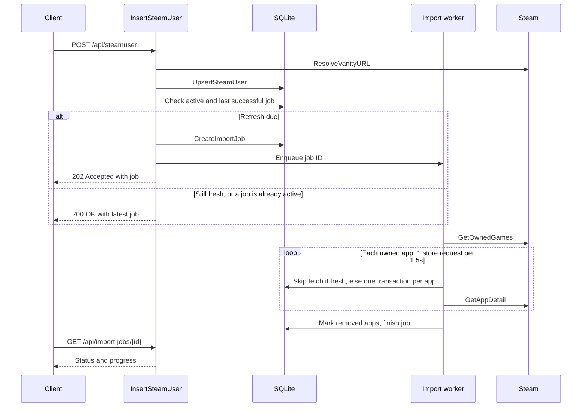

# Background Steam import plan

## Goal

`POST /api/steamuser` currently fetches details for every owned game before
it responds. That takes longer than the server's 30-second `WriteTimeout`
and ends in a "socket hang up" for any sizeable library.

After this change, the endpoint saves the user, queues an import job, and
returns straight away. A single background worker fetches app details within
Steam's rate limit and saves them. Clients poll a status endpoint for progress.



## Decisions

| Topic | Decision |
|---|---|
| Queue | Stored in an `import_jobs` table. Survives restarts. |
| Status | Polling endpoint `GET /api/import-jobs/{id}`. |
| Per-app failures | Logged and counted in `failed_apps`. The job keeps going. |
| User refresh | Only after `STEAM_REFRESH_INTERVAL` has passed since the user's last *successful* job. Default 7 days. |
| App detail freshness | Same `STEAM_REFRESH_INTERVAL`, measured from `apps.updated_at`. |
| Rate limit | `golang.org/x/time/rate`, 1 store request per 1.5s. Applies to `GetAppDetail` only. |
| Games no longer owned | Not deleted. Marked `steam_user_apps.removed = TRUE`. |
| Migrations | Edit `00001_initial_schema.sql`. Local dev databases get reset. |
| Owned IDs | `steam_user_apps` stores the ID the user owns. It's looked up through `app_alias`. |
| Aliases | Every app gets an `app_alias` row, including ones that map to themselves (80 -> 80). |

## Phase 0: groundwork

1. **Fix the duration parsing** in `internal/config/config.go`. The defaults
   are currently converted to nanoseconds and then multiplied by
   `time.Second` again. Use `strconv.Itoa(int(defaultX / time.Second))` for
   `STEAM_API_TIMEOUT` and `STEAM_API_CACHE_INTERVAL`.
2. **Add `STEAM_REFRESH_INTERVAL`** to `Config` (in seconds, like the
   others; default `7 * 24 * time.Hour`). Keep it separate from
   `STEAM_API_CACHE_INTERVAL`, which controls the in-memory HTTP cache.
3. **Make Steam calls cancellable.** Add a `ctx context.Context` parameter to
   `GetOwnedGames` and `GetAppDetail` and use `http.NewRequestWithContext`.
4. **Add `steamapi.ErrRateLimited`** for 429 and 403 responses. Wrap it in a
   `RateLimitError` carrying the `Retry-After` value if Steam sends one.
5. **Check status codes in `GetOwnedGames`.** Return an error on non-200.
   A missing `games` field (private profile or empty library) returns an
   empty list. The job records it as zero apps.
6. **Add the dependency:** `go get golang.org/x/time/rate`.

## Phase 1: schema (edit `00001_initial_schema.sql`)

### `apps`

Add a column:

```sql
updated_at TIMESTAMP
```

### `app_alias`

Move this table above `steam_user_apps`. The schema is unchanged:

```sql
CREATE TABLE app_alias (
    app_id INT NOT NULL,
    alias_id INT PRIMARY KEY NOT NULL,
    FOREIGN KEY (app_id) REFERENCES apps(steam_appid)
);
```

### `steam_user_apps`

`app_id` is the owned ID. It now points to `app_alias` and has a `removed`
flag:

```sql
CREATE TABLE steam_user_apps (
    steam_id BIGINT,
    app_id INT,
    removed BOOLEAN NOT NULL DEFAULT FALSE,
    PRIMARY KEY (steam_id, app_id),
    FOREIGN KEY (steam_id) REFERENCES steam_users(steam_id),
    FOREIGN KEY (app_id) REFERENCES app_alias(alias_id)
);
```

### `import_jobs` (new)

```sql
CREATE TABLE import_jobs (
    id INTEGER PRIMARY KEY,
    steam_id BIGINT NOT NULL,
    status TEXT NOT NULL,                  -- queued | running | succeeded | failed
    total_apps INT NOT NULL DEFAULT 0,
    processed_apps INT NOT NULL DEFAULT 0,
    skipped_apps INT NOT NULL DEFAULT 0,   -- not found on Steam
    failed_apps INT NOT NULL DEFAULT 0,
    error TEXT,                            -- set when the whole job fails
    created_at TIMESTAMP NOT NULL,
    started_at TIMESTAMP,
    finished_at TIMESTAMP,
    FOREIGN KEY (steam_id) REFERENCES steam_users(steam_id)
);
CREATE INDEX import_jobs_steam_id_status ON import_jobs (steam_id, status);
```

### `-- +goose Down` order

Drop the tables that hold foreign keys first:

```sql
DROP TABLE import_jobs;
DROP TABLE steam_user_apps;
DROP TABLE app_alias;
DROP TABLE app_genres;
DROP TABLE app_categories;
DROP TABLE steam_users;
DROP TABLE genres;
DROP TABLE categories;
DROP TABLE apps;
```

### Queries

- **`queries/apps.sql`:** `UpsertApp` sets `updated_at`. It's passed in as
  a parameter so tests can control time through `Store.now`.
- **`queries/steam_user_apps.sql`:**
  - `AddSteamUserApp` becomes an upsert that sets `removed = FALSE` on
    conflict, so a re-owned game comes back.
  - Add `MarkSteamUserAppsRemoved` (`UPDATE ... SET removed = TRUE WHERE
    steam_id = ? AND app_id NOT IN (sqlc.slice(owned_ids))`).
  - Add `ListActiveSteamUserApps`, joining `app_alias` and `apps` and
    filtering `removed = FALSE`.
- **`queries/import_jobs.sql` (new):**
  - `CreateImportJob`, `GetImportJob`
  - `GetActiveImportJobForUser` (status `queued` or `running`)
  - `GetLatestSucceededImportJobForUser`
  - `MarkImportJobRunning`, `UpdateImportJobProgress`
  - `FinishImportJob` (status, counts, error, `finished_at`)
  - `ListUnfinishedImportJobs`
- **`queries/app_alias.sql`:** no changes. `GetAppByAlias` is the standard
  way to look up an owned app.

Delete the local database, then run `sqlc generate`.

## Phase 2: `internal/importer` package

### Types

```go
type SteamClient interface {
    GetOwnedGames(ctx context.Context, steamID int64) (*steamapi.OwnedGamesResponse, error)
    GetAppDetail(ctx context.Context, appID int) (*steamapi.AppDetail, error)
}

type Importer struct {
    database        *sql.DB
    queries         *dbgen.Queries
    steam           SteamClient
    logger          *logging.Logger
    limiter         *rate.Limiter      // rate.Every(1500 * time.Millisecond), burst 1
    refreshInterval time.Duration
    now             func() time.Time
    jobs            chan int64         // buffered, e.g. 100
    cancel          context.CancelFunc
    wg              sync.WaitGroup
}
```

`SteamClient` is an interface so tests can use a fake.

### Lifecycle

- **`Start(ctx)`:** starts one worker goroutine. Then it loads
  `ListUnfinishedImportJobs` and enqueues them, so jobs left `queued` or
  `running` by a restart get resumed. Rerunning a job is safe because every
  write is an upsert.
- **`Enqueue(jobID)`:** doesn't block. If the queue is full, it logs a
  message and the job stays `queued` in the database, to be picked up on the
  next restart.
- **`Shutdown(ctx)`:** cancels the worker's context and waits on `wg` until
  `ctx` runs out. A job that was mid-run stays `running` and is resumed on
  the next `Start`.

One worker is enough. Steam's rate limit applies to the whole server, and a
single SQLite writer avoids lock contention.

### Running a job

1. `MarkImportJobRunning`.
2. `GetOwnedGames`. If it fails, `FinishImportJob(failed, error)` and stop.
   Otherwise record `total_apps`.
3. For each owned ID:
   1. `GetAppByAlias(ownedID)`. If the app exists and `updated_at` is
      within `refreshInterval`, run `AddSteamUserApp(steamID, ownedID)` and
      count it as processed. If two owned IDs map to the same app, the second
      lookup finds the row saved by the first, so the app is fetched once.
   2. Otherwise `limiter.Wait(ctx)`, then `GetAppDetail(ctx, ownedID)`:
      - **`ErrAppNotFound`:** log it and count it as skipped. The user can't
        be linked because no alias row exists.
      - **`ErrRateLimited`:** wait for `Retry-After`, or back off
        exponentially from 5s. Retry up to 3 times, then count it as failed.
      - **Other errors:** log and count as failed.
   3. Save the app in one transaction (`queries.WithTx(tx)`):
      1. `UpsertApp` keyed by `canonicalID = Data.AppID`, setting `updated_at`.
      2. `UpsertAppAlias(canonicalID, canonicalID)`. If
         `ownedID != canonicalID`, also `UpsertAppAlias(ownedID, canonicalID)`.
      3. `ClearAppCategories` and `ClearAppGenres` for `canonicalID`, then
         upsert and re-add the current ones (logic moved from
         `addAppCategories` and `addAppGenres`).
      4. `AddSteamUserApp(steamID, ownedID)`.

      If the transaction fails, roll back, log it, and count it as failed.
   4. Every 10 apps, call `UpdateImportJobProgress`.
4. `MarkSteamUserAppsRemoved(steamID, all owned IDs)`. Skip this if
   `GetOwnedGames` returned no games, so a private profile doesn't mark the
   whole library removed.
5. `FinishImportJob(succeeded, counts)`. If the context was cancelled
   (shutdown), leave the job `running` instead of finishing it.

Log through `logging.Logger.Event`, with events such as
`import_app_skipped`, `import_app_failed`, `import_job_finished`, and
fields `jobId`, `steamId`, `appId`, `error`.

## Phase 3: HTTP changes

### `POST /api/steamuser`

1. Validate the body, resolve the vanity URL, and `UpsertSteamUser` (as now).
2. If `GetActiveImportJobForUser` returns a job, respond `200 OK` with it.
3. If `GetLatestSucceededImportJobForUser` finished within
   `refreshInterval`, respond `200 OK` with that job.
4. Otherwise `CreateImportJob(queued)`, `importer.Enqueue(id)`, and respond
   `202 Accepted` with a `Location: /api/import-jobs/{id}` header.

Response body: `{ "steamUser": {...}, "importJob": {...} }`.

Steps 2-4 are a check followed by an insert, so two POSTs at the same moment
could both create a job. It's harmless (the second job mostly hits fresh
apps), and moving these checks into a method on the importer protected by
a mutex closes the gap.

### `GET /api/import-jobs/{id}` (new)

- Returns `status`, `totalApps`, `processedApps`, `skippedApps`,
  `failedApps`, `error`, `createdAt`, `startedAt`, and `finishedAt`.
- `400` for an ID that isn't a number. `404` for an unknown job.

### Other handler changes

- `Handler` gets an `*importer.Importer` and a `*logging.Logger`.
- Remove `addApps`, `addAppCategories`, and `addAppGenres` from
  `internal/api/handler.go`. They move into the importer.
- `internalError` logs through `logger.Event("unhandled_error", ...)`.

## Phase 4: wiring

- **`internal/httpserver/app.go`:** add `Importer` to `Options`, pass it to
  `api.NewHandler`, and register `GET /api/import-jobs/{id}`.
- **`cmd/server/main.go`:**
  - Create the importer after `database.Migrate`, and call `Start` with a
    context that ends when the server shuts down.
  - On shutdown, call `server.Shutdown` first, then `importer.Shutdown`
    (with the same 5s timeout).
- **`internal/steamapi`:** `*Client` has to satisfy `importer.SteamClient`.

## Phase 5: tests

### Importer

Use a fake `SteamClient` and a temporary SQLite file run through
`database.Open` and `database.Migrate`. Cover:

- **Basic import:** app, self-alias, categories, genres, and user link are
  all saved.
- **Alias:** owning 100 that resolves to 80 creates aliases 80 -> 80 and
  100 -> 80, and `steam_user_apps.app_id = 100`.
- **Two owned IDs for one app** cause a single `GetAppDetail` call.
- **Not found:** counted as skipped, and no user link.
- **Rate limited:** 429 then success retries and succeeds. Repeated 429s
  are counted as failed and the job still finishes.
- **Fresh app:** no Steam call, but the user is still linked.
- **Stale app:** re-fetched, and old categories and genres are replaced.
- **Removed games:** an app missing from a later `GetOwnedGames` gets
  `removed = TRUE`. When it comes back, it returns to `removed = FALSE`. An
  empty library marks nothing removed.
- **Restart:** a job left `running` is resumed by `Start`.

Use a limiter with a very short interval, and an injected `now`.

### Handler

- New user: `202` with a `Location` header.
- Active job already exists: `200` with that job, and no new job created.
- Last successful job within the interval: `200`. Older than the interval:
  `202`. Last job failed: `202`.
- `GET /api/import-jobs/{id}`: `200`, `400`, `404`.

## Out of scope

- Push updates (SSE or WebSocket).
- More than one worker, or several server instances sharing a queue.
- Fetching missing apps again before the refresh interval passes. They're
  retried on the next refresh.
